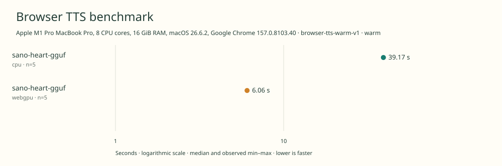

# native-benchmark-comparison

Apple M1 Pro MacBook Pro, 8 CPU cores, 16 GiB RAM, macOS 26.6.2, Google Chrome 157.0.8103.40 · Apple M1 Pro · Google Chrome 157.0.8103.40

Protocol: **browser-tts-warm-v1**, scenario **warm**. Comparison of separate native harness runs.

First source-chunk request through final CPU-readable PCM; excludes initialization, validation, hashing, WAV encoding and save. Optional articleCallPeakRssBytes spans the entire browser call including post-timer validation/export.

| Model | Requested backend | Status | Median | Min–max | Runs |
|---|---|---|---:|---:|---:|
| sano-amy-1p8m-gguf | cpu | measured | 1123.00 s | 1122.69–1123.17 s | 5 |
| sano-amy-1p8m-gguf | webgpu | measured | 170.54 s | 169.98–174.36 s | 5 |
| sano-amy-gguf | cpu | measured | 1118.90 s | 1117.89–1119.51 s | 5 |
| sano-amy-gguf | webgpu | measured | 173.41 s | 173.04–173.79 s | 5 |
| sano-amy-small-gguf | cpu | measured | 831.37 s | 831.32–831.85 s | 5 |
| sano-amy-small-gguf | webgpu | measured | 141.77 s | 141.59–142.54 s | 5 |
| sano-heart-gguf | cpu | measured | 39.17 s | 39.08–39.36 s | 5 |
| sano-heart-gguf | webgpu | measured | 6.06 s | 6.03–6.13 s | 5 |
| sano-hfc-gguf | cpu | measured | 901.17 s | 901.11–901.32 s | 5 |
| sano-hfc-gguf | webgpu | measured | 140.06 s | 139.12–140.57 s | 5 |
| sano-kristin-gguf | webgpu | measured | 157.80 s | 156.04–159.41 s | 5 |

Additional metrics (median of available observations; scopes are distinct):

| Model | Backend | Metric | Median | Unit | n |
|---|---|---|---:|---|---:|
| sano-amy-1p8m-gguf | cpu | First completed source chunk | 12796.015 | ms | 5 |
| sano-amy-1p8m-gguf | cpu | First PCM block | 12795.995 | ms | 5 |
| sano-amy-1p8m-gguf | cpu | Generated audio | 1312.891 | s | 5 |
| sano-amy-1p8m-gguf | cpu | Generation / audio duration | 0.855 | ratio | 5 |
| sano-amy-1p8m-gguf | webgpu | First completed source chunk | 1980.175 | ms | 5 |
| sano-amy-1p8m-gguf | webgpu | First PCM block | 1980.175 | ms | 5 |
| sano-amy-1p8m-gguf | webgpu | Generated audio | 1312.880 | s | 5 |
| sano-amy-1p8m-gguf | webgpu | Generation / audio duration | 0.130 | ratio | 5 |
| sano-amy-gguf | cpu | First completed source chunk | 12720.850 | ms | 5 |
| sano-amy-gguf | cpu | First PCM block | 12720.835 | ms | 5 |
| sano-amy-gguf | cpu | Generated audio | 1312.840 | s | 5 |
| sano-amy-gguf | cpu | Generation / audio duration | 0.852 | ratio | 5 |
| sano-amy-gguf | webgpu | First completed source chunk | 2001.050 | ms | 5 |
| sano-amy-gguf | webgpu | First PCM block | 2001.040 | ms | 5 |
| sano-amy-gguf | webgpu | Generated audio | 1312.830 | s | 5 |
| sano-amy-gguf | webgpu | Generation / audio duration | 0.132 | ratio | 5 |
| sano-amy-small-gguf | cpu | First completed source chunk | 9550.885 | ms | 5 |
| sano-amy-small-gguf | cpu | First PCM block | 9550.875 | ms | 5 |
| sano-amy-small-gguf | cpu | Generated audio | 1331.523 | s | 5 |
| sano-amy-small-gguf | cpu | Generation / audio duration | 0.624 | ratio | 5 |
| sano-amy-small-gguf | webgpu | First completed source chunk | 1658.255 | ms | 5 |
| sano-amy-small-gguf | webgpu | First PCM block | 1658.250 | ms | 5 |
| sano-amy-small-gguf | webgpu | Generated audio | 1331.513 | s | 5 |
| sano-amy-small-gguf | webgpu | Generation / audio duration | 0.106 | ratio | 5 |
| sano-heart-gguf | cpu | First completed source chunk | 439.815 | ms | 5 |
| sano-heart-gguf | cpu | First PCM block | 439.800 | ms | 5 |
| sano-heart-gguf | cpu | Generated audio | 1330.012 | s | 5 |
| sano-heart-gguf | cpu | Generation / audio duration | 0.029 | ratio | 5 |
| sano-heart-gguf | webgpu | First completed source chunk | 82.645 | ms | 5 |
| sano-heart-gguf | webgpu | First PCM block | 81.580 | ms | 5 |
| sano-heart-gguf | webgpu | Generated audio | 1330.002 | s | 5 |
| sano-heart-gguf | webgpu | Generation / audio duration | 0.005 | ratio | 5 |
| sano-hfc-gguf | cpu | First completed source chunk | 10173.835 | ms | 5 |
| sano-hfc-gguf | cpu | First PCM block | 10173.815 | ms | 5 |
| sano-hfc-gguf | cpu | Generated audio | 1052.399 | s | 5 |
| sano-hfc-gguf | cpu | Generation / audio duration | 0.856 | ratio | 5 |
| sano-hfc-gguf | webgpu | First completed source chunk | 1609.925 | ms | 5 |
| sano-hfc-gguf | webgpu | First PCM block | 1609.920 | ms | 5 |
| sano-hfc-gguf | webgpu | Generated audio | 1052.411 | s | 5 |
| sano-hfc-gguf | webgpu | Generation / audio duration | 0.133 | ratio | 5 |
| sano-kristin-gguf | webgpu | First completed source chunk | 1891.110 | ms | 5 |
| sano-kristin-gguf | webgpu | First PCM block | 1891.100 | ms | 5 |
| sano-kristin-gguf | webgpu | Generated audio | 1175.157 | s | 5 |
| sano-kristin-gguf | webgpu | Generation / audio duration | 0.134 | ratio | 5 |

Model support (catalog capability, not coverage of this run):

| Model | Supported voices | Bundled voices | Languages | Tested voice |
|---|---:|---:|---|---|
| sano-amy-1p8m-gguf | 1 | 1 | 1 (en) | amy-1p8m (US English; Piper NFD phonemes with interleaved PAD) |
| sano-amy-1p8m-gguf | 1 | 1 | 1 (en) | amy-1p8m (US English; Piper NFD phonemes with interleaved PAD) |
| sano-amy-gguf | 1 | 1 | 1 (en) | amy (US English; Piper NFD phonemes with interleaved PAD) |
| sano-amy-gguf | 1 | 1 | 1 (en) | amy (US English; Piper NFD phonemes with interleaved PAD) |
| sano-amy-small-gguf | 1 | 1 | 1 (en) | amy-1p1m (US English; Piper NFD phonemes with interleaved PAD) |
| sano-amy-small-gguf | 1 | 1 | 1 (en) | amy-1p1m (US English; Piper NFD phonemes with interleaved PAD) |
| sano-heart-gguf | 1 | 1 | 1 (en) | heart (US English; Misaki-normalized eSpeak IPA) |
| sano-heart-gguf | 1 | 1 | 1 (en) | heart (US English; Misaki-normalized eSpeak IPA) |
| sano-hfc-gguf | 1 | 1 | 1 (en) | hfc (US English; Piper NFD phonemes with interleaved PAD) |
| sano-hfc-gguf | 1 | 1 | 1 (en) | hfc (US English; Piper NFD phonemes with interleaved PAD) |
| sano-kristin-gguf | 1 | 1 | 1 (en) | kristin (US English; Piper NFD phonemes with interleaved PAD) |

Individual pinned amy-en-1p8m voice converted with Kokopop. One selected voice; 22050 Hz. Mixed F16/F32 GGUF from pinned Piperlite FP16 source; precision preserved across CPU and WebGPU. CPU is cpu/wasm; GPU is webgpu+wasm with mandatory actual dispatch proof. Kokopop LONG\_FORM normalization and internal chunking are retained. No other voices are bundled. Sources: [1](https://huggingface.co/ampixa/sanoTTS/blob/25410576d005d7f08d186990fd91f6a2651243de/amy-en-1p8m/manifest.json), [2](https://huggingface.co/ampixa/sanoTTS/blob/25410576d005d7f08d186990fd91f6a2651243de/README.md), [3](https://github.com/tterrasson/kokopop/tree/73ed5710cb37ca0384bc4bfdd7138d13605c9a88).

Individual pinned amy-en-1p8m voice converted with Kokopop. One selected voice; 22050 Hz. Mixed F16/F32 GGUF from pinned Piperlite FP16 source; precision preserved across CPU and WebGPU. CPU is cpu/wasm; GPU is webgpu+wasm with mandatory actual dispatch proof. Kokopop LONG\_FORM normalization and internal chunking are retained. No other voices are bundled. Sources: [1](https://huggingface.co/ampixa/sanoTTS/blob/25410576d005d7f08d186990fd91f6a2651243de/amy-en-1p8m/manifest.json), [2](https://huggingface.co/ampixa/sanoTTS/blob/25410576d005d7f08d186990fd91f6a2651243de/README.md), [3](https://github.com/tterrasson/kokopop/tree/73ed5710cb37ca0384bc4bfdd7138d13605c9a88).

Individual pinned amy-en-1p46m voice converted with Kokopop. One selected voice; 22050 Hz. Mixed F16/F32 GGUF from pinned Piperlite FP16 source; precision preserved across CPU and WebGPU. CPU is cpu/wasm; GPU is webgpu+wasm with mandatory actual dispatch proof. Kokopop LONG\_FORM normalization and internal chunking are retained. No other voices are bundled. Sources: [1](https://huggingface.co/ampixa/sanoTTS/blob/25410576d005d7f08d186990fd91f6a2651243de/amy-en-1p46m/manifest.json), [2](https://huggingface.co/ampixa/sanoTTS/blob/25410576d005d7f08d186990fd91f6a2651243de/README.md), [3](https://github.com/tterrasson/kokopop/tree/73ed5710cb37ca0384bc4bfdd7138d13605c9a88).

Individual pinned amy-en-1p46m voice converted with Kokopop. One selected voice; 22050 Hz. Mixed F16/F32 GGUF from pinned Piperlite FP16 source; precision preserved across CPU and WebGPU. CPU is cpu/wasm; GPU is webgpu+wasm with mandatory actual dispatch proof. Kokopop LONG\_FORM normalization and internal chunking are retained. No other voices are bundled. Sources: [1](https://huggingface.co/ampixa/sanoTTS/blob/25410576d005d7f08d186990fd91f6a2651243de/amy-en-1p46m/manifest.json), [2](https://huggingface.co/ampixa/sanoTTS/blob/25410576d005d7f08d186990fd91f6a2651243de/README.md), [3](https://github.com/tterrasson/kokopop/tree/73ed5710cb37ca0384bc4bfdd7138d13605c9a88).

Individual pinned amy-en-1p1m voice converted with Kokopop. One selected voice; 22050 Hz. Mixed F16/F32 GGUF from pinned Piperlite FP16 source; precision preserved across CPU and WebGPU. CPU is cpu/wasm; GPU is webgpu+wasm with mandatory actual dispatch proof. Kokopop LONG\_FORM normalization and internal chunking are retained. No other voices are bundled. Sources: [1](https://huggingface.co/ampixa/sanoTTS/blob/25410576d005d7f08d186990fd91f6a2651243de/amy-en-1p1m/manifest.json), [2](https://huggingface.co/ampixa/sanoTTS/blob/25410576d005d7f08d186990fd91f6a2651243de/README.md), [3](https://github.com/tterrasson/kokopop/tree/73ed5710cb37ca0384bc4bfdd7138d13605c9a88).

Individual pinned amy-en-1p1m voice converted with Kokopop. One selected voice; 22050 Hz. Mixed F16/F32 GGUF from pinned Piperlite FP16 source; precision preserved across CPU and WebGPU. CPU is cpu/wasm; GPU is webgpu+wasm with mandatory actual dispatch proof. Kokopop LONG\_FORM normalization and internal chunking are retained. No other voices are bundled. Sources: [1](https://huggingface.co/ampixa/sanoTTS/blob/25410576d005d7f08d186990fd91f6a2651243de/amy-en-1p1m/manifest.json), [2](https://huggingface.co/ampixa/sanoTTS/blob/25410576d005d7f08d186990fd91f6a2651243de/README.md), [3](https://github.com/tterrasson/kokopop/tree/73ed5710cb37ca0384bc4bfdd7138d13605c9a88).

Individual pinned heart voice converted with Kokopop. One selected voice; 24000 Hz. F32 GGUF from pinned Heart F32 source; Kokopop Vocos. CPU is cpu/wasm; GPU is webgpu+wasm with mandatory actual dispatch proof. Kokopop LONG\_FORM normalization and internal chunking are retained. No other voices are bundled. Sources: [1](https://huggingface.co/ampixa/sanoTTS/blob/25410576d005d7f08d186990fd91f6a2651243de/heart/meta.json), [2](https://huggingface.co/ampixa/sanoTTS/blob/25410576d005d7f08d186990fd91f6a2651243de/README.md), [3](https://github.com/tterrasson/kokopop/tree/73ed5710cb37ca0384bc4bfdd7138d13605c9a88).

Individual pinned heart voice converted with Kokopop. One selected voice; 24000 Hz. F32 GGUF from pinned Heart F32 source; Kokopop Vocos. CPU is cpu/wasm; GPU is webgpu+wasm with mandatory actual dispatch proof. Kokopop LONG\_FORM normalization and internal chunking are retained. No other voices are bundled. Sources: [1](https://huggingface.co/ampixa/sanoTTS/blob/25410576d005d7f08d186990fd91f6a2651243de/heart/meta.json), [2](https://huggingface.co/ampixa/sanoTTS/blob/25410576d005d7f08d186990fd91f6a2651243de/README.md), [3](https://github.com/tterrasson/kokopop/tree/73ed5710cb37ca0384bc4bfdd7138d13605c9a88).

Individual pinned hfc-en-1p8m voice converted with Kokopop. One selected voice; 22050 Hz. Mixed F16/F32 GGUF from pinned Piperlite FP16 source; precision preserved across CPU and WebGPU. CPU is cpu/wasm; GPU is webgpu+wasm with mandatory actual dispatch proof. Kokopop LONG\_FORM normalization and internal chunking are retained. No other voices are bundled. Sources: [1](https://huggingface.co/ampixa/sanoTTS/blob/25410576d005d7f08d186990fd91f6a2651243de/hfc-en-1p8m/manifest.json), [2](https://huggingface.co/ampixa/sanoTTS/blob/25410576d005d7f08d186990fd91f6a2651243de/README.md), [3](https://github.com/tterrasson/kokopop/tree/73ed5710cb37ca0384bc4bfdd7138d13605c9a88).

Individual pinned hfc-en-1p8m voice converted with Kokopop. One selected voice; 22050 Hz. Mixed F16/F32 GGUF from pinned Piperlite FP16 source; precision preserved across CPU and WebGPU. CPU is cpu/wasm; GPU is webgpu+wasm with mandatory actual dispatch proof. Kokopop LONG\_FORM normalization and internal chunking are retained. No other voices are bundled. Sources: [1](https://huggingface.co/ampixa/sanoTTS/blob/25410576d005d7f08d186990fd91f6a2651243de/hfc-en-1p8m/manifest.json), [2](https://huggingface.co/ampixa/sanoTTS/blob/25410576d005d7f08d186990fd91f6a2651243de/README.md), [3](https://github.com/tterrasson/kokopop/tree/73ed5710cb37ca0384bc4bfdd7138d13605c9a88).

Individual pinned kristin-en-1p4m voice converted with Kokopop. One selected voice; 22050 Hz. Mixed F16/F32 GGUF from pinned Piperlite FP16 source; precision preserved across CPU and WebGPU. CPU is cpu/wasm; GPU is webgpu+wasm with mandatory actual dispatch proof. Kokopop LONG\_FORM normalization and internal chunking are retained. No other voices are bundled. Sources: [1](https://huggingface.co/ampixa/sanoTTS/blob/25410576d005d7f08d186990fd91f6a2651243de/kristin-en-1p4m/manifest.json), [2](https://huggingface.co/ampixa/sanoTTS/blob/25410576d005d7f08d186990fd91f6a2651243de/README.md), [3](https://github.com/tterrasson/kokopop/tree/73ed5710cb37ca0384bc4bfdd7138d13605c9a88).

- **sano-amy-1p8m-gguf / cpu**: Explicit CPU/WASM mode of the same Kokopop runtime and selected locked Sano GGUF.
- **sano-amy-1p8m-gguf / webgpu**: An eligible hardware WebGPU adapter was selected; ggml scheduler telemetry assigned named neural ops and GPUComputePassEncoder recorded dispatches during seeded selected-voice synthesis.
- **sano-amy-gguf / cpu**: Explicit CPU/WASM mode of the same Kokopop runtime and selected locked Sano GGUF.
- **sano-amy-gguf / webgpu**: An eligible hardware WebGPU adapter was selected; ggml scheduler telemetry assigned named neural ops and GPUComputePassEncoder recorded dispatches during seeded selected-voice synthesis.
- **sano-amy-small-gguf / cpu**: Explicit CPU/WASM mode of the same Kokopop runtime and selected locked Sano GGUF.
- **sano-amy-small-gguf / webgpu**: An eligible hardware WebGPU adapter was selected; ggml scheduler telemetry assigned named neural ops and GPUComputePassEncoder recorded dispatches during seeded selected-voice synthesis.
- **sano-heart-gguf / cpu**: Explicit CPU/WASM mode of the same Kokopop runtime and selected locked Sano GGUF.
- **sano-heart-gguf / webgpu**: An eligible hardware WebGPU adapter was selected; ggml scheduler telemetry assigned named neural ops and GPUComputePassEncoder recorded dispatches during seeded selected-voice synthesis.
- **sano-hfc-gguf / cpu**: Explicit CPU/WASM mode of the same Kokopop runtime and selected locked Sano GGUF.
- **sano-hfc-gguf / webgpu**: An eligible hardware WebGPU adapter was selected; ggml scheduler telemetry assigned named neural ops and GPUComputePassEncoder recorded dispatches during seeded selected-voice synthesis.
- **sano-kristin-gguf / webgpu**: An eligible hardware WebGPU adapter was selected; ggml scheduler telemetry assigned named neural ops and GPUComputePassEncoder recorded dispatches during seeded selected-voice synthesis.

Comparison of separate native run receipts; no repetitions were pooled.

Input: 2026-11-19t07-11-20-724z-sano-heart-gguf-cpu-warm-34c4fdc0

Input: 2026-11-19t07-18-37-488z-sano-heart-gguf-webgpu-warm-52fc27d6

Input: 2026-11-19t07-24-52-683z-sano-amy-gguf-cpu-warm-aa4c26dc

Input: 2026-11-19t09-37-32-733z-sano-amy-gguf-webgpu-warm-fde5a665

Input: 2026-11-19t11-19-23-941z-sano-amy-small-gguf-webgpu-warm-8ed449ce

Input: 2026-11-19t14-02-37-802z-sano-amy-1p8m-gguf-webgpu-warm-5aeea5f0

Input: 2026-11-19t15-58-25-950z-sano-hfc-gguf-webgpu-warm-b6511d1f

Input: 2026-11-19t21-27-07-061z-sano-kristin-gguf-webgpu-warm-a89b3f8b

Input: 2026-11-19t21-45-39-297z-sano-amy-small-gguf-cpu-warm-e28a866a

Input: 2026-11-19t23-21-13-639z-sano-amy-1p8m-gguf-cpu-warm-a61a04eb

Input: 2026-11-20t05-11-12-260z-sano-hfc-gguf-cpu-warm-8c06ca10

Read each source result for power, thermal, execution-order and other run-specific notes.

Different protocols, fixtures, settings or machines must not be pooled into a speedup ranking. This report does not rate speech quality.
