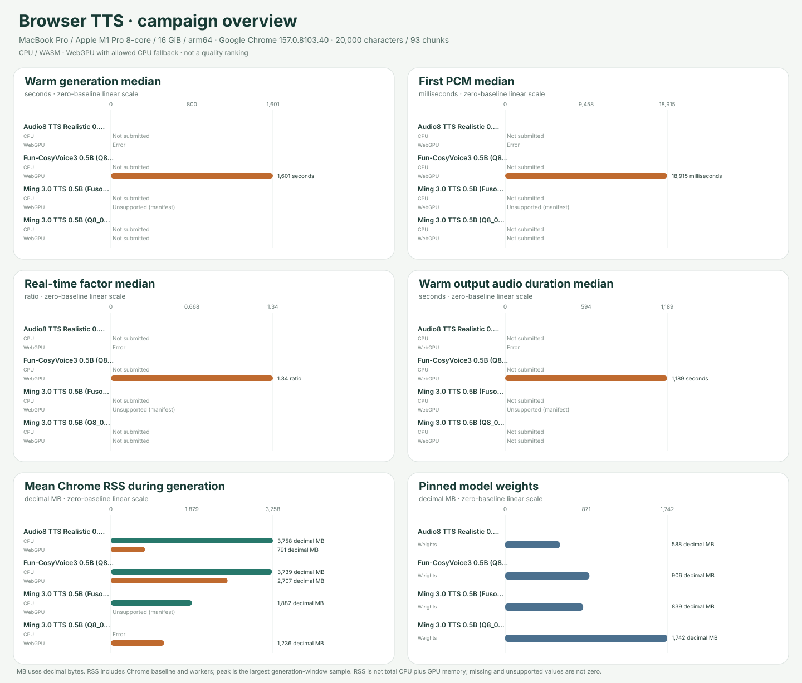

# Browser TTS campaign overview

**Cohort:** native headed-Chrome results from source commit `ab5aec3e510420adbcac9971f35f92152b19959c` (source fingerprint `241f993d2bb839cb691e5835e05ad41721522bb1ab1a3aeb03882e58e3e36036`), on MacBook Pro / Apple M1 Pro 8-core / 16 GiB / arm64 · Darwin 25.6.0 · Apple M1 Pro · Google Chrome 157.0.8103.40 · GPU apple. Fixture: `english-20k-v1`, 20,000 characters / 93 chunks, SHA-256 `4cd173ad03d14ba96df6eb1e58b193c0c796032c114cfb954838b5150651eb0b`.

The included receipts share one source, exact environment and fixture; voice, precision and non-backend settings are checked per model. The recorded non-backend model settings match; `executionProviders` identifies the requested runtime providers. Scenarios remain separate and are never pooled. Model support and terms: [voice/language counts](../../docs/MODEL_SUPPORT.md) · [licensing and publication boundaries](../../docs/LICENSING.md).

**Original Audio8 WebGPU waveform fault.** 90.31% of this recording is constant at one PCM value. Its elapsed time describes a diagnostic execution. The archived cached time and memory describe that execution. [Full waveform audit](https://github.com/ngelik/tts-bench/tree/main/diagnostics/audio8-waveform).

## Warm generation

Full warm workload: one excluded full-article warm-up and at least five scored 20,000-character / 93-chunk repetitions. Generation is the benchmark timer; values summarize scored repetitions only. First PCM is median of recorded per-trial values. Audio duration and RTF are reconciled from output samples, sample rate and generation time.

| Model | CPU generation median (min–max) | WebGPU generation median (min–max) | CPU first PCM median | WebGPU first PCM median | CPU audio / RTF median | WebGPU audio / RTF median |
|---|---:|---:|---:|---:|---:|---:|
| Audio8 TTS Realistic 0.6B INT4 | Not submitted | Error | Not submitted | Error | Not submitted | Error |
| Fun-CosyVoice3 0.5B (Q8/Q4 ONNX) | Not submitted | Not submitted | Not submitted | Not submitted | Not submitted | Not submitted |
| Ming 3.0 TTS 0.5B (Fusor mixed quantization / CPU) | Not submitted | Unsupported (not declared in manifest) | Not submitted | Unsupported (not declared in manifest) | Not submitted | Unsupported (not declared in manifest) |
| Ming 3.0 TTS 0.5B (Q8_0 GGUF) | Not submitted | Not submitted | Not submitted | Not submitted | Not submitted | Not submitted |

## Resource diagnostics

Cached RAM is the mean process-tree RSS sampled during one full generation in a separate one-tab Chrome session. It includes browser baseline and inference workers, may double-count shared pages, and is not model-only RAM or VRAM. The peak column is the largest RSS sample inside the same generation window; process RSS does not measure total CPU plus GPU allocations. Decimal MB = 1,000,000 bytes.

| Model | CPU mean Chrome RSS | CPU max sampled RSS | WebGPU mean Chrome RSS | WebGPU max sampled RSS | Pinned model weights |
|---|---:|---:|---:|---:|---:|
| Audio8 TTS Realistic 0.6B INT4 | 3757.79 MB (n=1; 41825 samples) | 5079.12 MB (sampled max; n=1; 41825 samples) | 790.79 MB (n=1; 16866 samples) | 2293.40 MB (sampled max; n=1; 16866 samples) | 587.71 MB |
| Fun-CosyVoice3 0.5B (Q8/Q4 ONNX) | 3738.68 MB (n=1; 29467 samples) | 4206.44 MB (sampled max; n=1; 29467 samples) | 2706.94 MB (n=1; 3159 samples) | 3328.46 MB (sampled max; n=1; 3159 samples) | 905.67 MB |
| Ming 3.0 TTS 0.5B (Fusor mixed quantization / CPU) | 1882.03 MB (n=1; 1868 samples) | 1995.41 MB (sampled max; n=1; 1868 samples) | Unsupported (not declared in manifest) | Unsupported (not declared in manifest) | 838.60 MB |
| Ming 3.0 TTS 0.5B (Q8_0 GGUF) | Error | Error | 1235.53 MB (n=1; 10358 samples) | 2018.75 MB (sampled max; n=1; 10358 samples) | 1742.28 MB |

## Submitted receipts

Each cell links to its submitted receipt and full per-run report. Missing entries are labeled, not treated as zero.

| Model | Warm CPU | Warm WebGPU | Cached CPU RAM | Cached WebGPU RAM | Support | License |
|---|---|---|---|---|---|---|
| Audio8 TTS Realistic 0.6B INT4 | Not submitted | [Report](../../results/2026-11-15t06-00-59-478z-audio8-realistic-0.6b-int4-webgpu-warm-8a08bc92/summary.md) | [Report](../../results/2026-11-15t00-00-04-032z-audio8-realistic-0.6b-int4-cpu-cached-b259df93/summary.md) | [Report](../../results/2026-11-14t17-07-22-490z-audio8-realistic-0.6b-int4-webgpu-cached-5ffbf694/summary.md) | [Support details](../../docs/MODEL_SUPPORT.md#audio8-realistic-0.6b-int4) | [Terms](../../docs/LICENSING.md) |
| Fun-CosyVoice3 0.5B (Q8/Q4 ONNX) | Not submitted | Not submitted | [Report](../../results/2026-11-14t19-46-27-024z-fun-cosyvoice3-0.5b-2512-cpu-cached-7c12aec4/summary.md) | [Report](../../results/2026-11-14t15-12-11-363z-fun-cosyvoice3-0.5b-2512-webgpu-cached-168c91d4/summary.md) | [Support details](../../docs/MODEL_SUPPORT.md#fun-cosyvoice3-0.5b-2512) | [Terms](../../docs/LICENSING.md) |
| Ming 3.0 TTS 0.5B (Fusor mixed quantization / CPU) | Not submitted | Unsupported (manifest) | [Report](../../results/2026-11-14t19-30-24-576z-ming-3.0-tts-0.5b-fusor-mix-cpu-cpu-cached-40143301/summary.md) | Unsupported (manifest) | [Support details](../../docs/MODEL_SUPPORT.md#ming-3.0-tts-0.5b-fusor-mix-cpu) | [Terms](../../docs/LICENSING.md) |
| Ming 3.0 TTS 0.5B (Q8_0 GGUF) | Not submitted | Not submitted | [Report](../../results/2026-11-14t23-56-30-288z-ming-3.0-tts-0.5b-gguf-cpu-cached-a590a0df/summary.md) | [Report](../../results/2026-11-14t15-39-16-252z-ming-3.0-tts-0.5b-gguf-webgpu-cached-680f3a63/summary.md) | [Support details](../../docs/MODEL_SUPPORT.md#ming-3.0-tts-0.5b-gguf) | [Terms](../../docs/LICENSING.md) |

## Unsupported and error outcomes

Reasons are listed once per model, backend, status and reason; the receipt table above retains links for every submitted cell.

| Model | Backend | Status | Reason | Source receipt |
|---|---|---|---|---|
| audio8-realistic-0.6b-int4 | webgpu | Error | page.evaluate: Target page, context or browser has been closed | [Report](../../results/2026-11-15t06-00-59-478z-audio8-realistic-0.6b-int4-webgpu-warm-8a08bc92/summary.md) |
| ming-3.0-tts-0.5b-gguf | cpu | Error | page.evaluate: Error: RuntimeError: unreachable     at http://127.0.0.1:56691/runtimes/audio-cpp-browser-v1/bench_browser.wasm:wasm-function[3530]:0x30e124     at abort (http://127.0.0.1:56691/runtimes/audio-cpp-browser-v1/bench_browser.js:1:10470)     at __abort_js (http://127.0.0.1:56691/runtimes/audio-cpp-browser-v1/bench_browser.js:1:81171)     at http://127.0.0.1:56691/runtimes/audio-cpp-browser-v1/bench_browser.wasm:wasm-function[2637]:0x2dde42     at http://127.0.0.1:56691/runtimes/audio-cpp-browser-v1/bench_browser.wasm:wasm-function[2114]:0x289af4     at http://127.0.0.1:56691/runtimes/audio-cpp-browser-v1/bench_browser.wasm:wasm-function[1685]:0x18b2a3     at http://127.0.0.1:56691/runtimes/audio-cpp-browser-v1/bench_browser.wasm:wasm-function[1687]:0x18b563     at http://127.0.0.1:56691/runtimes/audio-cpp-browser-v1/bench_browser.wasm:wasm-function[1713]:0x1dadb6     at http://127.0.0.1:56691/runtimes/audio-cpp-browser-v1/bench_browser.wasm:wasm-function[2244]:0x294cba     at http://127.0.0.1:56691/runtimes/audio-cpp-browser-v1/bench_browser.wasm:wasm-function[251]:0x16831     at http://127.0.0.1:56691/runtimes/audio-cpp-browser-v1/bench_browser.wasm:wasm-function[3530]:0x30e124     at abort (http://127.0.0.1:56691/runtimes/audio-cpp-browser-v1/bench_browser.js:1:10470)     at __abort_js (http://127.0.0.1:56691/runtimes/audio-cpp-browser-v1/bench_browser.js:1:81171)     at http://127.0.0.1:56691/runtimes/audio-cpp-browser-v1/bench_browser.wasm:wasm-function[2637]:0x2dde42     at http://127.0.0.1:56691/runtimes/audio-cpp-browser-v1/bench_browser.wasm:wasm-function[2114]:0x289af4     at http://127.0.0.1:56691/runtimes/audio-cpp-browser-v1/bench_browser.wasm:wasm-function[1685]:0x18b2a3     at http://127.0.0.1:56691/runtimes/audio-cpp-browser-v1/bench_browser.wa | [Report](../../results/2026-11-14t23-56-30-288z-ming-3.0-tts-0.5b-gguf-cpu-cached-a590a0df/summary.md) |

This overview reports measured browser execution and resource diagnostics only. It does not rank speech quality or establish intelligibility. Compare scenarios only within their named protocol boundaries; unsupported, unavailable, unrecorded and not-submitted values remain distinct.
