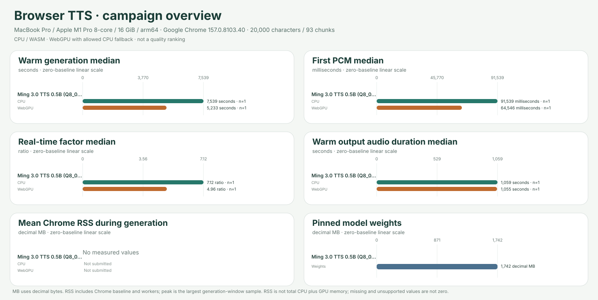

# Browser TTS campaign overview

**Cohort:** native headed-Chrome results from source commit `3aaf2d5d54df00c1e7482e141f8e26387c6169e0` (source fingerprint `5b6bb735d5457cea99c9f584dfbb15907037c33a2985f11a3e1d8a70ebbc799c`), on MacBook Pro / Apple M1 Pro 8-core / 16 GiB / arm64 · Darwin 25.6.0 · Apple M1 Pro · Google Chrome 157.0.8103.40 · GPU apple. Fixture: `english-20k-v1`, 20,000 characters / 93 chunks, SHA-256 `4cd173ad03d14ba96df6eb1e58b193c0c796032c114cfb954838b5150651eb0b`.

The included receipts share one source, exact environment and fixture; voice, precision and non-backend settings are checked per model. The recorded non-backend model settings match; `executionProviders` identifies the requested runtime providers. Scenarios remain separate and are never pooled. Model support and terms: [voice/language counts](../../docs/MODEL_SUPPORT.md) · [licensing and publication boundaries](../../docs/LICENSING.md).

## Warm generation

Each warm run starts with one excluded 20,000-character article (93 chunks). Each generation time shows the observed range and the number of scored articles (n). When n=1, the median and both endpoints are the single observation. First PCM is the median time to the first audio samples. Output duration and real-time factor use the recorded sample count, sample rate and generation time.

| Model | CPU generation median (min–max) | WebGPU generation median (min–max) | CPU first PCM median | WebGPU first PCM median | CPU audio / RTF median | WebGPU audio / RTF median |
|---|---:|---:|---:|---:|---:|---:|
| Ming 3.0 TTS 0.5B (Q8_0 GGUF) | 7539.10 s (7539.10–7539.10; n=1) | 5233.21 s (5233.21–5233.21; n=1) | 91539.09 ms (n=1) | 64546.03 ms (n=1) | 1058.70 s / 7.121 | 1054.80 s / 4.961 |

## Resource diagnostics

Cached RAM is the mean process-tree RSS sampled during one full generation in a separate one-tab Chrome session. It includes browser baseline and inference workers, may double-count shared pages, and is not model-only RAM or VRAM. The peak column is the largest RSS sample inside the same generation window; process RSS does not measure total CPU plus GPU allocations. Decimal MB = 1,000,000 bytes.

| Model | CPU mean Chrome RSS | CPU max sampled RSS | WebGPU mean Chrome RSS | WebGPU max sampled RSS | Pinned model weights |
|---|---:|---:|---:|---:|---:|
| Ming 3.0 TTS 0.5B (Q8_0 GGUF) | Not submitted | Not submitted | Not submitted | Not submitted | 1742.28 MB |

## Submitted receipts

Each cell links to its submitted receipt and full per-run report. Missing entries are labeled, not treated as zero.

| Model | Warm CPU | Warm WebGPU | Cached CPU RAM | Cached WebGPU RAM | Support | License |
|---|---|---|---|---|---|---|
| Ming 3.0 TTS 0.5B (Q8_0 GGUF) | [Report](../../results/2026-11-17t13-41-42-641z-ming-3.0-tts-0.5b-gguf-cpu-warm-7d9eb112/summary.md) | [Report](../../results/2026-11-17t18-11-26-404z-ming-3.0-tts-0.5b-gguf-webgpu-warm-d6f2bd29/summary.md) | Not submitted | Not submitted | [Support details](../../docs/MODEL_SUPPORT.md#ming-3.0-tts-0.5b-gguf) | [Terms](../../docs/LICENSING.md) |

## Unsupported and error outcomes

All submitted cells are measured.

This overview reports measured browser execution and resource diagnostics only. It does not rank speech quality or establish intelligibility. Compare scenarios only within their named protocol boundaries; unsupported, unavailable, unrecorded and not-submitted values remain distinct.
