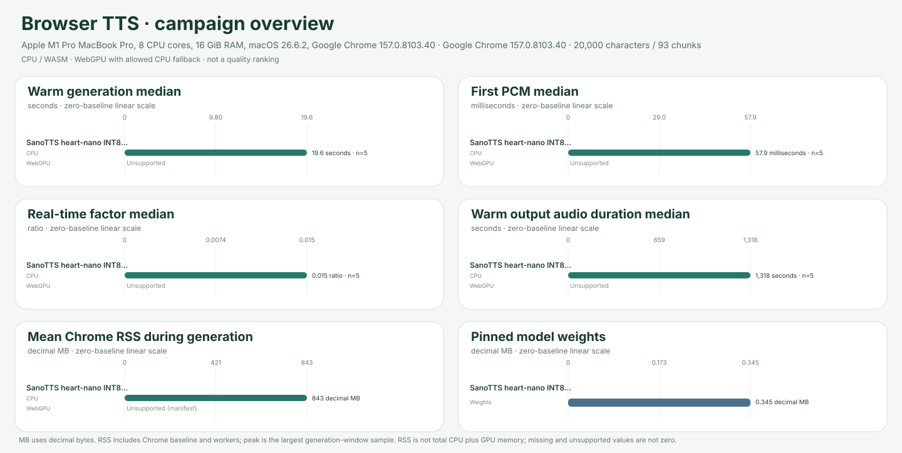

# Browser TTS campaign overview

**Cohort:** native headed-Chrome results from source commit `b0f8c8887e9dfab5cef7b8fac9a15af865d722ef` (source fingerprint `169e80e92ff65871eac7fb0de708fb6b2da8c15d9ab96ed7110def2e3341f027`), on Apple M1 Pro MacBook Pro, 8 CPU cores, 16 GiB RAM, macOS 26.6.2, Google Chrome 157.0.8103.40 · Darwin 25.6.0 · Apple M1 Pro · Google Chrome 157.0.8103.40 · GPU not reported. Fixture: `english-20k-v1`, 20,000 characters / 93 chunks, SHA-256 `4cd173ad03d14ba96df6eb1e58b193c0c796032c114cfb954838b5150651eb0b`.

The included receipts share one source, exact environment and fixture; voice, precision and non-backend settings are checked per model. The recorded non-backend model settings match; `executionProviders` identifies the requested runtime providers. Scenarios remain separate and are never pooled. Model support and terms: [voice/language counts](../../docs/MODEL_SUPPORT.md) · [licensing and publication boundaries](../../docs/LICENSING.md).

## Warm generation

Each warm run starts with one excluded 20,000-character article (93 chunks). Each generation time shows the observed range and the number of scored articles (n). When n=1, the median and both endpoints are the single observation. First PCM is the median time to the first audio samples. Output duration and real-time factor use the recorded sample count, sample rate and generation time.

| Model | CPU generation median (min–max) | WebGPU generation median (min–max) | CPU first PCM median | WebGPU first PCM median | CPU audio / RTF median | WebGPU audio / RTF median |
|---|---:|---:|---:|---:|---:|---:|
| SanoTTS heart-nano INT8 (English, US) | 19.59 s (19.58–19.63; n=5) | Unsupported | 57.95 ms (n=5) | Unsupported | 1317.60 s / 0.015 | Unsupported |

## Resource diagnostics

Cached RAM is the mean process-tree RSS sampled during one full generation in a separate one-tab Chrome session. It includes browser baseline and inference workers, may double-count shared pages, and is not model-only RAM or VRAM. The peak column is the largest RSS sample inside the same generation window; process RSS does not measure total CPU plus GPU allocations. Decimal MB = 1,000,000 bytes.

| Model | CPU mean Chrome RSS | CPU max sampled RSS | WebGPU mean Chrome RSS | WebGPU max sampled RSS | Pinned model weights |
|---|---:|---:|---:|---:|---:|
| SanoTTS heart-nano INT8 (English, US) | 842.88 MB (n=1; 38 samples) | 906.79 MB (sampled max; n=1; 38 samples) | Unsupported (not declared in manifest) | Unsupported (not declared in manifest) | 0.35 MB |

## Submitted receipts

Each cell links to its submitted receipt and full per-run report. Missing entries are labeled, not treated as zero.

| Model | Warm CPU | Warm WebGPU | Cached CPU RAM | Cached WebGPU RAM | Support | License |
|---|---|---|---|---|---|---|
| SanoTTS heart-nano INT8 (English, US) | [Report](../../results/2026-11-19t05-00-58-025z-sano-heart-nano-cpu-warm-0b78045e/summary.md) | [Report](../../results/2026-11-19t05-03-32-384z-sano-heart-nano-webgpu-warm-09e97638/summary.md) | [Report](../../results/2026-11-19t05-03-03-415z-sano-heart-nano-cpu-cached-ea706271/summary.md) | Unsupported (manifest) | [Support details](../../docs/MODEL_SUPPORT.md#sano-heart-nano) | [Terms](../../docs/LICENSING.md) |

## Unsupported and error outcomes

Reasons are listed once per model, backend, status and reason; the receipt table above retains links for every submitted cell.

| Model | Backend | Status | Reason | Source receipt |
|---|---|---|---|---|
| sano-heart-nano | webgpu | Unsupported | The pinned official SanoTTS heart-nano browser path is CPU WebAssembly; it does not implement WebGPU dispatch. | [Report](../../results/2026-11-19t05-03-32-384z-sano-heart-nano-webgpu-warm-09e97638/summary.md) |

This overview reports measured browser execution and resource diagnostics only. It does not rank speech quality or establish intelligibility. Compare scenarios only within their named protocol boundaries; unsupported, unavailable, unrecorded and not-submitted values remain distinct.
