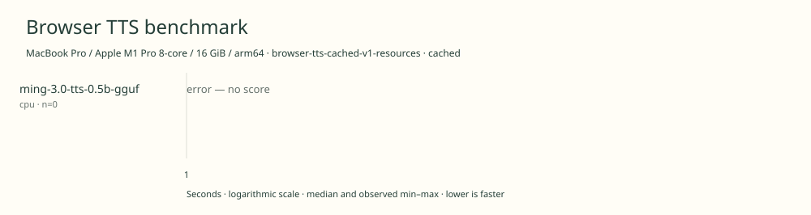

# 2026-11-14t23-56-30-288z-ming-3.0-tts-0.5b-gguf-cpu-cached-a590a0df

MacBook Pro / Apple M1 Pro 8-core / 16 GiB / arm64 · Apple M1 Pro · Google Chrome 157.0.8103.40

Protocol: **browser-tts-cached-v1-resources**, scenario **cached**. Native harness run.

First source-chunk request through final CPU-readable PCM; excludes initialization, validation, hashing, WAV encoding and save. Optional articleCallPeakRssBytes spans the entire browser call including post-timer validation/export. Generation RSS uses timestamped samples inside browser generation start/end boundaries; it includes the owned Chrome process tree and browser baseline.

| Model | Requested backend | Status | Median | Min–max | Runs |
|---|---|---|---:|---:|---:|
| ming-3.0-tts-0.5b-gguf | cpu | error | — | — | 0 |

Model support (catalog capability, not coverage of this run):

| Model | Supported voices | Bundled voices | Languages | Tested voice |
|---|---:|---:|---|---|
| ming-3.0-tts-0.5b-gguf | 117 | 1 | 7 | US_James built-in voice (English) |

Named base speakers in the upstream checkpoint catalog. The benchmark adapter exposes one fixed English voice.. US\_James is the sole benchmarked voice. The count deduplicates named base voices and excludes emotion variants, voice cloning and voice design. Sources: [1](https://github.com/inclusionAI/Ming-3.0-tts/blob/e999c39fa676722aaa9ea29b5aa19a90525b271f/cookbooks/instruction_en.md#built-in-premium-voices), [2](https://huggingface.co/audio-cpp/Ming-3.0-TTS-0.5B-GGUF/blob/2eb8d37c7f10672e69c8aa33091baa04c461b66c/README.md), [3](https://github.com/0xShug0/audio.cpp/blob/d38518a0d6a7aaab9d3f3dd91e9780c69857b0ac/docs/models/ming3_tts.md).

- **ming-3.0-tts-0.5b-gguf / cpu**: Explicit CPU audio.cpp backend; separate untimed synthesis probe returned finite PCM. page.evaluate: Error: RuntimeError: unreachable     at http://127.0.0.1:56691/runtimes/audio-cpp-browser-v1/bench_browser.wasm:wasm-function[3530]:0x30e124     at abort (http://127.0.0.1:56691/runtimes/audio-cpp-browser-v1/bench_browser.js:1:10470)     at __abort_js (http://127.0.0.1:56691/runtimes/audio-cpp-browser-v1/bench_browser.js:1:81171)     at http://127.0.0.1:56691/runtimes/audio-cpp-browser-v1/bench_browser.wasm:wasm-function[2637]:0x2dde42     at http://127.0.0.1:56691/runtimes/audio-cpp-browser-v1/bench_browser.wasm:wasm-function[2114]:0x289af4     at http://127.0.0.1:56691/runtimes/audio-cpp-browser-v1/bench_browser.wasm:wasm-function[1685]:0x18b2a3     at http://127.0.0.1:56691/runtimes/audio-cpp-browser-v1/bench_browser.wasm:wasm-function[1687]:0x18b563     at http://127.0.0.1:56691/runtimes/audio-cpp-browser-v1/bench_browser.wasm:wasm-function[1713]:0x1dadb6     at http://127.0.0.1:56691/runtimes/audio-cpp-browser-v1/bench_browser.wasm:wasm-function[2244]:0x294cba     at http://127.0.0.1:56691/runtimes/audio-cpp-browser-v1/bench_browser.wasm:wasm-function[251]:0x16831     at http://127.0.0.1:56691/runtimes/audio-cpp-browser-v1/bench_browser.wasm:wasm-function[3530]:0x30e124     at abort (http://127.0.0.1:56691/runtimes/audio-cpp-browser-v1/bench_browser.js:1:10470)     at __abort_js (http://127.0.0.1:56691/runtimes/audio-cpp-browser-v1/bench_browser.js:1:81171)     at http://127.0.0.1:56691/runtimes/audio-cpp-browser-v1/bench_browser.wasm:wasm-function[2637]:0x2dde42     at http://127.0.0.1:56691/runtimes/audio-cpp-browser-v1/bench_browser.wasm:wasm-function[2114]:0x289af4     at http://127.0.0.1:56691/runtimes/audio-cpp-browser-v1/bench_browser.wasm:wasm-function[1685]:0x18b2a3     at http://127.0.0.1:56691/runtimes/audio-cpp-browser-v1/bench_browser.wa

Capability checks run separately before timing. GPU dispatch does not imply GPU-exclusive execution.

Raw WAV is saved locally; opt-in audio publication is separate from timing and automatic result submission.

English 20k November campaign. Sequential headed Chrome, AC power and one isolated benchmark tab. Predeclared backend order, no cold-load check. Separate generation-window RSS diagnostic.

RSS is sampled every 500 ms across the owned Chrome process tree, including the Chrome baseline and inference workers. Whole-call peak spans post-timer validation/export; generation mean uses only in-window samples from browser generation start through final CPU-readable PCM.

Different protocols, fixtures, settings or machines must not be pooled into a speedup ranking. This report does not rate speech quality.
