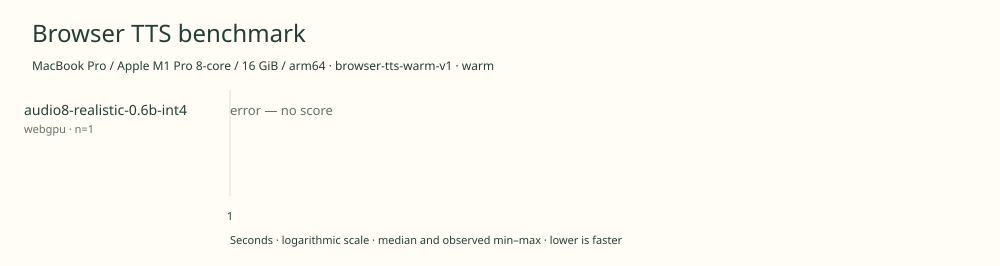

# 2026-11-15t06-00-59-478z-audio8-realistic-0.6b-int4-webgpu-warm-8a08bc92

MacBook Pro / Apple M1 Pro 8-core / 16 GiB / arm64 · Apple M1 Pro · Google Chrome 157.0.8103.40

Protocol: **browser-tts-warm-v1**, scenario **warm**. Native harness run.

First source-chunk request through final CPU-readable PCM; excludes initialization, validation, hashing, WAV encoding and save. Optional articleCallPeakRssBytes spans the entire browser call including post-timer validation/export.

| Model | Requested backend | Status | Median | Min–max | Runs |
|---|---|---|---:|---:|---:|
| audio8-realistic-0.6b-int4 | webgpu | error | — | — | 1 |

**Waveform fault in audio8-realistic-0.6b-int4 / webgpu.** 90.31% of this recording is constant at one PCM value. Its elapsed time describes a diagnostic execution. Matching timed article(s): 8413.724 s. [Full waveform audit](https://github.com/ngelik/tts-bench/tree/main/diagnostics/audio8-waveform).

Model support (catalog capability, not coverage of this run):

| Model | Supported voices | Bundled voices | Languages | Tested voice |
|---|---:|---:|---|---|
| audio8-realistic-0.6b-int4 | Unknown | 0 | 23 | Reference-free English synthesis |

Realistic 0.6B checkpoint; reference-free synthesis or open-ended zero-shot voices.. No preset voices ship in this configuration. Reference-free English mode is tested. Sources: [1](https://huggingface.co/Edge0/Audio8-TTS-Realistic-Air/blob/1e857568bfd4f02931aca3988ee773a44d2d26d3/README.md), [2](https://huggingface.co/stephvax/audio8-tts-realistic-0.6b-onnx-int4/blob/04313606782af6b9a1aa93724555bc7b64ba9197/provenance.json).

- **audio8-realistic-0.6b-int4 / webgpu**: 1625590 dispatches in separate capability probe; WebGPU with WASM fallback. page.evaluate: Target page, context or browser has been closed

Capability checks run separately before timing. GPU dispatch does not imply GPU-exclusive execution.

Raw WAV is saved locally; opt-in audio publication is separate from timing and automatic result submission.

English 20k November campaign. Sequential headed Chrome, AC power and one isolated benchmark tab. Predeclared backend order, no cold-load check. One excluded full article followed by five scored repetitions.

Different protocols, fixtures, settings or machines must not be pooled into a speedup ranking. This report does not rate speech quality.
