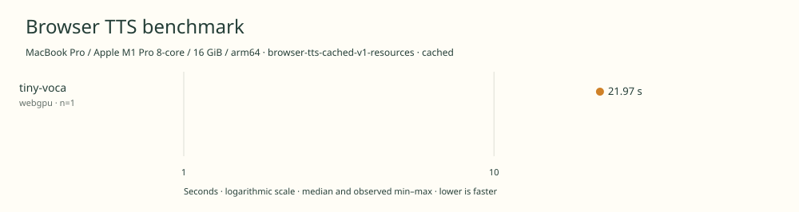

# 2026-11-15t22-55-04-428z-tiny-voca-webgpu-cached-4a50b4ec

MacBook Pro / Apple M1 Pro 8-core / 16 GiB / arm64 · Apple M1 Pro · Google Chrome 157.0.8103.40

Protocol: **browser-tts-cached-v1-resources**, scenario **cached**. Native harness run.

First source-chunk request through final CPU-readable PCM; excludes initialization, validation, hashing, WAV encoding and save. Optional articleCallPeakRssBytes spans the entire browser call including post-timer validation/export. Generation RSS uses timestamped samples inside browser generation start/end boundaries; it includes the owned Chrome process tree and browser baseline.

| Model | Requested backend | Status | Median | Min–max | Runs |
|---|---|---|---:|---:|---:|
| tiny-voca | webgpu | measured | 21.97 s | 21.97–21.97 s | 1 |

Additional metrics (median of available observations; scopes are distinct):

| Model | Backend | Metric | Median | Unit | n |
|---|---|---|---:|---|---:|
| tiny-voca | webgpu | First completed source chunk | 367.120 | ms | 1 |
| tiny-voca | webgpu | First PCM block | 165.545 | ms | 1 |
| tiny-voca | webgpu | Generated audio | 1152.395 | s | 1 |
| tiny-voca | webgpu | Generation / audio duration | 0.019 | ratio | 1 |
| tiny-voca | webgpu | Model initialization | 2347.647 | ms | 1 |
| tiny-voca | webgpu | Complete controller trial including setup/export | 27716.257 | ms | 1 |
| tiny-voca | webgpu | Transferred HTTP body data | 38404 | bytes | 1 |
| tiny-voca | webgpu | Ideal body transfer at 1 Mbps | 0.307 | s | 1 |
| tiny-voca | webgpu | Whole-call Chrome process-tree peak RSS | 2815574016 | bytes | 1 |
| tiny-voca | webgpu | Per-trial mean generation Chrome process-tree RSS | 2349252227 | bytes | 1 |
| tiny-voca | webgpu | In-window Chrome RSS observations | 43.000 | samples | 1 |

Model support (catalog capability, not coverage of this run):

| Model | Supported voices | Bundled voices | Languages | Tested voice |
|---|---:|---:|---|---|
| tiny-voca | 2 | 2 | 1 (en) | F2 (American English) |

Pinned two-voice American English checkpoint. The F2 and M2 voices are embedded in one graph. Only F2 is benchmarked. Sources: [1](https://huggingface.co/n4ze3m/tiny-voca/blob/a46fbe0c8514cb32f5e80be987e6c96ef0540f8d/README.md), [2](https://huggingface.co/n4ze3m/tiny-voca/blob/a46fbe0c8514cb32f5e80be987e6c96ef0540f8d/config.json), [3](https://github.com/n4ze3m/tiny-voca/blob/28e0722c6ad040d74a1f6e63d77621272477a71f/web/public/worker.js).

- **tiny-voca / webgpu**: 2526 compute dispatches in the untimed probe. Dizione runs locally on CPU, with WASM fallback for ONNX operators.

Capability checks run separately before timing. GPU dispatch does not imply GPU-exclusive execution.

Raw WAV is saved locally; opt-in audio publication is separate from timing and automatic result submission.

Campaign 2026-11-15T22-55-03-922Z-33e7948b593d; cell 1/1; source 6ad6b9f4f062c77514e1fc8da4254327b2cf2e59; Mains power attached; pre-run load averages 2.44, 5.10, 5.12; sequential M1 slot order; normal user background apps remain; thermal state not instrumented; cell webgpu cached; headed pinned Google Chrome 157.0.8103.40.

RSS is sampled every 500 ms across the owned Chrome process tree, including the Chrome baseline and inference workers. Whole-call peak spans post-timer validation/export; generation mean uses only in-window samples from browser generation start through final CPU-readable PCM.

Different protocols, fixtures, settings or machines must not be pooled into a speedup ranking. This report does not rate speech quality.
