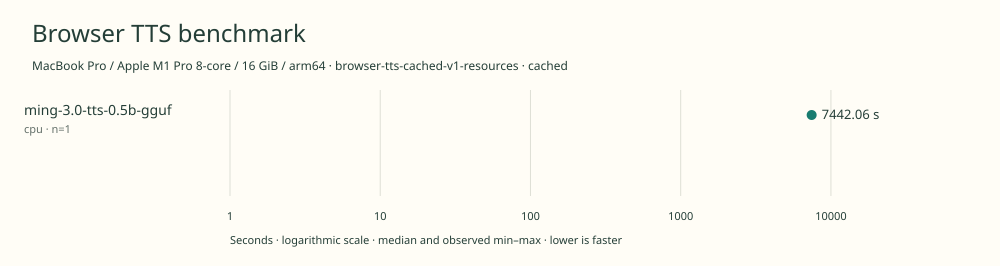

# 2026-11-16t12-55-40-269z-ming-3.0-tts-0.5b-gguf-cpu-cached-f62b1742

MacBook Pro / Apple M1 Pro 8-core / 16 GiB / arm64 · Apple M1 Pro · Google Chrome 157.0.8103.40

Protocol: **browser-tts-cached-v1-resources**, scenario **cached**. Native harness run.

First source-chunk request through final CPU-readable PCM; excludes initialization, validation, hashing, WAV encoding and save. Optional articleCallPeakRssBytes spans the entire browser call including post-timer validation/export. Generation RSS uses timestamped samples inside browser generation start/end boundaries; it includes the owned Chrome process tree and browser baseline.

| Model | Requested backend | Status | Median | Min–max | Runs |
|---|---|---|---:|---:|---:|
| ming-3.0-tts-0.5b-gguf | cpu | measured | 7442.06 s | 7442.06–7442.06 s | 1 |

Additional metrics (median of available observations; scopes are distinct):

| Model | Backend | Metric | Median | Unit | n |
|---|---|---|---:|---|---:|
| ming-3.0-tts-0.5b-gguf | cpu | First completed source chunk | 90729.340 | ms | 1 |
| ming-3.0-tts-0.5b-gguf | cpu | First PCM block | 90721.685 | ms | 1 |
| ming-3.0-tts-0.5b-gguf | cpu | Generated audio | 1058.700 | s | 1 |
| ming-3.0-tts-0.5b-gguf | cpu | Generation / audio duration | 7.029 | ratio | 1 |
| ming-3.0-tts-0.5b-gguf | cpu | Model initialization | 4699.166 | ms | 1 |
| ming-3.0-tts-0.5b-gguf | cpu | Complete controller trial including setup/export | 7452824.753 | ms | 1 |
| ming-3.0-tts-0.5b-gguf | cpu | Transferred HTTP body data | 38404 | bytes | 1 |
| ming-3.0-tts-0.5b-gguf | cpu | Ideal body transfer at 1 Mbps | 0.307 | s | 1 |
| ming-3.0-tts-0.5b-gguf | cpu | Whole-call Chrome process-tree peak RSS | 4933877760 | bytes | 1 |
| ming-3.0-tts-0.5b-gguf | cpu | Per-trial mean generation Chrome process-tree RSS | 1706772974 | bytes | 1 |
| ming-3.0-tts-0.5b-gguf | cpu | In-window Chrome RSS observations | 14818.000 | samples | 1 |

Model support (catalog capability, not coverage of this run):

| Model | Supported voices | Bundled voices | Languages | Tested voice |
|---|---:|---:|---|---|
| ming-3.0-tts-0.5b-gguf | 117 | 1 | 7 | US_James built-in voice (English) |

Named base speakers in the upstream checkpoint catalog. The benchmark adapter exposes one fixed English voice.. US\_James is the sole benchmarked voice. The count deduplicates named base voices and excludes emotion variants, voice cloning and voice design. Sources: [1](https://github.com/inclusionAI/Ming-3.0-tts/blob/e999c39fa676722aaa9ea29b5aa19a90525b271f/cookbooks/instruction_en.md#built-in-premium-voices), [2](https://huggingface.co/audio-cpp/Ming-3.0-TTS-0.5B-GGUF/blob/2eb8d37c7f10672e69c8aa33091baa04c461b66c/README.md), [3](https://github.com/0xShug0/audio.cpp/blob/d38518a0d6a7aaab9d3f3dd91e9780c69857b0ac/docs/models/ming3_tts.md).

- **ming-3.0-tts-0.5b-gguf / cpu**: Explicit CPU audio.cpp backend; separate untimed synthesis probe returned finite PCM.

Capability checks run separately before timing. GPU dispatch does not imply GPU-exclusive execution.

Raw WAV is saved locally; opt-in audio publication is separate from timing and automatic result submission.

Campaign 2026-11-16T12-55-38-600Z-2fd4ed8d3947; cell 1/1; source d77c64289955a57526291d39b22caceffae40413; Ming Q8_0 GGUF, audio-cpp-browser-v3, six threads, US_James. One baseline M1 Pro on AC, pinned headed Chrome, consecutive canonical article spans. Run cells individually under the shared M1 slot. Cached runs sample generation-window memory. Warm cells use one excluded full article plus five scored articles.

RSS is sampled every 500 ms across the owned Chrome process tree, including the Chrome baseline and inference workers. Whole-call peak spans post-timer validation/export; generation mean uses only in-window samples from browser generation start through final CPU-readable PCM.

Different protocols, fixtures, settings or machines must not be pooled into a speedup ranking. This report does not rate speech quality.
