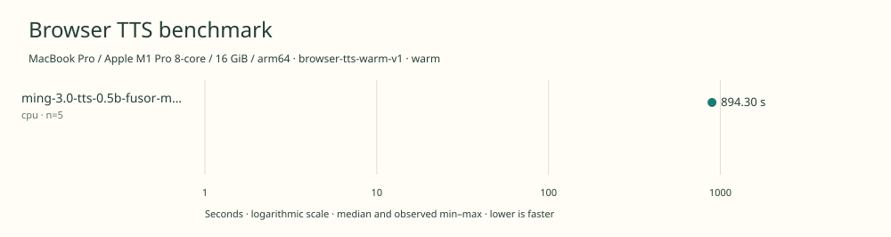

# 2026-11-16t18-03-47-233z-ming-3.0-tts-0.5b-fusor-mix-cpu-cpu-warm-5b9985a7

MacBook Pro / Apple M1 Pro 8-core / 16 GiB / arm64 · Apple M1 Pro · Google Chrome 157.0.8103.40

Protocol: **browser-tts-warm-v1**, scenario **warm**. Native harness run.

First source-chunk request through final CPU-readable PCM; excludes initialization, validation, hashing, WAV encoding and save. Optional articleCallPeakRssBytes spans the entire browser call including post-timer validation/export.

| Model | Requested backend | Status | Median | Min–max | Runs |
|---|---|---|---:|---:|---:|
| ming-3.0-tts-0.5b-fusor-mix-cpu | cpu | measured | 894.30 s | 891.12–912.28 s | 5 |

Additional metrics (median of available observations; scopes are distinct):

| Model | Backend | Metric | Median | Unit | n |
|---|---|---|---:|---|---:|
| ming-3.0-tts-0.5b-fusor-mix-cpu | cpu | First completed source chunk | 10341.980 | ms | 5 |
| ming-3.0-tts-0.5b-fusor-mix-cpu | cpu | First PCM block | 818.080 | ms | 5 |
| ming-3.0-tts-0.5b-fusor-mix-cpu | cpu | Generated audio | 1009.300 | s | 5 |
| ming-3.0-tts-0.5b-fusor-mix-cpu | cpu | Generation / audio duration | 0.886 | ratio | 5 |

Model support (catalog capability, not coverage of this run):

| Model | Supported voices | Bundled voices | Languages | Tested voice |
|---|---:|---:|---|---|
| ming-3.0-tts-0.5b-fusor-mix-cpu | 117 | 7 | 7 | US_James (built-in US English male narrator) |

Named presets in the base Ming checkpoint cookbook. The Fusor browser runtime bundles seven and the benchmark selects US\_James.. Five English and two Chinese voice presets are enumerated by the pinned WASM voices\(\) export. The base checkpoint supports seven languages. Only English is evaluated. Sources: [1](https://github.com/inclusionAI/Ming-3.0-tts/blob/e999c39fa676722aaa9ea29b5aa19a90525b271f/cookbooks/instruction_en.md#built-in-premium-voices), [2](https://huggingface.co/fusorlabs/ming-3.0-tts-0.5b-web/blob/62588575d91dceb33822fe1e3925e748393c6b3e/README.md), [3](https://huggingface.co/spaces/fusorlabs/ming-wasm/tree/bdf46b41e966340f398fdd82d3ca64f4058ad892/engine/dist/web-threaded-relaxed), [4](https://github.com/fusor-rs/ming-wasm/blob/bcbcf268f6b32db48c075aec94f3b7ff59208085/README.md).

- **ming-3.0-tts-0.5b-fusor-mix-cpu / cpu**: Pinned Fusor web-threaded-relaxed WebAssembly runtime initialized with 6 compute threads. A separate untimed synthesis probe returned finite PCM.

Capability checks run separately before timing. GPU dispatch does not imply GPU-exclusive execution.

Raw WAV is saved locally; opt-in audio publication is separate from timing and automatic result submission.

English 20k November campaign. Sequential headed Chrome, AC power and one isolated benchmark tab. Predeclared backend order, no cold-load check. One excluded full article followed by five scored repetitions.

Different protocols, fixtures, settings or machines must not be pooled into a speedup ranking. This report does not rate speech quality.
