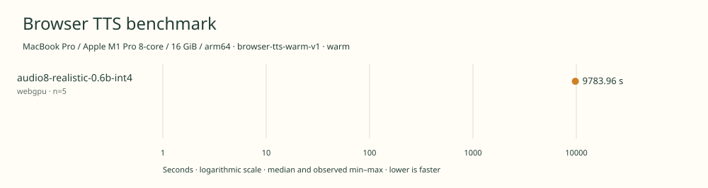

# 2026-11-16t21-11-13-259z-audio8-realistic-0.6b-int4-webgpu-warm-ad53a67c

MacBook Pro / Apple M1 Pro 8-core / 16 GiB / arm64 · Apple M1 Pro · Google Chrome 157.0.8103.40

Protocol: **browser-tts-warm-v1**, scenario **warm**. Native harness run.

First source-chunk request through final CPU-readable PCM; excludes initialization, validation, hashing, WAV encoding and save. Optional articleCallPeakRssBytes spans the entire browser call including post-timer validation/export.

| Model | Requested backend | Status | Median | Min–max | Runs |
|---|---|---|---:|---:|---:|
| audio8-realistic-0.6b-int4 | webgpu | measured | 9783.96 s | 9782.39–9798.06 s | 5 |

Additional metrics (median of available observations; scopes are distinct):

| Model | Backend | Metric | Median | Unit | n |
|---|---|---|---:|---|---:|
| audio8-realistic-0.6b-int4 | webgpu | First completed source chunk | 113932.520 | ms | 5 |
| audio8-realistic-0.6b-int4 | webgpu | First PCM block | 113932.450 | ms | 5 |
| audio8-realistic-0.6b-int4 | webgpu | Generated audio | 1427.749 | s | 5 |
| audio8-realistic-0.6b-int4 | webgpu | Generation / audio duration | 6.853 | ratio | 5 |

Model support (catalog capability, not coverage of this run):

| Model | Supported voices | Bundled voices | Languages | Tested voice |
|---|---:|---:|---|---|
| audio8-realistic-0.6b-int4 | Unknown | 0 | 23 | Reference-free English synthesis |

Realistic 0.6B checkpoint; reference-free synthesis or open-ended zero-shot voices.. No preset voices ship in this configuration. Reference-free English mode is tested. Sources: [1](https://huggingface.co/Edge0/Audio8-TTS-Realistic-Air/blob/1e857568bfd4f02931aca3988ee773a44d2d26d3/README.md), [2](https://huggingface.co/stephvax/audio8-tts-realistic-0.6b-onnx-int4/blob/04313606782af6b9a1aa93724555bc7b64ba9197/provenance.json).

- **audio8-realistic-0.6b-int4 / webgpu**: 1624576 autoregressive dispatches in separate capability probe; WASM-only codec (0 dispatches).

Capability checks run separately before timing. GPU dispatch does not imply GPU-exclusive execution.

Raw WAV is saved locally; opt-in audio publication is separate from timing and automatic result submission.

Campaign 2026-11-16T21-11-12-341Z-f98dc9ae0215; cell 1/1; source 9c7d880199e87a15a3959ae94b632f9d9cdd40da; Mains power attached; pre-run load averages 2.32, 2.16, 1.80; serial M1 order; normal user background apps remain; thermal state not instrumented; Audio8 webgpu warm full article; serial campaign cell; headed pinned Chrome 157.0.8103.40.

Different protocols, fixtures, settings or machines must not be pooled into a speedup ranking. This report does not rate speech quality.
