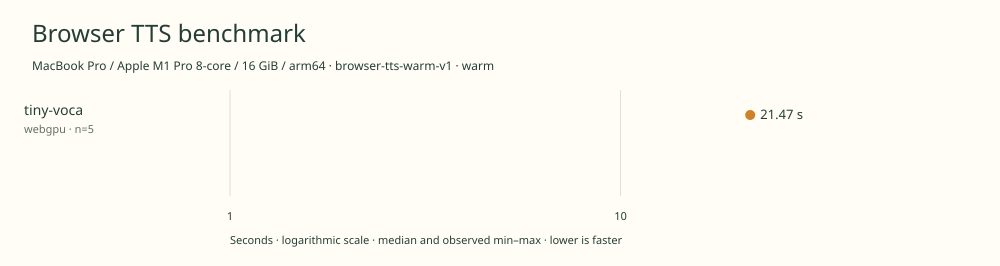

# 2026-11-17t13-36-15-139z-tiny-voca-webgpu-warm-4f28ad8d

MacBook Pro / Apple M1 Pro 8-core / 16 GiB / arm64 · Apple M1 Pro · Google Chrome 157.0.8103.40

Protocol: **browser-tts-warm-v1**, scenario **warm**. Native harness run.

First source-chunk request through final CPU-readable PCM; excludes initialization, validation, hashing, WAV encoding and save. Optional articleCallPeakRssBytes spans the entire browser call including post-timer validation/export.

| Model | Requested backend | Status | Median | Min–max | Runs |
|---|---|---|---:|---:|---:|
| tiny-voca | webgpu | measured | 21.47 s | 21.45–21.49 s | 5 |

Additional metrics (median of available observations; scopes are distinct):

| Model | Backend | Metric | Median | Unit | n |
|---|---|---|---:|---|---:|
| tiny-voca | webgpu | First completed source chunk | 256.140 | ms | 5 |
| tiny-voca | webgpu | First PCM block | 86.070 | ms | 5 |
| tiny-voca | webgpu | Generated audio | 1152.395 | s | 5 |
| tiny-voca | webgpu | Generation / audio duration | 0.019 | ratio | 5 |

Model support (catalog capability, not coverage of this run):

| Model | Supported voices | Bundled voices | Languages | Tested voice |
|---|---:|---:|---|---|
| tiny-voca | 2 | 2 | 1 (en) | F2 (American English) |

Pinned two-voice American English checkpoint. The F2 and M2 voices are embedded in one graph. Only F2 is benchmarked. Sources: [1](https://huggingface.co/n4ze3m/tiny-voca/blob/a46fbe0c8514cb32f5e80be987e6c96ef0540f8d/README.md), [2](https://huggingface.co/n4ze3m/tiny-voca/blob/a46fbe0c8514cb32f5e80be987e6c96ef0540f8d/config.json), [3](https://github.com/n4ze3m/tiny-voca/blob/28e0722c6ad040d74a1f6e63d77621272477a71f/web/public/worker.js).

- **tiny-voca / webgpu**: 2526 compute dispatches in the untimed probe. Dizione runs locally on CPU, with WASM fallback for ONNX operators.

Capability checks run separately before timing. GPU dispatch does not imply GPU-exclusive execution.

Raw WAV is saved locally; opt-in audio publication is separate from timing and automatic result submission.

Campaign 2026-11-17T13-36-14-572Z-fcf02d554091; cell 1/1; source 6ad6b9f4f062c77514e1fc8da4254327b2cf2e59; Mains power attached; pre-run load averages 1.98, 2.62, 2.89; sequential M1 slot order; normal user background apps remain; thermal state not instrumented; cell webgpu warm; headed pinned Google Chrome 157.0.8103.40.

Different protocols, fixtures, settings or machines must not be pooled into a speedup ranking. This report does not rate speech quality.
