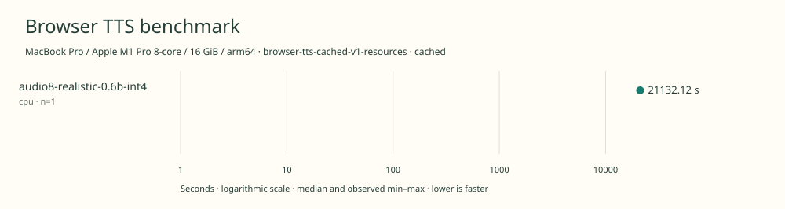

# 2026-11-17t21-08-29-351z-audio8-realistic-0.6b-int4-cpu-cached-026c8c6a

MacBook Pro / Apple M1 Pro 8-core / 16 GiB / arm64 · Apple M1 Pro · Google Chrome 157.0.8103.40

Protocol: **browser-tts-cached-v1-resources**, scenario **cached**. Native harness run.

First source-chunk request through final CPU-readable PCM; excludes initialization, validation, hashing, WAV encoding and save. Optional articleCallPeakRssBytes spans the entire browser call including post-timer validation/export. Generation RSS uses timestamped samples inside browser generation start/end boundaries; it includes the owned Chrome process tree and browser baseline.

| Model | Requested backend | Status | Median | Min–max | Runs |
|---|---|---|---:|---:|---:|
| audio8-realistic-0.6b-int4 | cpu | measured | 21132.12 s | 21132.12–21132.12 s | 1 |

Additional metrics (median of available observations; scopes are distinct):

| Model | Backend | Metric | Median | Unit | n |
|---|---|---|---:|---|---:|
| audio8-realistic-0.6b-int4 | cpu | First completed source chunk | 251702.270 | ms | 1 |
| audio8-realistic-0.6b-int4 | cpu | First PCM block | 251702.160 | ms | 1 |
| audio8-realistic-0.6b-int4 | cpu | Generated audio | 1429.049 | s | 1 |
| audio8-realistic-0.6b-int4 | cpu | Generation / audio duration | 14.788 | ratio | 1 |
| audio8-realistic-0.6b-int4 | cpu | Model initialization | 4369.810 | ms | 1 |
| audio8-realistic-0.6b-int4 | cpu | Complete controller trial including setup/export | 21145374.268 | ms | 1 |
| audio8-realistic-0.6b-int4 | cpu | Transferred HTTP body data | 38404 | bytes | 1 |
| audio8-realistic-0.6b-int4 | cpu | Ideal body transfer at 1 Mbps | 0.307 | s | 1 |
| audio8-realistic-0.6b-int4 | cpu | Whole-call Chrome process-tree peak RSS | 4335206400 | bytes | 1 |
| audio8-realistic-0.6b-int4 | cpu | Per-trial mean generation Chrome process-tree RSS | 3062813394 | bytes | 1 |
| audio8-realistic-0.6b-int4 | cpu | In-window Chrome RSS observations | 42113.000 | samples | 1 |

Model support (catalog capability, not coverage of this run):

| Model | Supported voices | Bundled voices | Languages | Tested voice |
|---|---:|---:|---|---|
| audio8-realistic-0.6b-int4 | Unknown | 0 | 23 | Reference-free English synthesis |

Realistic 0.6B checkpoint; reference-free synthesis or open-ended zero-shot voices.. No preset voices ship in this configuration. Reference-free English mode is tested. Sources: [1](https://huggingface.co/Edge0/Audio8-TTS-Realistic-Air/blob/1e857568bfd4f02931aca3988ee773a44d2d26d3/README.md), [2](https://huggingface.co/stephvax/audio8-tts-realistic-0.6b-onnx-int4/blob/04313606782af6b9a1aa93724555bc7b64ba9197/provenance.json).

- **audio8-realistic-0.6b-int4 / cpu**: Six-thread WebAssembly.

Capability checks run separately before timing. GPU dispatch does not imply GPU-exclusive execution.

Raw WAV is saved locally; opt-in audio publication is separate from timing and automatic result submission.

Campaign 2026-11-17T21-08-28-397Z-7dde8d0f16f3; cell 1/1; source 9c7d880199e87a15a3959ae94b632f9d9cdd40da; Mains power attached; pre-run load averages 3.12, 2.02, 1.76; serial M1 order; normal user background apps remain; thermal state not instrumented; Audio8 cpu cached full article; serial campaign cell; headed pinned Chrome 157.0.8103.40.

RSS is sampled every 500 ms across the owned Chrome process tree, including the Chrome baseline and inference workers. Whole-call peak spans post-timer validation/export; generation mean uses only in-window samples from browser generation start through final CPU-readable PCM.

Different protocols, fixtures, settings or machines must not be pooled into a speedup ranking. This report does not rate speech quality.
