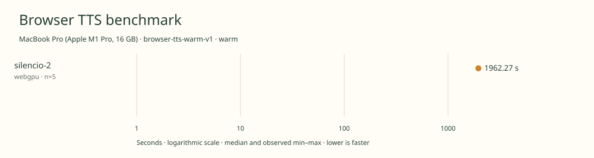

# 2026-11-18t04-11-04-421z-silencio-2-webgpu-warm-a22e3d55

MacBook Pro (Apple M1 Pro, 16 GB) · Apple M1 Pro · Google Chrome 157.0.8103.40

Protocol: **browser-tts-warm-v1**, scenario **warm**. Native harness run.

First source-chunk request through final CPU-readable PCM; excludes initialization, validation, hashing, WAV encoding and save. Optional articleCallPeakRssBytes spans the entire browser call including post-timer validation/export.

| Model | Requested backend | Status | Median | Min–max | Runs |
|---|---|---|---:|---:|---:|
| silencio-2 | webgpu | measured | 1962.27 s | 1957.79–1962.85 s | 5 |

Additional metrics (median of available observations; scopes are distinct):

| Model | Backend | Metric | Median | Unit | n |
|---|---|---|---:|---|---:|
| silencio-2 | webgpu | First completed source chunk | 20638.210 | ms | 5 |
| silencio-2 | webgpu | First PCM block | 201.195 | ms | 5 |
| silencio-2 | webgpu | Generated audio | 1207.680 | s | 5 |
| silencio-2 | webgpu | Generation / audio duration | 1.625 | ratio | 5 |

Model support (catalog capability, not coverage of this run):

| Model | Supported voices | Bundled voices | Languages | Tested voice |
|---|---:|---:|---|---|
| silencio-2 | 8 | 1 | 1 (en) | 260 |

Pinned BlueRoseLabs/Silencio-2 checkpoint and its eight bundled voice catalog entries; this benchmark exposes only synthetic voice 260.. English only. The browser configuration uses voice 260, carries its model-bound state, and does not expose custom voice cloning or the other seven catalog entries. CPU/WASM and WebGPU run FP32 ONNX graphs with one WASM thread; WebGPU allows WASM operator fallback and must prove actual GPU dispatch. Seeded browser noise is disclosed and is not bitwise PyTorch RNG parity. Sources: [1](https://huggingface.co/BlueRoseLabs/Silencio-2/blob/20930f5f6a6bb564f2a8207152fd5c5d8eecff03/README.md), [2](https://huggingface.co/BlueRoseLabs/Silencio-2/tree/20930f5f6a6bb564f2a8207152fd5c5d8eecff03), [3](https://erogol.com/small_tts_bench/).

- **silencio-2 / webgpu**: Observed 306177 actual WebGPU compute dispatches during separate untimed synthesis. WebGPU with WASM operator fallback; CPU-readable PCM. Hooks removed before scored generation.

Capability checks run separately before timing. GPU dispatch does not imply GPU-exclusive execution.

Raw WAV is saved locally; opt-in audio publication is separate from timing and automatic result submission.

Campaign 2026-11-18T03-09-54-940Z-24399c495e1e; cell 2/4; source 0d5dd8e407191485dcb34565e7f42baa961f5f3f; requested n=5; effective n=5; MacBook Pro (MacBookPro18,3, Apple M1 Pro, 8 CPU cores: 6 performance and 2 efficiency, 16 GB RAM), macOS 26.6.2 arm64, headed Google Chrome 157.0.8103.40, AC attached. One excluded full-article warm-up per warm backend; sequential CPU warm, WebGPU warm, then CPU and WebGPU cached full-article RSS diagnostics. Canonical english-20k-v1 fixture; each cell runs alone through the shared M1 publication slot. Background load and thermal/power state are recorded with the native receipts.

Different protocols, fixtures, settings or machines must not be pooled into a speedup ranking. This report does not rate speech quality.
