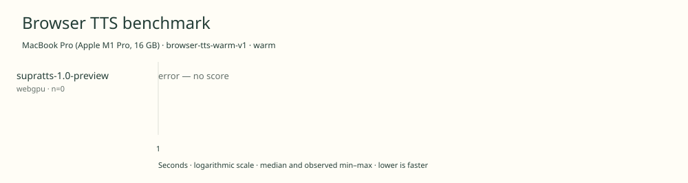

# 2026-11-18t07-33-33-066z-supratts-1.0-preview-webgpu-warm-dbe1775e

MacBook Pro (Apple M1 Pro, 16 GB) · Apple M1 Pro · Google Chrome 157.0.8103.40

Protocol: **browser-tts-warm-v1**, scenario **warm**. Native harness run.

First source-chunk request through final CPU-readable PCM; excludes initialization, validation, hashing, WAV encoding and save. Optional articleCallPeakRssBytes spans the entire browser call including post-timer validation/export.

| Model | Requested backend | Status | Median | Min–max | Runs |
|---|---|---|---:|---:|---:|
| supratts-1.0-preview | webgpu | error | — | — | 0 |

Model support (catalog capability, not coverage of this run):

| Model | Supported voices | Bundled voices | Languages | Tested voice |
|---|---:|---:|---|---|
| supratts-1.0-preview | 1 | 1 | 1 (en) | unknown |

Pinned English preview checkpoint; one fixed voice. English-only, fixed single voice; upstream ships no streaming API. The browser port runs the pinned official dictionary-first G2P and NumPy OOV fallback in Pyodide, plus four FP32 ONNX graphs exported from the official MIT checkpoint. Zero noise, 24 kHz mono, shipped 100-band mel tilt and centered Hann iSTFT/DC filter match the official synthesis path. CPU uses one-thread ONNX Runtime Web WASM. WebGPU runs neural operators on an explicitly requested hardware adapter with WASM fallback; frontend and waveform reconstruction remain on CPU. The separate GPU capability probe requires observed compute dispatches before the backend is measured. Sources: [1](https://erogol.com/small_tts_bench/), [2](https://huggingface.co/SupraLabs/SupraTTS-1.0-Preview/blob/80a6b0bd13c92e30e88b0c22183be9c2bdc7061c/README.md), [3](https://huggingface.co/SupraLabs/SupraTTS-1.0-Preview/blob/80a6b0bd13c92e30e88b0c22183be9c2bdc7061c/config.json), [4](https://huggingface.co/SupraLabs/SupraTTS-1.0-Preview/blob/80a6b0bd13c92e30e88b0c22183be9c2bdc7061c/microtts/synthesize.py), [5](https://github.com/ngelik/tts-bench/tree/829ebd388cdc976afd43bec7cff6b9b38f5fc9f6/tools/export-supratts-onnx.py), [6](https://github.com/ngelik/tts-bench/releases/tag/supratts-onnx-v1).

- **supratts-1.0-preview / webgpu**: Capability probe has not completed. page.evaluate: Error: Error: another WebGPU EP inference session is being created.     at f.webgpuRegisterDevice (http://127.0.0.1:51673/runtimes/onnxruntime-web/1.23.2/ort-wasm-simd-threaded.asyncify.mjs:128:111)     at dn (http://127.0.0.1:51673/runtimes/onnxruntime-web/1.23.2/ort.webgpu.min.mjs:6:28534)     at hr (http://127.0.0.1:51673/runtimes/onnxruntime-web/1.23.2/ort.webgpu.min.mjs:6:29778)     at Ce (http://127.0.0.1:51673/runtimes/onnxruntime-web/1.23.2/ort.webgpu.min.mjs:6:50646)     at Rr (http://127.0.0.1:51673/runtimes/onnxruntime-web/1.23.2/ort.webgpu.min.mjs:6:62060)     at Xe.loadModel (http://127.0.0.1:51673/runtimes/onnxruntime-web/1.23.2/ort.webgpu.min.mjs:6:63955)     at Ze.createInferenceSessionHandler (http://127.0.0.1:51673/runtimes/onnxruntime-web/1.23.2/ort.webgpu.min.mjs:6:65666)     at t.create (http://127.0.0.1:51673/runtimes/onnxruntime-web/1.23.2/ort.webgpu.min.mjs:6:19844)     at async Promise.all (index 1)     at async loadOrt (http://127.0.0.1:51673/web/workers/supratts.mjs:353:14)     at f.webgpuRegisterDevice (http://127.0.0.1:51673/runtimes/onnxruntime-web/1.23.2/ort-wasm-simd-threaded.asyncify.mjs:128:111)     at dn (http://127.0.0.1:51673/runtimes/onnxruntime-web/1.23.2/ort.webgpu.min.mjs:6:28534)     at hr (http://127.0.0.1:51673/runtimes/onnxruntime-web/1.23.2/ort.webgpu.min.mjs:6:29778)     at Ce (http://127.0.0.1:51673/runtimes/onnxruntime-web/1.23.2/ort.webgpu.min.mjs:6:50646)     at Rr (http://127.0.0.1:51673/runtimes/onnxruntime-web/1.23.2/ort.webgpu.min.mjs:6:62060)     at Xe.loadModel (http://127.0.0.1:51673/runtimes/onnxruntime-web/1.23.2/ort.webgpu.min.mjs:6:63955)     at Ze.createInferenceSessionHandler (http://127.0.0.1:51673/runtimes/onnxruntime-web/1.23.2/ort.webgpu.min.mjs:6:65666)     at t.create (http://127.0.0.1:

Capability checks run separately before timing. GPU dispatch does not imply GPU-exclusive execution.

Raw WAV is saved locally; opt-in audio publication is separate from timing and automatic result submission.

Campaign 2026-11-18T07-30-36-110Z-2ba5316cff6e; cell 3/4; source 60565a58e6c3240c14a21b462c5f8fd9435ba924; requested n=5; effective n=5; Clean merged source; full english-20k-v1 fixture; one excluded warm-up plus five scored trials for warm cells; one cached full-article generation with 500 ms Chrome process-tree RSS sampling for resource cells; CPU uses one-thread WASM; WebGPU requires hardware adapter and observed dispatch; no cold runs.

Different protocols, fixtures, settings or machines must not be pooled into a speedup ranking. This report does not rate speech quality.
