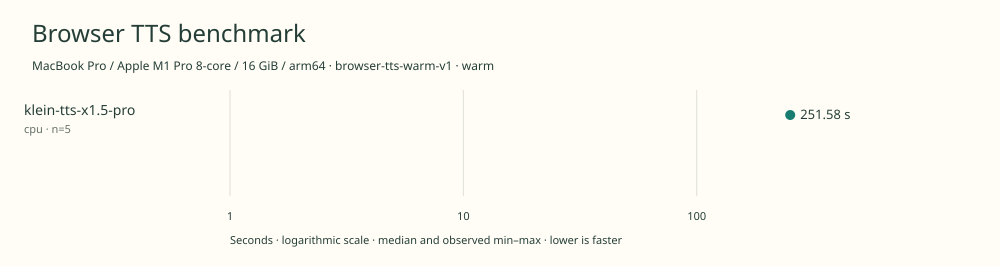

# 2026-11-18t07-33-51-166z-klein-tts-x1.5-pro-cpu-warm-95c8a5c3

MacBook Pro / Apple M1 Pro 8-core / 16 GiB / arm64 · Apple M1 Pro · Google Chrome 157.0.8103.40

Protocol: **browser-tts-warm-v1**, scenario **warm**. Native harness run.

First source-chunk request through final CPU-readable PCM; excludes initialization, validation, hashing, WAV encoding and save. Optional articleCallPeakRssBytes spans the entire browser call including post-timer validation/export.

| Model | Requested backend | Status | Median | Min–max | Runs |
|---|---|---|---:|---:|---:|
| klein-tts-x1.5-pro | cpu | measured | 251.58 s | 251.47–252.12 s | 5 |

Additional metrics (median of available observations; scopes are distinct):

| Model | Backend | Metric | Median | Unit | n |
|---|---|---|---:|---|---:|
| klein-tts-x1.5-pro | cpu | First completed source chunk | 2863.950 | ms | 5 |
| klein-tts-x1.5-pro | cpu | First PCM block | 2863.950 | ms | 5 |
| klein-tts-x1.5-pro | cpu | Generated audio | 1258.600 | s | 5 |
| klein-tts-x1.5-pro | cpu | Generation / audio duration | 0.200 | ratio | 5 |

Model support (catalog capability, not coverage of this run):

| Model | Supported voices | Bundled voices | Languages | Tested voice |
|---|---:|---:|---|---|
| klein-tts-x1.5-pro | 17 | 17 | 4 (en, es, fr, it) | Sarah (af_heart) |

Pinned Klein-TTS X1.5 Pro ONNX checkpoint. 17 speaker embeddings and four language prefixes in the pinned model.json. The benchmark uses Sarah \(af\_heart\) in English; no other voice or language is exercised. Sources: [1](https://huggingface.co/klein-ml/Klein-TTS-X1.5-Pro/blob/25e0e73bebba71e5985bc369628ebdcb81bf7116/README.md), [2](https://huggingface.co/klein-ml/Klein-TTS-X1.5-Pro/blob/25e0e73bebba71e5985bc369628ebdcb81bf7116/onnx/model.json).

- **klein-tts-x1.5-pro / cpu**: Explicit one-thread WASM inference; browser eSpeak G2P is CPU work.

Capability checks run separately before timing. GPU dispatch does not imply GPU-exclusive execution.

Raw WAV is saved locally; opt-in audio publication is separate from timing and automatic result submission.

Campaign 2026-11-18T07-33-50-628Z-3af21c8aa442; cell 1/4; source ba9785f716cf24724e9a9c0a398abdb56efd5e2c; requested n=5; effective n=5; Apple M1 Pro, 16 GiB RAM, macOS 26.6.2, Google Chrome 157.0.8103.40, on AC power. Sequential CPU then WebGPU order; cached RSS diagnostics follow warm timings.

Different protocols, fixtures, settings or machines must not be pooled into a speedup ranking. This report does not rate speech quality.
