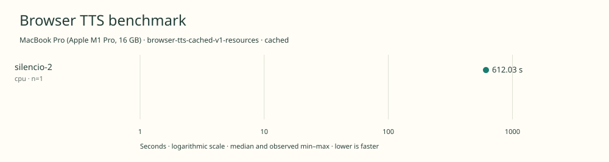

# 2026-11-18t08-02-54-453z-silencio-2-cpu-cached-ef3f099f

MacBook Pro (Apple M1 Pro, 16 GB) · Apple M1 Pro · Google Chrome 157.0.8103.40

Protocol: **browser-tts-cached-v1-resources**, scenario **cached**. Native harness run.

First source-chunk request through final CPU-readable PCM; excludes initialization, validation, hashing, WAV encoding and save. Optional articleCallPeakRssBytes spans the entire browser call including post-timer validation/export. Generation RSS uses timestamped samples inside browser generation start/end boundaries; it includes the owned Chrome process tree and browser baseline.

| Model | Requested backend | Status | Median | Min–max | Runs |
|---|---|---|---:|---:|---:|
| silencio-2 | cpu | measured | 612.03 s | 612.03–612.03 s | 1 |

Additional metrics (median of available observations; scopes are distinct):

| Model | Backend | Metric | Median | Unit | n |
|---|---|---|---:|---|---:|
| silencio-2 | cpu | First completed source chunk | 6225.195 | ms | 1 |
| silencio-2 | cpu | First PCM block | 91.390 | ms | 1 |
| silencio-2 | cpu | Generated audio | 1204.960 | s | 1 |
| silencio-2 | cpu | Generation / audio duration | 0.508 | ratio | 1 |
| silencio-2 | cpu | Model initialization | 2276.338 | ms | 1 |
| silencio-2 | cpu | Complete controller trial including setup/export | 618049.234 | ms | 1 |
| silencio-2 | cpu | Transferred HTTP body data | 38404 | bytes | 1 |
| silencio-2 | cpu | Ideal body transfer at 1 Mbps | 0.307 | s | 1 |
| silencio-2 | cpu | Whole-call Chrome process-tree peak RSS | 2044510208 | bytes | 1 |
| silencio-2 | cpu | Per-trial mean generation Chrome process-tree RSS | 1601694894 | bytes | 1 |
| silencio-2 | cpu | In-window Chrome RSS observations | 1219.000 | samples | 1 |

Model support (catalog capability, not coverage of this run):

| Model | Supported voices | Bundled voices | Languages | Tested voice |
|---|---:|---:|---|---|
| silencio-2 | 8 | 1 | 1 (en) | 260 |

Pinned BlueRoseLabs/Silencio-2 checkpoint and its eight bundled voice catalog entries; this benchmark exposes only synthetic voice 260.. English only. The browser configuration uses voice 260, carries its model-bound state, and does not expose custom voice cloning or the other seven catalog entries. CPU/WASM and WebGPU run FP32 ONNX graphs with one WASM thread; WebGPU allows WASM operator fallback and must prove actual GPU dispatch. Seeded browser noise is disclosed and is not bitwise PyTorch RNG parity. Sources: [1](https://huggingface.co/BlueRoseLabs/Silencio-2/blob/20930f5f6a6bb564f2a8207152fd5c5d8eecff03/README.md), [2](https://huggingface.co/BlueRoseLabs/Silencio-2/tree/20930f5f6a6bb564f2a8207152fd5c5d8eecff03), [3](https://erogol.com/small_tts_bench/).

- **silencio-2 / cpu**: Explicit single-thread ONNX Runtime Web WASM provider; text preprocessing runs in the worker.

Capability checks run separately before timing. GPU dispatch does not imply GPU-exclusive execution.

Raw WAV is saved locally; opt-in audio publication is separate from timing and automatic result submission.

Campaign 2026-11-18T08-02-53-405Z-20bba4b8bbdd; cell 1/1; source 0d5dd8e407191485dcb34565e7f42baa961f5f3f; requested n=1; effective n=1; MacBook Pro (MacBookPro18,3, Apple M1 Pro, 8 CPU cores: 6 performance and 2 efficiency, 16 GB RAM), macOS 26.6.2 arm64, headed Google Chrome 157.0.8103.40, AC attached. One full-article cached CPU resource/RSS cell, run alone through the shared M1 publication slot after the sequential CPU and WebGPU warm cells recorded in runs/campaign-2026-11-18T03-09-54-940Z-24399c495e1e. Canonical english-20k-v1 fixture. Background load and thermal/power state are recorded with native receipts.

RSS is sampled every 500 ms across the owned Chrome process tree, including the Chrome baseline and inference workers. Whole-call peak spans post-timer validation/export; generation mean uses only in-window samples from browser generation start through final CPU-readable PCM.

Different protocols, fixtures, settings or machines must not be pooled into a speedup ranking. This report does not rate speech quality.
