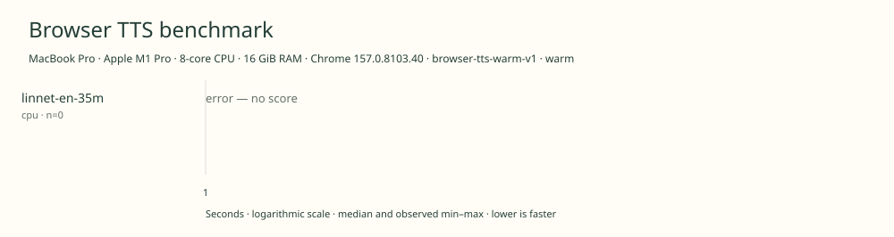

# 2026-11-18t08-13-25-604z-linnet-en-35m-cpu-warm-3b452224

MacBook Pro · Apple M1 Pro · 8-core CPU · 16 GiB RAM · Chrome 157.0.8103.40 · Apple M1 Pro · Google Chrome 157.0.8103.40

Protocol: **browser-tts-warm-v1**, scenario **warm**. Native harness run.

First source-chunk request through final CPU-readable PCM; excludes initialization, validation, hashing, WAV encoding and save. Optional articleCallPeakRssBytes spans the entire browser call including post-timer validation/export.

| Model | Requested backend | Status | Median | Min–max | Runs |
|---|---|---|---:|---:|---:|
| linnet-en-35m | cpu | error | — | — | 0 |

Model support (catalog capability, not coverage of this run):

| Model | Supported voices | Bundled voices | Languages | Tested voice |
|---|---:|---:|---|---|
| linnet-en-35m | 2 | 1 | 1 (en) | unknown |

Pinned Linnet en-35m checkpoint with the built-in f1 voice staged for browser inference. The checkpoint supports two built-in American English voices; only linnet-en-f1 is staged and benchmarked. Voice cloning is outside the included terms. Sources: [1](https://huggingface.co/VoxRT/linnet-en-35m/blob/a75fdfe50bc3d3e776b9c5040f149f49a054aaf5/README.md), [2](https://github.com/VoxRT/LinnetTTS/tree/f3d3f68cbd8b7d07380d11c82bf75af06bc41281), [3](https://www.voxrt.com/text-to-speech).

- **linnet-en-35m / cpu**: Capability probe has not completed. page.evaluate: Error: Failed to fetch Linnet asset linnet-en-35m.fp16.safetensors: Failed to execute 'put' on 'Cache': Cache.put() encountered a network error     at worker.onmessage (http://127.0.0.1:52998/web/adapters/rpc-bridge.mjs:43:25)

Capability checks run separately before timing. GPU dispatch does not imply GPU-exclusive execution.

Raw WAV is saved locally; opt-in audio publication is separate from timing and automatic result submission.

Campaign 2026-11-18T08-13-25-043Z-3031e2aa81fe; cell 1/1; source 1866106d8dc126273b4405d664e006a644c83516; requested n=5; effective n=5; LINNET en-35m on the baseline MacBook Pro with Apple M1 Pro, 8 CPU cores and 16 GiB RAM, using headed Google Chrome 157.0.8103.40 in disposable profiles. CPU uses the official CPU/WASM path; WebGPU uses the reviewed hybrid runtime and must prove actual GPU dispatch. Acquire and release the shared M1 slot separately for each complete cell, in order: CPU warm, WebGPU warm, CPU cached, WebGPU cached; preserve unsupported status if actual WebGPU dispatch is unavailable and do not substitute CPU. Warm timing uses one excluded full-article warm-up and five scored full articles. Cached RSS is a separate one-article process-tree diagnostic. Record actual pre-run power/load; thermals are uninstrumented.

Different protocols, fixtures, settings or machines must not be pooled into a speedup ranking. This report does not rate speech quality.
