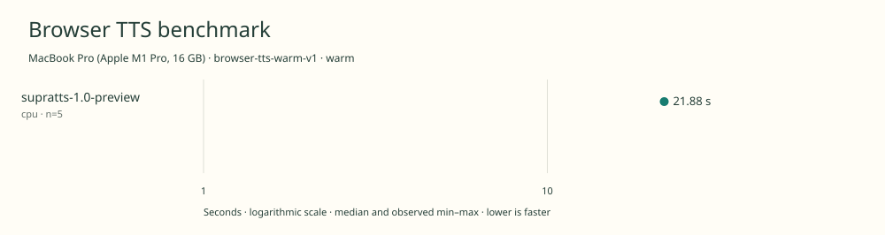

# 2026-11-18t08-13-28-317z-supratts-1.0-preview-cpu-warm-9a02ca76

MacBook Pro (Apple M1 Pro, 16 GB) · Apple M1 Pro · Google Chrome 157.0.8103.40

Protocol: **browser-tts-warm-v1**, scenario **warm**. Native harness run.

First source-chunk request through final CPU-readable PCM; excludes initialization, validation, hashing, WAV encoding and save. Optional articleCallPeakRssBytes spans the entire browser call including post-timer validation/export.

| Model | Requested backend | Status | Median | Min–max | Runs |
|---|---|---|---:|---:|---:|
| supratts-1.0-preview | cpu | measured | 21.88 s | 21.81–21.92 s | 5 |

Additional metrics (median of available observations; scopes are distinct):

| Model | Backend | Metric | Median | Unit | n |
|---|---|---|---:|---|---:|
| supratts-1.0-preview | cpu | First completed source chunk | 291.920 | ms | 5 |
| supratts-1.0-preview | cpu | First PCM block | 121.510 | ms | 5 |
| supratts-1.0-preview | cpu | Generated audio | 1284.148 | s | 5 |
| supratts-1.0-preview | cpu | Generation / audio duration | 0.017 | ratio | 5 |

Model support (catalog capability, not coverage of this run):

| Model | Supported voices | Bundled voices | Languages | Tested voice |
|---|---:|---:|---|---|
| supratts-1.0-preview | 1 | 1 | 1 (en) | fixed single voice |

Pinned English preview checkpoint; one fixed voice. English-only, fixed single voice; upstream ships no streaming API. The browser port runs the pinned official dictionary-first G2P and NumPy OOV fallback in Pyodide, plus four FP32 ONNX graphs exported from the official MIT checkpoint. Zero noise, 24 kHz mono, shipped 100-band mel tilt and centered Hann iSTFT/DC filter match the official synthesis path. CPU uses one-thread ONNX Runtime Web WASM. WebGPU runs neural operators on an explicitly requested hardware adapter with WASM fallback; frontend and waveform reconstruction remain on CPU. The separate GPU capability probe requires observed compute dispatches before the backend is measured. Sources: [1](https://erogol.com/small_tts_bench/), [2](https://huggingface.co/SupraLabs/SupraTTS-1.0-Preview/blob/80a6b0bd13c92e30e88b0c22183be9c2bdc7061c/README.md), [3](https://huggingface.co/SupraLabs/SupraTTS-1.0-Preview/blob/80a6b0bd13c92e30e88b0c22183be9c2bdc7061c/config.json), [4](https://huggingface.co/SupraLabs/SupraTTS-1.0-Preview/blob/80a6b0bd13c92e30e88b0c22183be9c2bdc7061c/microtts/synthesize.py), [5](https://github.com/ngelik/tts-bench/tree/829ebd388cdc976afd43bec7cff6b9b38f5fc9f6/tools/export-supratts-onnx.py), [6](https://github.com/ngelik/tts-bench/releases/tag/supratts-onnx-v1).

- **supratts-1.0-preview / cpu**: Explicit one-thread ONNX Runtime Web WASM; the official Python/NumPy G2P and signal reconstruction run in the same Chrome worker.

Capability checks run separately before timing. GPU dispatch does not imply GPU-exclusive execution.

Raw WAV is saved locally; opt-in audio publication is separate from timing and automatic result submission.

Campaign 2026-11-18T08-13-27-118Z-d9221f3115b9; cell 1/1; source ef1163d7a243fe0d82b4c0ecccb5de113d58a9a1; requested n=5; effective n=5; Retest after serialized ONNX Runtime session creation; clean public source; full english-20k-v1 fixture; warm cells use one excluded full-article warm-up plus five scored trials; cached resource cells use one full-article generation with 500 ms Chrome process-tree RSS sampling; CPU is one-thread WASM; WebGPU requires hardware adapter and observed dispatch; no cold runs; each cell acquires and releases the shared M1 slot independently.

Different protocols, fixtures, settings or machines must not be pooled into a speedup ranking. This report does not rate speech quality.
