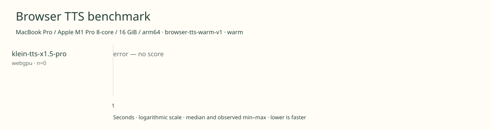

# 2026-11-18t08-16-32-717z-klein-tts-x1.5-pro-webgpu-warm-94682c35

MacBook Pro / Apple M1 Pro 8-core / 16 GiB / arm64 · Apple M1 Pro · Google Chrome 157.0.8103.40

Protocol: **browser-tts-warm-v1**, scenario **warm**. Native harness run.

First source-chunk request through final CPU-readable PCM; excludes initialization, validation, hashing, WAV encoding and save. Optional articleCallPeakRssBytes spans the entire browser call including post-timer validation/export.

| Model | Requested backend | Status | Median | Min–max | Runs |
|---|---|---|---:|---:|---:|
| klein-tts-x1.5-pro | webgpu | error | — | — | 0 |

Model support (catalog capability, not coverage of this run):

| Model | Supported voices | Bundled voices | Languages | Tested voice |
|---|---:|---:|---|---|
| klein-tts-x1.5-pro | 17 | 17 | 4 (en, es, fr, it) | unknown |

Pinned Klein-TTS X1.5 Pro ONNX checkpoint. 17 speaker embeddings and four language prefixes in the pinned model.json. The benchmark uses Sarah \(af\_heart\) in English; no other voice or language is exercised. Sources: [1](https://huggingface.co/klein-ml/Klein-TTS-X1.5-Pro/blob/25e0e73bebba71e5985bc369628ebdcb81bf7116/README.md), [2](https://huggingface.co/klein-ml/Klein-TTS-X1.5-Pro/blob/25e0e73bebba71e5985bc369628ebdcb81bf7116/onnx/model.json).

- **klein-tts-x1.5-pro / webgpu**: Capability probe has not completed. page.evaluate: Error: Error: another WebGPU EP inference session is being created.     at f.webgpuRegisterDevice (http://127.0.0.1:53123/runtimes/onnxruntime-web/1.23.2/ort-wasm-simd-threaded.asyncify.mjs:128:111)     at dn (http://127.0.0.1:53123/runtimes/onnxruntime-web/1.23.2/ort.webgpu.min.mjs:6:28534)     at hr (http://127.0.0.1:53123/runtimes/onnxruntime-web/1.23.2/ort.webgpu.min.mjs:6:29778)     at Ce (http://127.0.0.1:53123/runtimes/onnxruntime-web/1.23.2/ort.webgpu.min.mjs:6:50646)     at Rr (http://127.0.0.1:53123/runtimes/onnxruntime-web/1.23.2/ort.webgpu.min.mjs:6:62060)     at Xe.loadModel (http://127.0.0.1:53123/runtimes/onnxruntime-web/1.23.2/ort.webgpu.min.mjs:6:63955)     at Ze.createInferenceSessionHandler (http://127.0.0.1:53123/runtimes/onnxruntime-web/1.23.2/ort.webgpu.min.mjs:6:65666)     at t.create (http://127.0.0.1:53123/runtimes/onnxruntime-web/1.23.2/ort.webgpu.min.mjs:6:19844)     at async Promise.all (index 1)     at async loadJsonAndGraphs (http://127.0.0.1:53123/web/workers/klein.mjs:125:24)     at f.webgpuRegisterDevice (http://127.0.0.1:53123/runtimes/onnxruntime-web/1.23.2/ort-wasm-simd-threaded.asyncify.mjs:128:111)     at dn (http://127.0.0.1:53123/runtimes/onnxruntime-web/1.23.2/ort.webgpu.min.mjs:6:28534)     at hr (http://127.0.0.1:53123/runtimes/onnxruntime-web/1.23.2/ort.webgpu.min.mjs:6:29778)     at Ce (http://127.0.0.1:53123/runtimes/onnxruntime-web/1.23.2/ort.webgpu.min.mjs:6:50646)     at Rr (http://127.0.0.1:53123/runtimes/onnxruntime-web/1.23.2/ort.webgpu.min.mjs:6:62060)     at Xe.loadModel (http://127.0.0.1:53123/runtimes/onnxruntime-web/1.23.2/ort.webgpu.min.mjs:6:63955)     at Ze.createInferenceSessionHandler (http://127.0.0.1:53123/runtimes/onnxruntime-web/1.23.2/ort.webgpu.min.mjs:6:65666)     at t.create (http://127

Capability checks run separately before timing. GPU dispatch does not imply GPU-exclusive execution.

Raw WAV is saved locally; opt-in audio publication is separate from timing and automatic result submission.

Campaign 2026-11-18T08-16-32-161Z-8217d67c891a; cell 1/1; source ba9785f716cf24724e9a9c0a398abdb56efd5e2c; requested n=5; effective n=5; Apple M1 Pro, 16 GiB RAM, macOS 26.6.2, Google Chrome 157.0.8103.40, on AC power. This is the WebGPU warm cell after the CPU warm cell. Brief unrelated disk-cache cleanup overlapped CPU warm trial 1 at about 07:40 UTC; an exact-duplicate historical GGUF file was removed at about 07:42 UTC near the trial-1/trial-2 boundary. The cleanup effect on timing or resources was not measured and no impact estimate is made. Warm CPU then warm WebGPU; cached RSS diagnostics follow.

Different protocols, fixtures, settings or machines must not be pooled into a speedup ranking. This report does not rate speech quality.
