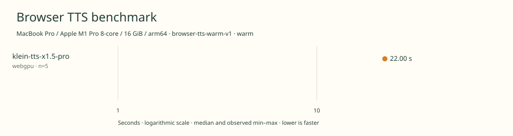

# 2026-11-18t10-25-17-102z-klein-tts-x1.5-pro-webgpu-warm-47eae0fb

MacBook Pro / Apple M1 Pro 8-core / 16 GiB / arm64 · Apple M1 Pro · Google Chrome 157.0.8103.40

Protocol: **browser-tts-warm-v1**, scenario **warm**. Native harness run.

First source-chunk request through final CPU-readable PCM; excludes initialization, validation, hashing, WAV encoding and save. Optional articleCallPeakRssBytes spans the entire browser call including post-timer validation/export.

| Model | Requested backend | Status | Median | Min–max | Runs |
|---|---|---|---:|---:|---:|
| klein-tts-x1.5-pro | webgpu | measured | 22.00 s | 21.99–22.11 s | 5 |

Additional metrics (median of available observations; scopes are distinct):

| Model | Backend | Metric | Median | Unit | n |
|---|---|---|---:|---|---:|
| klein-tts-x1.5-pro | webgpu | First completed source chunk | 271.200 | ms | 5 |
| klein-tts-x1.5-pro | webgpu | First PCM block | 271.195 | ms | 5 |
| klein-tts-x1.5-pro | webgpu | Generated audio | 1258.600 | s | 5 |
| klein-tts-x1.5-pro | webgpu | Generation / audio duration | 0.017 | ratio | 5 |

Model support (catalog capability, not coverage of this run):

| Model | Supported voices | Bundled voices | Languages | Tested voice |
|---|---:|---:|---|---|
| klein-tts-x1.5-pro | 17 | 17 | 4 (en, es, fr, it) | Sarah (af_heart) |

Pinned Klein-TTS X1.5 Pro ONNX checkpoint. 17 speaker embeddings and four language prefixes in the pinned model.json. The benchmark uses Sarah \(af\_heart\) in English; no other voice or language is exercised. Sources: [1](https://huggingface.co/klein-ml/Klein-TTS-X1.5-Pro/blob/25e0e73bebba71e5985bc369628ebdcb81bf7116/README.md), [2](https://huggingface.co/klein-ml/Klein-TTS-X1.5-Pro/blob/25e0e73bebba71e5985bc369628ebdcb81bf7116/onnx/model.json).

- **klein-tts-x1.5-pro / webgpu**: Non-fallback hardware adapter apple; observed 1343 compute dispatches in a separate untimed probe. WebGPU with possible WASM operator fallback; eSpeak preprocessing and CPU-readable PCM readback are CPU work.

Capability checks run separately before timing. GPU dispatch does not imply GPU-exclusive execution.

Raw WAV is saved locally; opt-in audio publication is separate from timing and automatic result submission.

Campaign 2026-11-18T10-25-16-509Z-065c7eed3ff1; cell 1/1; source 1bf5187012bad86ab324679b05dfc0a712896f80; requested n=5; effective n=5; Apple M1 Pro, 16 GiB RAM, macOS 26.6.2, Google Chrome 157.0.8103.40, on AC power. First clean-source WebGPU warm cell after the Klein sequential session-init fix. Earlier CPU warm result on source ba9785f overlapped brief unrelated disk-cache maintenance at about 07:40 UTC and an exact-duplicate historical GGUF removal at approximately 07:42 UTC near its trial-1/trial-2 boundary; impact on those earlier measurements was not measured and no estimate is made. No cleanup overlaps this cell.

Different protocols, fixtures, settings or machines must not be pooled into a speedup ranking. This report does not rate speech quality.
