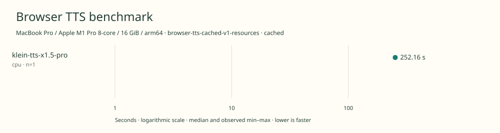

# 2026-11-18t11-54-42-795z-klein-tts-x1.5-pro-cpu-cached-289eb3eb

MacBook Pro / Apple M1 Pro 8-core / 16 GiB / arm64 · Apple M1 Pro · Google Chrome 157.0.8103.40

Protocol: **browser-tts-cached-v1-resources**, scenario **cached**. Native harness run.

First source-chunk request through final CPU-readable PCM; excludes initialization, validation, hashing, WAV encoding and save. Optional articleCallPeakRssBytes spans the entire browser call including post-timer validation/export. Generation RSS uses timestamped samples inside browser generation start/end boundaries; it includes the owned Chrome process tree and browser baseline.

| Model | Requested backend | Status | Median | Min–max | Runs |
|---|---|---|---:|---:|---:|
| klein-tts-x1.5-pro | cpu | measured | 252.16 s | 252.16–252.16 s | 1 |

Additional metrics (median of available observations; scopes are distinct):

| Model | Backend | Metric | Median | Unit | n |
|---|---|---|---:|---|---:|
| klein-tts-x1.5-pro | cpu | First completed source chunk | 3029.030 | ms | 1 |
| klein-tts-x1.5-pro | cpu | First PCM block | 3029.015 | ms | 1 |
| klein-tts-x1.5-pro | cpu | Generated audio | 1258.600 | s | 1 |
| klein-tts-x1.5-pro | cpu | Generation / audio duration | 0.200 | ratio | 1 |
| klein-tts-x1.5-pro | cpu | Model initialization | 519.359 | ms | 1 |
| klein-tts-x1.5-pro | cpu | Complete controller trial including setup/export | 256494.613 | ms | 1 |
| klein-tts-x1.5-pro | cpu | Transferred HTTP body data | 38404 | bytes | 1 |
| klein-tts-x1.5-pro | cpu | Ideal body transfer at 1 Mbps | 0.307 | s | 1 |
| klein-tts-x1.5-pro | cpu | Whole-call Chrome process-tree peak RSS | 2141782016 | bytes | 1 |
| klein-tts-x1.5-pro | cpu | Per-trial mean generation Chrome process-tree RSS | 1331755065 | bytes | 1 |
| klein-tts-x1.5-pro | cpu | In-window Chrome RSS observations | 502.000 | samples | 1 |

Model support (catalog capability, not coverage of this run):

| Model | Supported voices | Bundled voices | Languages | Tested voice |
|---|---:|---:|---|---|
| klein-tts-x1.5-pro | 17 | 17 | 4 (en, es, fr, it) | Sarah (af_heart) |

Pinned Klein-TTS X1.5 Pro ONNX checkpoint. 17 speaker embeddings and four language prefixes in the pinned model.json. The benchmark uses Sarah \(af\_heart\) in English; no other voice or language is exercised. Sources: [1](https://huggingface.co/klein-ml/Klein-TTS-X1.5-Pro/blob/25e0e73bebba71e5985bc369628ebdcb81bf7116/README.md), [2](https://huggingface.co/klein-ml/Klein-TTS-X1.5-Pro/blob/25e0e73bebba71e5985bc369628ebdcb81bf7116/onnx/model.json).

- **klein-tts-x1.5-pro / cpu**: Explicit one-thread WASM inference; browser eSpeak G2P is CPU work.

Capability checks run separately before timing. GPU dispatch does not imply GPU-exclusive execution.

Raw WAV is saved locally; opt-in audio publication is separate from timing and automatic result submission.

Campaign 2026-11-18T11-54-42-250Z-1a298cc8c10a; cell 1/1; source 1bf5187012bad86ab324679b05dfc0a712896f80; requested n=1; effective n=1; Apple M1 Pro, 16 GiB RAM, macOS 26.6.2, Google Chrome 157.0.8103.40, on AC power. One-cell CPU cached resource diagnostic on the merged Klein sequential session-init source, after the matched CPU and WebGPU warm cells. Earlier CPU warm result on source ba9785f overlapped brief unrelated disk-cache maintenance at about 07:40 UTC and an exact-duplicate historical GGUF removal at approximately 07:42 UTC near its trial-1/trial-2 boundary; impact on those earlier measurements was not measured and no estimate is made. No cleanup overlaps this cell.

RSS is sampled every 500 ms across the owned Chrome process tree, including the Chrome baseline and inference workers. Whole-call peak spans post-timer validation/export; generation mean uses only in-window samples from browser generation start through final CPU-readable PCM.

Different protocols, fixtures, settings or machines must not be pooled into a speedup ranking. This report does not rate speech quality.
