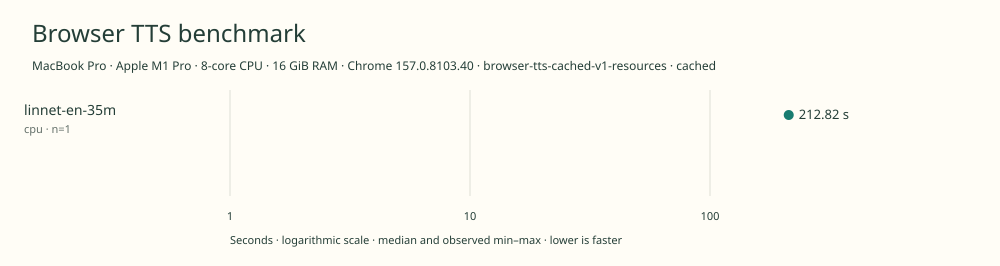

# 2026-11-18t13-57-01-943z-linnet-en-35m-cpu-cached-ba06fb4d

MacBook Pro · Apple M1 Pro · 8-core CPU · 16 GiB RAM · Chrome 157.0.8103.40 · Apple M1 Pro · Google Chrome 157.0.8103.40

Protocol: **browser-tts-cached-v1-resources**, scenario **cached**. Native harness run.

First source-chunk request through final CPU-readable PCM; excludes initialization, validation, hashing, WAV encoding and save. Optional articleCallPeakRssBytes spans the entire browser call including post-timer validation/export. Generation RSS uses timestamped samples inside browser generation start/end boundaries; it includes the owned Chrome process tree and browser baseline.

| Model | Requested backend | Status | Median | Min–max | Runs |
|---|---|---|---:|---:|---:|
| linnet-en-35m | cpu | measured | 212.82 s | 212.82–212.82 s | 1 |

Additional metrics (median of available observations; scopes are distinct):

| Model | Backend | Metric | Median | Unit | n |
|---|---|---|---:|---|---:|
| linnet-en-35m | cpu | First completed source chunk | 2648.555 | ms | 1 |
| linnet-en-35m | cpu | First PCM block | 390.040 | ms | 1 |
| linnet-en-35m | cpu | Generated audio | 1051.760 | s | 1 |
| linnet-en-35m | cpu | Generation / audio duration | 0.202 | ratio | 1 |
| linnet-en-35m | cpu | Model initialization | 244.336 | ms | 1 |
| linnet-en-35m | cpu | Complete controller trial including setup/export | 216288.141 | ms | 1 |
| linnet-en-35m | cpu | Transferred HTTP body data | 38404 | bytes | 1 |
| linnet-en-35m | cpu | Ideal body transfer at 1 Mbps | 0.307 | s | 1 |
| linnet-en-35m | cpu | Whole-call Chrome process-tree peak RSS | 1656356864 | bytes | 1 |
| linnet-en-35m | cpu | Per-trial mean generation Chrome process-tree RSS | 1284580935 | bytes | 1 |
| linnet-en-35m | cpu | In-window Chrome RSS observations | 423.000 | samples | 1 |

Model support (catalog capability, not coverage of this run):

| Model | Supported voices | Bundled voices | Languages | Tested voice |
|---|---:|---:|---|---|
| linnet-en-35m | 2 | 1 | 1 (en) | linnet-en-f1 |

Pinned Linnet en-35m checkpoint with the built-in f1 voice staged for browser inference. The checkpoint supports two built-in American English voices; only linnet-en-f1 is staged and benchmarked. Voice cloning is outside the included terms. Sources: [1](https://huggingface.co/VoxRT/linnet-en-35m/blob/a75fdfe50bc3d3e776b9c5040f149f49a054aaf5/README.md), [2](https://github.com/VoxRT/LinnetTTS/tree/f3d3f68cbd8b7d07380d11c82bf75af06bc41281), [3](https://www.voxrt.com/text-to-speech).

- **linnet-en-35m / cpu**: Official LinnetTTS WebAssembly SIMD128 inference runs on one browser CPU thread.

Capability checks run separately before timing. GPU dispatch does not imply GPU-exclusive execution.

Raw WAV is saved locally; opt-in audio publication is separate from timing and automatic result submission.

Campaign 2026-11-18T13-57-01-423Z-070586991b1a; cell 1/1; source 1866106d8dc126273b4405d664e006a644c83516; requested n=1; effective n=1; LINNET en-35m on the baseline MacBook Pro with Apple M1 Pro, 8 CPU cores and 16 GiB RAM, using headed Google Chrome 157.0.8103.40 in disposable profiles. CPU uses the official CPU/WASM path; WebGPU uses the reviewed hybrid runtime and must prove actual GPU dispatch. Acquire and release the shared M1 slot separately for each complete cell, in order: CPU warm, WebGPU warm, CPU cached, WebGPU cached; preserve unsupported status if actual WebGPU dispatch is unavailable and do not substitute CPU. Warm timing uses one excluded full-article warm-up and five scored full articles. Cached RSS is a separate one-article process-tree diagnostic. Record actual pre-run power/load; thermals are uninstrumented.

RSS is sampled every 500 ms across the owned Chrome process tree, including the Chrome baseline and inference workers. Whole-call peak spans post-timer validation/export; generation mean uses only in-window samples from browser generation start through final CPU-readable PCM.

Different protocols, fixtures, settings or machines must not be pooled into a speedup ranking. This report does not rate speech quality.
