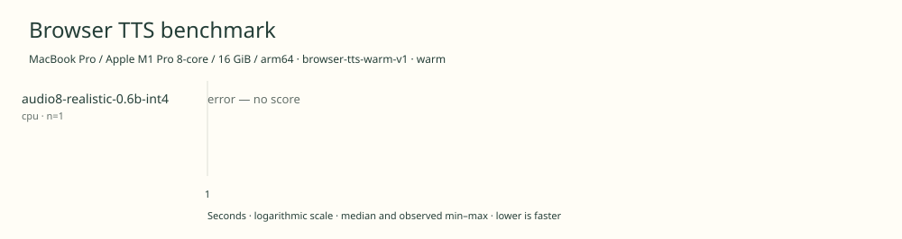

# 2026-11-18t14-52-21-179z-audio8-realistic-0.6b-int4-cpu-warm-ed2138bb

MacBook Pro / Apple M1 Pro 8-core / 16 GiB / arm64 · Apple M1 Pro · Google Chrome 157.0.8103.40

Protocol: **browser-tts-warm-v1**, scenario **warm**. Native harness run.

First source-chunk request through final CPU-readable PCM; excludes initialization, validation, hashing, WAV encoding and save. Optional articleCallPeakRssBytes spans the entire browser call including post-timer validation/export.

| Model | Requested backend | Status | Median | Min–max | Runs |
|---|---|---|---:|---:|---:|
| audio8-realistic-0.6b-int4 | cpu | error | — | — | 1 |

Model support (catalog capability, not coverage of this run):

| Model | Supported voices | Bundled voices | Languages | Tested voice |
|---|---:|---:|---|---|
| audio8-realistic-0.6b-int4 | Unknown | 0 | 23 | Reference-free English synthesis |

Realistic 0.6B checkpoint; reference-free synthesis or open-ended zero-shot voices.. No preset voices ship in this configuration. Reference-free English mode is tested. Sources: [1](https://huggingface.co/Edge0/Audio8-TTS-Realistic-Air/blob/1e857568bfd4f02931aca3988ee773a44d2d26d3/README.md), [2](https://huggingface.co/stephvax/audio8-tts-realistic-0.6b-onnx-int4/blob/04313606782af6b9a1aa93724555bc7b64ba9197/provenance.json).

- **audio8-realistic-0.6b-int4 / cpu**: Six-thread WebAssembly. page.evaluate: Target page, context or browser has been closed

Capability checks run separately before timing. GPU dispatch does not imply GPU-exclusive execution.

Raw WAV is saved locally; opt-in audio publication is separate from timing and automatic result submission.

Campaign 2026-11-18T14-52-20-250Z-4f76144d1de6; cell 1/1; source 9c7d880199e87a15a3959ae94b632f9d9cdd40da; Mains power attached; pre-run load averages 1.83, 1.72, 1.80; serial M1 order; normal user background apps remain; thermal state not instrumented; Audio8 CPU warm; one excluded warmup plus five scored full-article repetitions; serial M1 cell; headed pinned Chrome 157.0.8103.40. This is a new CPU warm attempt after the preserved pre-synthesis setup error 2026-11-18t14-22-42-390z-audio8-realistic-0.6b-int4-cpu-warm-f13e8d18; that native error result remains unchanged and is not counted as a trial. After verified removal of two unused completed SDK compiler-cache trees, free disk changed from 4,944,617,472 to 6,169,743,360 bytes. A separate no-inference browser CacheStorage exercise on the same source and pinned Chrome cached the full 614,792,704-byte Audio8 model/runtime set successfully; disk free bottomed at 5,224,431,616 bytes while the disposable profile was active and returned to 6,166,835,200 bytes after cleanup. No source/runtime/asset changes were made.

Different protocols, fixtures, settings or machines must not be pooled into a speedup ranking. This report does not rate speech quality.
