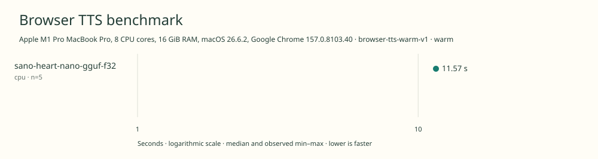

# 2026-11-19t04-36-30-063z-sano-heart-nano-gguf-f32-cpu-warm-c56188aa

Apple M1 Pro MacBook Pro, 8 CPU cores, 16 GiB RAM, macOS 26.6.2, Google Chrome 157.0.8103.40 · Apple M1 Pro · Google Chrome 157.0.8103.40

Protocol: **browser-tts-warm-v1**, scenario **warm**. Native harness run.

First source-chunk request through final CPU-readable PCM; excludes initialization, validation, hashing, WAV encoding and save. Optional articleCallPeakRssBytes spans the entire browser call including post-timer validation/export.

| Model | Requested backend | Status | Median | Min–max | Runs |
|---|---|---|---:|---:|---:|
| sano-heart-nano-gguf-f32 | cpu | measured | 11.57 s | 11.56–11.64 s | 5 |

Additional metrics (median of available observations; scopes are distinct):

| Model | Backend | Metric | Median | Unit | n |
|---|---|---|---:|---|---:|
| sano-heart-nano-gguf-f32 | cpu | First completed source chunk | 129.700 | ms | 5 |
| sano-heart-nano-gguf-f32 | cpu | First PCM block | 129.685 | ms | 5 |
| sano-heart-nano-gguf-f32 | cpu | Generated audio | 1303.390 | s | 5 |
| sano-heart-nano-gguf-f32 | cpu | Generation / audio duration | 0.009 | ratio | 5 |

Model support (catalog capability, not coverage of this run):

| Model | Supported voices | Bundled voices | Languages | Tested voice |
|---|---:|---:|---|---|
| sano-heart-nano-gguf-f32 | 1 | 1 | 1 (en) | heartnano (US English; upstream Misaki-normalized eSpeak IPA frontend) |

Pinned Ampixa heartnano package converted to the separately named Kokopop F32 GGUF profile. One fixed heartnano US English voice is benchmarked at 24 kHz. The GGUF is F32 expanded from the exact pinned Q8 front/decoder blobs; this is distinct from the official Q8 browser configuration. Generation uses speed 1 and seed 42 + canonical chunk id. Kokopop applies the pinned Misaki-normalized eSpeak IPA frontend. The CPU profile is cpu/wasm; WebGPU is webgpu+wasm and requires actual hardware dispatch. Only English \(US\) eSpeak data is bundled. Sources: [1](https://huggingface.co/ampixa/sanoTTS/blob/4a8194aa1dd958033ee449b3ad30c37e536b216e/README.md), [2](https://huggingface.co/ampixa/sanoTTS/blob/4a8194aa1dd958033ee449b3ad30c37e536b216e/heartnano/meta.json), [3](https://github.com/tterrasson/kokopop/tree/73ed5710cb37ca0384bc4bfdd7138d13605c9a88), [4](https://github.com/Ampixa/sanoTTS/tree/939d982b9faa54cbcf5d24cc878f5cd514b2646e).

- **sano-heart-nano-gguf-f32 / cpu**: Explicit CPU/WASM mode of the same Kokopop runtime and exact F32 heartnano GGUF.

Capability checks run separately before timing. GPU dispatch does not imply GPU-exclusive execution.

Raw WAV is saved locally; opt-in audio publication is separate from timing and automatic result submission.

Campaign 2026-11-19T04-36-29-540Z-423a0c3731b9; cell 1/2; source ca54c5ca1954406a72f4f0d705c6a37852ee7761; requested n=5; effective n=5; Native Apple M1 Pro baseline: 8 CPU cores, 16 GiB RAM, macOS 26.6.2, headed preserved Google Chrome 157.0.8103.40. Run CPU then WebGPU sequentially from one clean source and the exact generated F32 heartnano asset/runtime; same canonical 20,000-character, 93-chunk English fixture. Voice heartnano, locale en_us, 24 kHz, speed 1, base seed 42 + zero-based canonical span ID; Kokopop internally normalizes and segments LONG_FORM input, applies its trim/crossfade/pause behavior, and derives internal chunk seeds. Each warm cell has one excluded full-article warm-up and five scored full articles. No RSS or cached-resource diagnostic. Capture actual browser version, effective backend, capability and dispatch evidence, background conditions, all receipt/checkpoint JSON and selected trial WAVs. Preserve failures as recorded; no score or backend fallback. This is the separate Kokopop F32-expanded heartnano configuration, not the official INT8 Sano profile.

Different protocols, fixtures, settings or machines must not be pooled into a speedup ranking. This report does not rate speech quality.
