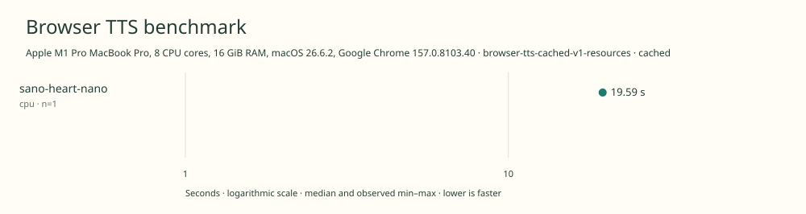

# 2026-11-19t05-03-03-415z-sano-heart-nano-cpu-cached-ea706271

Apple M1 Pro MacBook Pro, 8 CPU cores, 16 GiB RAM, macOS 26.6.2, Google Chrome 157.0.8103.40 · Apple M1 Pro · Google Chrome 157.0.8103.40

Protocol: **browser-tts-cached-v1-resources**, scenario **cached**. Native harness run.

First source-chunk request through final CPU-readable PCM; excludes initialization, validation, hashing, WAV encoding and save. Optional articleCallPeakRssBytes spans the entire browser call including post-timer validation/export. Generation RSS uses timestamped samples inside browser generation start/end boundaries; it includes the owned Chrome process tree and browser baseline.

| Model | Requested backend | Status | Median | Min–max | Runs |
|---|---|---|---:|---:|---:|
| sano-heart-nano | cpu | measured | 19.59 s | 19.59–19.59 s | 1 |

Additional metrics (median of available observations; scopes are distinct):

| Model | Backend | Metric | Median | Unit | n |
|---|---|---|---:|---|---:|
| sano-heart-nano | cpu | First completed source chunk | 233.920 | ms | 1 |
| sano-heart-nano | cpu | First PCM block | 71.205 | ms | 1 |
| sano-heart-nano | cpu | Generated audio | 1317.600 | s | 1 |
| sano-heart-nano | cpu | Generation / audio duration | 0.015 | ratio | 1 |
| sano-heart-nano | cpu | Model initialization | 46.461 | ms | 1 |
| sano-heart-nano | cpu | Complete controller trial including setup/export | 23849.952 | ms | 1 |
| sano-heart-nano | cpu | Transferred HTTP body data | 38404 | bytes | 1 |
| sano-heart-nano | cpu | Ideal body transfer at 1 Mbps | 0.307 | s | 1 |
| sano-heart-nano | cpu | Whole-call Chrome process-tree peak RSS | 1483227136 | bytes | 1 |
| sano-heart-nano | cpu | Per-trial mean generation Chrome process-tree RSS | 842877898 | bytes | 1 |
| sano-heart-nano | cpu | In-window Chrome RSS observations | 38.000 | samples | 1 |

Model support (catalog capability, not coverage of this run):

| Model | Supported voices | Bundled voices | Languages | Tested voice |
|---|---:|---:|---|---|
| sano-heart-nano | 1 | 1 | 1 (en) | SanoTTS heart-nano (English, US) |

Pinned heart-nano int8 voice checkpoint, official en-us browser G2P and snt\_nano WASM runtime. One bundled heart-nano English \(US\) voice is exercised. The official demo splits canonical spans into sentence/clause pieces of at most 120 characters; each piece is tokenized and synthesized inside the timed span call, and non-whitespace dropped IPA or output/token caps fail closed. This registration is CPU/WASM only; other Sano voices and separate WebGPU conversions are not included. Sources: [1](https://huggingface.co/ampixa/sanoTTS/blob/4a8194aa1dd958033ee449b3ad30c37e536b216e/README.md), [2](https://huggingface.co/ampixa/sanoTTS/blob/4a8194aa1dd958033ee449b3ad30c37e536b216e/web/voices/heartnano/meta.json), [3](https://github.com/Ampixa/sanoTTS/tree/c0584a51213721faba98135821faab71bae888f0/web).

- **sano-heart-nano / cpu**: Pinned official Sano heart-nano int8 WASM completed an untimed neural synthesis piece in a headed Chrome worker; no GPU execution.

Capability checks run separately before timing. GPU dispatch does not imply GPU-exclusive execution.

Raw WAV is saved locally; opt-in audio publication is separate from timing and automatic result submission.

Campaign 2026-11-19T05-03-02-888Z-9a90fdbc10cc; cell 1/1; source b0f8c8887e9dfab5cef7b8fac9a15af865d722ef; requested n=1; effective n=1; Separate cached-assets, new-engine, n=1 Chrome process-tree RSS diagnostic for the official INT8 CPU/WASM profile; it is not a resident warm timing. Same pinned source, heartnano voice, 24 kHz and host setup as the preceding CPU warm cell. Record pre-run power and background load separately; no thermal instrumentation.

RSS is sampled every 500 ms across the owned Chrome process tree, including the Chrome baseline and inference workers. Whole-call peak spans post-timer validation/export; generation mean uses only in-window samples from browser generation start through final CPU-readable PCM.

Different protocols, fixtures, settings or machines must not be pooled into a speedup ranking. This report does not rate speech quality.
