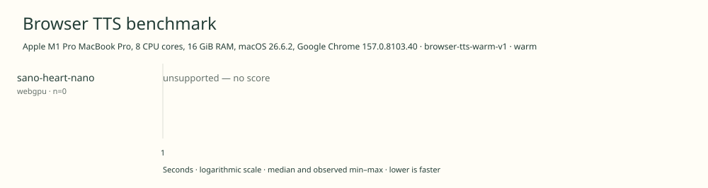

# 2026-11-19t05-03-32-384z-sano-heart-nano-webgpu-warm-09e97638

Apple M1 Pro MacBook Pro, 8 CPU cores, 16 GiB RAM, macOS 26.6.2, Google Chrome 157.0.8103.40 · Apple M1 Pro · Google Chrome 157.0.8103.40

Protocol: **browser-tts-warm-v1**, scenario **warm**. Native harness run.

First source-chunk request through final CPU-readable PCM; excludes initialization, validation, hashing, WAV encoding and save. Optional articleCallPeakRssBytes spans the entire browser call including post-timer validation/export.

| Model | Requested backend | Status | Median | Min–max | Runs |
|---|---|---|---:|---:|---:|
| sano-heart-nano | webgpu | unsupported | — | — | 0 |

Model support (catalog capability, not coverage of this run):

| Model | Supported voices | Bundled voices | Languages | Tested voice |
|---|---:|---:|---|---|
| sano-heart-nano | 1 | 1 | 1 (en) | SanoTTS heart-nano (English, US) |

Pinned heart-nano int8 voice checkpoint, official en-us browser G2P and snt\_nano WASM runtime. One bundled heart-nano English \(US\) voice is exercised. The official demo splits canonical spans into sentence/clause pieces of at most 120 characters; each piece is tokenized and synthesized inside the timed span call, and non-whitespace dropped IPA or output/token caps fail closed. This registration is CPU/WASM only; other Sano voices and separate WebGPU conversions are not included. Sources: [1](https://huggingface.co/ampixa/sanoTTS/blob/4a8194aa1dd958033ee449b3ad30c37e536b216e/README.md), [2](https://huggingface.co/ampixa/sanoTTS/blob/4a8194aa1dd958033ee449b3ad30c37e536b216e/web/voices/heartnano/meta.json), [3](https://github.com/Ampixa/sanoTTS/tree/c0584a51213721faba98135821faab71bae888f0/web).

- **sano-heart-nano / webgpu**: The pinned official SanoTTS heart-nano browser path is CPU WebAssembly; it does not implement WebGPU dispatch. The pinned official SanoTTS heart-nano browser path is CPU WebAssembly; it does not implement WebGPU dispatch.

Capability checks run separately before timing. GPU dispatch does not imply GPU-exclusive execution.

Raw WAV is saved locally; opt-in audio publication is separate from timing and automatic result submission.

Campaign 2026-11-19T05-03-31-857Z-c624daa5564b; cell 1/1; source b0f8c8887e9dfab5cef7b8fac9a15af865d722ef; requested n=5; effective n=5; Capability/status evidence only for the official SanoTTS heart-nano browser registration, which declares CPU/WASM support and no WebGPU provider. Request webgpu explicitly; preserve an explicit unsupported result or any unexpected initialization error. This is not a GPU timing and does not substitute another runtime.

Different protocols, fixtures, settings or machines must not be pooled into a speedup ranking. This report does not rate speech quality.
