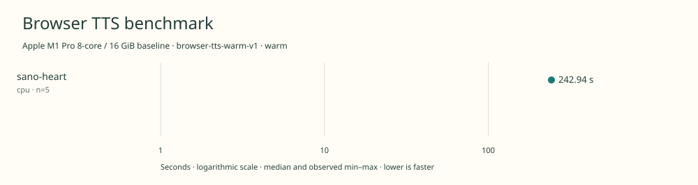

# 2026-11-19t05-34-55-044z-sano-heart-cpu-warm-eff21fdc

Apple M1 Pro 8-core / 16 GiB baseline · Apple M1 Pro · Google Chrome 157.0.8103.40

Protocol: **browser-tts-warm-v1**, scenario **warm**. Native harness run.

First source-chunk request through final CPU-readable PCM; excludes initialization, validation, hashing, WAV encoding and save. Optional articleCallPeakRssBytes spans the entire browser call including post-timer validation/export.

| Model | Requested backend | Status | Median | Min–max | Runs |
|---|---|---|---:|---:|---:|
| sano-heart | cpu | measured | 242.94 s | 242.60–243.05 s | 5 |

Additional metrics (median of available observations; scopes are distinct):

| Model | Backend | Metric | Median | Unit | n |
|---|---|---|---:|---|---:|
| sano-heart | cpu | First completed source chunk | 2739.255 | ms | 5 |
| sano-heart | cpu | First PCM block | 720.045 | ms | 5 |
| sano-heart | cpu | Generated audio | 1340.619 | s | 5 |
| sano-heart | cpu | Generation / audio duration | 0.181 | ratio | 5 |

Model support (catalog capability, not coverage of this run):

| Model | Supported voices | Bundled voices | Languages | Tested voice |
|---|---:|---:|---|---|
| sano-heart | 1 | 1 | 1 (en) | SanoTTS heart (English, US) |

One pinned Heart full-size FP32 English \(US\) mel-100 voice with the official snt\_nano browser runtime. The official Heart model uses its full-size FP32 \`snt\_nano\` module, distinct from heart-nano INT8 and piperlite voices. The same official English G2P/Trellis frontend splits each canonical span into sentence/clause pieces up to 120 characters; non-whitespace dropped symbols, token/output caps or empty synthesis fail closed. CPU/WASM only. Sources: [1](https://huggingface.co/ampixa/sanoTTS/blob/bc04c49fd137607b60294b3894441bbfbe5c6659/README.md), [2](https://huggingface.co/ampixa/sanoTTS/blob/bc04c49fd137607b60294b3894441bbfbe5c6659/web/voices/heart/meta.json), [3](https://github.com/Ampixa/sanoTTS/tree/c0584a51213721faba98135821faab71bae888f0/web).

- **sano-heart / cpu**: Pinned official Sano heart FP32 WASM completed an untimed neural synthesis piece in a headed Chrome worker; no GPU execution.

Capability checks run separately before timing. GPU dispatch does not imply GPU-exclusive execution.

Raw WAV is saved locally; opt-in audio publication is separate from timing and automatic result submission.

Campaign 2026-11-19T05-34-54-487Z-5e0bd40b13a2; cell 1/1; source 8b929d8e68834b101dd1992981e9b04640222748; requested n=5; effective n=5; Official Sano sano-heart English CPU/WASM profile; 24000 Hz. Source manifest SHA-256 df550f024216e8c8e206a9d8e72702dc4afdf845e05f907df855b4d12ceddd4a; assets.lock.json SHA-256 9083fb020ed8ee50a2c9ee646c3913b9707709db9ad03605ad6d59865724a99b. Headed Chrome 157.0.8103.40 on verified M1 Pro 8-core / 16 GiB baseline, AC power, disposable profile. One excluded full-article warm-up plus five scored 20,000-character articles; no RSS collection, no cache scenario. Preserve receipts and WAVs; no WebGPU fallback.

Different protocols, fixtures, settings or machines must not be pooled into a speedup ranking. This report does not rate speech quality.
