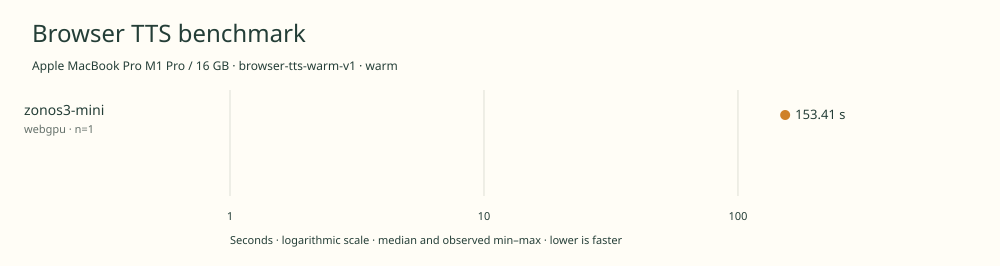

# 2026-11-19t05-59-40-287z-zonos3-mini-webgpu-warm-091d4772

Apple MacBook Pro M1 Pro / 16 GB · Apple M1 Pro · Google Chrome 157.0.8103.40

Protocol: **browser-tts-warm-v1**, scenario **warm**. Native harness run.

First source-chunk request through final CPU-readable PCM; excludes initialization, validation, hashing, WAV encoding and save. Optional articleCallPeakRssBytes spans the entire browser call including post-timer validation/export.

| Model | Requested backend | Status | Median | Min–max | Runs |
|---|---|---|---:|---:|---:|
| zonos3-mini | webgpu | measured | 153.41 s | 153.41–153.41 s | 1 |

Additional metrics (median of available observations; scopes are distinct):

| Model | Backend | Metric | Median | Unit | n |
|---|---|---|---:|---|---:|
| zonos3-mini | webgpu | First completed source chunk | 1764.930 | ms | 1 |
| zonos3-mini | webgpu | First PCM block | 112.690 | ms | 1 |
| zonos3-mini | webgpu | Generated audio | 1284.333 | s | 1 |
| zonos3-mini | webgpu | Generation / audio duration | 0.119 | ratio | 1 |

Model support (catalog capability, not coverage of this run):

| Model | Supported voices | Bundled voices | Languages | Tested voice |
|---|---:|---:|---|---|
| zonos3-mini | 27 | 1 | 43 | Imogen (English, British female) |

Pinned ZONOS3-Mini checkpoint and official 27-preset voice catalog; one English preset is staged and benchmarked.. The checkpoint advertises 43 languages across 44 server locale codes and the pinned voice manifest lists 27 presets, including 10 English voices. Only Imogen \(English, British female\) is staged and measured. The WebGPU profile loads its reference codes and speaker embedding; the CPU/WASM profile loads the speaker embedding only. The benchmark skips unused preview audio. No other preset or language is exercised. Sources: [1](https://huggingface.co/Zyphra/ZONOS3-Mini/blob/2921b8821772b0bd10a04456863d21abf9d2f283/README.md), [2](https://huggingface.co/Zyphra/ZONOS3-Mini/blob/2921b8821772b0bd10a04456863d21abf9d2f283/web/voices/voices.json), [3](https://github.com/Zyphra/ZONOS3-Mini/blob/a50e14117d99181ba7f28047b451ba03ba1a09a9/servers/web/README.md), [4](https://github.com/Zyphra/ZONOS3-Mini/blob/a50e14117d99181ba7f28047b451ba03ba1a09a9/model/src/zonos3/registries/languages.json).

- **zonos3-mini / webgpu**: Selected hardware adapter apple / metal-3; observed 42459 compute dispatches during separate untimed generation. The neural backbone and decoder use WebGPU; codec host iSTFT/FIR/resampling and PCM readback use CPU.

Capability checks run separately before timing. GPU dispatch does not imply GPU-exclusive execution.

Raw WAV is saved locally; opt-in audio publication is separate from timing and automatic result submission.

Campaign 2026-11-19T05-59-36-390Z-1d2d09933912; cell 1/1; source de9dded4722f160d185b4dcbbb720edec8ee595f; requested n=1; effective n=1; ZONOS3-Mini webgpu profile; Official Zyphra browser runtime pinned at a50e14117d99181ba7f28047b451ba03ba1a09a9. Require a real selected hardware adapter and a separate untimed inference-worker compute-dispatch probe; scored inference requires EOS. Backbone and KEEP-2 neural kernels dispatch on WebGPU; host iSTFT/FIR mixing/resampling and float32 PCM readback use CPU. Short-text/LACI is off; canonical spans pass unchanged. Actual voice: Imogen (English, British female); pinned Imogen codes and embedding; preview audio disabled.. Precision: Pinned official Web export; tensor formats are declared per-tensor in its manifests.. Source: de9dded4722f160d185b4dcbbb720edec8ee595f. Power: AC Power. Background activity: At 2026-11-19T05:43:25Z, this one-cell ZONOS WebGPU warm retry was queued behind Klein Heart CPU warm and Cosy Robot/Trellis setup in the shared serial M1 queue. The previous ZONOS 1-warmup/1-trial cell completed both articles with matching finite PCM but was rejected for a 2,442-character note; that invalid receipt is preserved. Assets are staged; inference cells run one at a time.. Record AC power, background activity, and run order separately; do not infer a matched CPU/GPU speedup across distinct runtime/precision profiles.

Different protocols, fixtures, settings or machines must not be pooled into a speedup ranking. This report does not rate speech quality.
