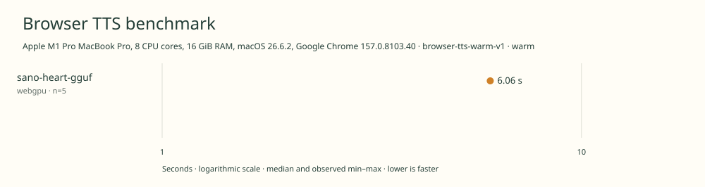

# 2026-11-19t07-18-37-488z-sano-heart-gguf-webgpu-warm-52fc27d6

Apple M1 Pro MacBook Pro, 8 CPU cores, 16 GiB RAM, macOS 26.6.2, Google Chrome 157.0.8103.40 · Apple M1 Pro · Google Chrome 157.0.8103.40

Protocol: **browser-tts-warm-v1**, scenario **warm**. Native harness run.

First source-chunk request through final CPU-readable PCM; excludes initialization, validation, hashing, WAV encoding and save. Optional articleCallPeakRssBytes spans the entire browser call including post-timer validation/export.

| Model | Requested backend | Status | Median | Min–max | Runs |
|---|---|---|---:|---:|---:|
| sano-heart-gguf | webgpu | measured | 6.06 s | 6.03–6.13 s | 5 |

Additional metrics (median of available observations; scopes are distinct):

| Model | Backend | Metric | Median | Unit | n |
|---|---|---|---:|---|---:|
| sano-heart-gguf | webgpu | First completed source chunk | 82.645 | ms | 5 |
| sano-heart-gguf | webgpu | First PCM block | 81.580 | ms | 5 |
| sano-heart-gguf | webgpu | Generated audio | 1330.002 | s | 5 |
| sano-heart-gguf | webgpu | Generation / audio duration | 0.005 | ratio | 5 |

Model support (catalog capability, not coverage of this run):

| Model | Supported voices | Bundled voices | Languages | Tested voice |
|---|---:|---:|---|---|
| sano-heart-gguf | 1 | 1 | 1 (en) | heart (US English; Misaki-normalized eSpeak IPA) |

Individual pinned heart voice converted with Kokopop. One selected voice; 24000 Hz. F32 GGUF from pinned Heart F32 source; Kokopop Vocos. CPU is cpu/wasm; GPU is webgpu+wasm with mandatory actual dispatch proof. Kokopop LONG\_FORM normalization and internal chunking are retained. No other voices are bundled. Sources: [1](https://huggingface.co/ampixa/sanoTTS/blob/25410576d005d7f08d186990fd91f6a2651243de/heart/meta.json), [2](https://huggingface.co/ampixa/sanoTTS/blob/25410576d005d7f08d186990fd91f6a2651243de/README.md), [3](https://github.com/tterrasson/kokopop/tree/73ed5710cb37ca0384bc4bfdd7138d13605c9a88).

- **sano-heart-gguf / webgpu**: An eligible hardware WebGPU adapter was selected; ggml scheduler telemetry assigned named neural ops and GPUComputePassEncoder recorded dispatches during seeded selected-voice synthesis.

Capability checks run separately before timing. GPU dispatch does not imply GPU-exclusive execution.

Raw WAV is saved locally; opt-in audio publication is separate from timing and automatic result submission.

Campaign 2026-11-19T07-18-36-966Z-0a30ccadec97; cell 1/1; source 01d9c9f51ed94c41b6dbf480a3a0b1304fc6d661; requested n=5; effective n=5; Native Apple M1 Pro 8 CPU cores/16 GiB, preserved headed Chrome 157.0.8103.40; exact public tested source; one excluded full English 20k/93-span warmup plus five scored articles; no RSS/cached measurement. Separate individual converted Kokopop F32 profile, voice heart, 24000 Hz. Speed1/base seed42+canonical span ID; pinned native LONG_FORM normalization/internal segmentation, pauses/crossfade and internal seeds retained. CPU then WebGPU per profile; separate fresh browser profile and shared compute lock per cell. No skipped input symbols across all93 audited spans. Native component substitutions to schwa are preserved: {}. This is frontend behavior, not an intelligibility claim; original output retained for listening. Counts are separate untimed diagnostic evidence, no altered inference runtime.

Different protocols, fixtures, settings or machines must not be pooled into a speedup ranking. This report does not rate speech quality.
