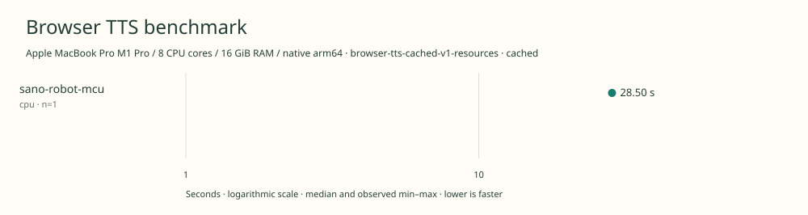

# 2026-11-19t09-36-45-778z-sano-robot-mcu-cpu-cached-0c917edc

Apple MacBook Pro M1 Pro / 8 CPU cores / 16 GiB RAM / native arm64 · Apple M1 Pro · Google Chrome 157.0.8103.40

Protocol: **browser-tts-cached-v1-resources**, scenario **cached**. Native harness run.

First source-chunk request through final CPU-readable PCM; excludes initialization, validation, hashing, WAV encoding and save. Optional articleCallPeakRssBytes spans the entire browser call including post-timer validation/export. Generation RSS uses timestamped samples inside browser generation start/end boundaries; it includes the owned Chrome process tree and browser baseline.

| Model | Requested backend | Status | Median | Min–max | Runs |
|---|---|---|---:|---:|---:|
| sano-robot-mcu | cpu | measured | 28.50 s | 28.50–28.50 s | 1 |

Additional metrics (median of available observations; scopes are distinct):

| Model | Backend | Metric | Median | Unit | n |
|---|---|---|---:|---|---:|
| sano-robot-mcu | cpu | First completed source chunk | 363.250 | ms | 1 |
| sano-robot-mcu | cpu | First PCM block | 117.370 | ms | 1 |
| sano-robot-mcu | cpu | Generated audio | 1131.683 | s | 1 |
| sano-robot-mcu | cpu | Generation / audio duration | 0.025 | ratio | 1 |
| sano-robot-mcu | cpu | Model initialization | 38.239 | ms | 1 |
| sano-robot-mcu | cpu | Complete controller trial including setup/export | 31967.849 | ms | 1 |
| sano-robot-mcu | cpu | Transferred HTTP body data | 38404 | bytes | 1 |
| sano-robot-mcu | cpu | Ideal body transfer at 1 Mbps | 0.307 | s | 1 |
| sano-robot-mcu | cpu | Whole-call Chrome process-tree peak RSS | 1250934784 | bytes | 1 |
| sano-robot-mcu | cpu | Per-trial mean generation Chrome process-tree RSS | 835658606 | bytes | 1 |
| sano-robot-mcu | cpu | In-window Chrome RSS observations | 56.000 | samples | 1 |

Model support (catalog capability, not coverage of this run):

| Model | Supported voices | Bundled voices | Languages | Tested voice |
|---|---:|---:|---|---|
| sano-robot-mcu | 1 | 1 | 1 (en) | SanoTTS Robot MCU (English, US) |

Pinned official mcu English checkpoint and CPU/WASM runtime. Official demo English preset; 120-character internal pieces preserve all canonical source characters. No WebGPU path in the selected runtime. Robot is the 567,008-parameter MCU model, not Kristin PiperLite. Sources: [1](https://github.com/Ampixa/sanoTTS/blob/c0584a51213721faba98135821faab71bae888f0/web/index.html), [2](https://github.com/Ampixa/sanoTTS/blob/c0584a51213721faba98135821faab71bae888f0/README.md).

- **sano-robot-mcu / cpu**: Official CPU WASM completed an untimed speech piece.

Capability checks run separately before timing. GPU dispatch does not imply GPU-exclusive execution.

Raw WAV is saved locally; opt-in audio publication is separate from timing and automatic result submission.

Campaign 2026-11-19T09-36-45-205Z-8dd58338b032; cell 1/1; source 7f9b7982e5336be8642f91404584114371582fcd; requested n=1; effective n=1; Serial native M1 Pro campaign, disposable headed Google Chrome 157.0.8103.40 from the explicitly preserved executable. Shared OS slot excludes other benchmark/diagnostic/publication work. Cached resource article precedes warm timing. Full-fixture frontend audited separately on this exact clean source; official 304 internal text pieces preserve all non-whitespace source characters. No cold check; no inferred GPU score. Power and hardware observed in companion preflight.

RSS is sampled every 500 ms across the owned Chrome process tree, including the Chrome baseline and inference workers. Whole-call peak spans post-timer validation/export; generation mean uses only in-window samples from browser generation start through final CPU-readable PCM.

Different protocols, fixtures, settings or machines must not be pooled into a speedup ranking. This report does not rate speech quality.
