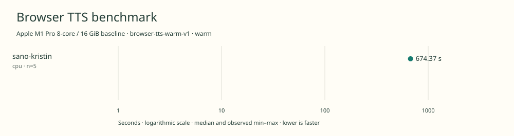

# 2026-11-19t10-04-14-383z-sano-kristin-cpu-warm-bd5428e0

Apple M1 Pro 8-core / 16 GiB baseline · Apple M1 Pro · Google Chrome 157.0.8103.40

Protocol: **browser-tts-warm-v1**, scenario **warm**. Native harness run.

First source-chunk request through final CPU-readable PCM; excludes initialization, validation, hashing, WAV encoding and save. Optional articleCallPeakRssBytes spans the entire browser call including post-timer validation/export.

| Model | Requested backend | Status | Median | Min–max | Runs |
|---|---|---|---:|---:|---:|
| sano-kristin | cpu | measured | 674.37 s | 673.21–674.57 s | 5 |

Additional metrics (median of available observations; scopes are distinct):

| Model | Backend | Metric | Median | Unit | n |
|---|---|---|---:|---|---:|
| sano-kristin | cpu | First completed source chunk | 7922.890 | ms | 5 |
| sano-kristin | cpu | First PCM block | 7922.885 | ms | 5 |
| sano-kristin | cpu | Generated audio | 1076.419 | s | 5 |
| sano-kristin | cpu | Generation / audio duration | 0.626 | ratio | 5 |

Model support (catalog capability, not coverage of this run):

| Model | Supported voices | Bundled voices | Languages | Tested voice |
|---|---:|---:|---|---|
| sano-kristin | 1 | 1 | 1 (en) | Kristin (English, eSpeak en) |

One pinned English Kristin 1.40M \(English\) voice checkpoint with the official piperlite WASM runtime. The official Kristin piperlite voice uses its pinned FP32 front/decoder package, eSpeak voice en, G2P voice slot 0, length scale 1.08 and 22,050 Hz output. Synthesis runs in the official sanotts-web 0.3.0 WebAssembly runtime; no WebGPU provider is available. Sources: [1](https://huggingface.co/ampixa/sanoTTS/blob/bc04c49fd137607b60294b3894441bbfbe5c6659/README.md), [2](https://huggingface.co/ampixa/sanoTTS/blob/bc04c49fd137607b60294b3894441bbfbe5c6659/web/voices/kristin/meta.json).

- **sano-kristin / cpu**: Official Sano piperlite Emscripten WebAssembly in a headed Chrome classic worker; an untimed CPU utterance passed; no GPU execution.

Capability checks run separately before timing. GPU dispatch does not imply GPU-exclusive execution.

Raw WAV is saved locally; opt-in audio publication is separate from timing and automatic result submission.

Campaign 2026-11-19T10-04-13-858Z-5db3de33aae1; cell 1/1; source 8b929d8e68834b101dd1992981e9b04640222748; requested n=5; effective n=5; Official Sano sano-kristin English CPU/WASM profile; 22050 Hz. Source manifest SHA-256 df550f024216e8c8e206a9d8e72702dc4afdf845e05f907df855b4d12ceddd4a; assets.lock.json SHA-256 9083fb020ed8ee50a2c9ee646c3913b9707709db9ad03605ad6d59865724a99b. Headed Chrome 157.0.8103.40 on verified M1 Pro 8-core / 16 GiB baseline, AC power, disposable profile. One excluded full-article warm-up plus five scored 20,000-character articles; no RSS collection, no cache scenario. Preserve receipts and WAVs; no WebGPU fallback. Pre-cell condition snapshot UTC 2026-11-19T10:04:13.725467+00:00; power: Now drawing from 'AC Power'  -InternalBattery-0 (id=22216803)	78%; AC attached; not charging present: true; host load: 2:04  up 14 days, 15:45, 1 user, load averages: 3.47 3.49 3.49.

Different protocols, fixtures, settings or machines must not be pooled into a speedup ranking. This report does not rate speech quality.
