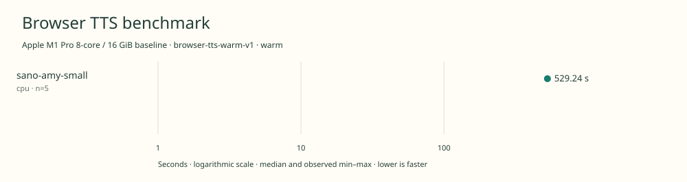

# 2026-11-19t11-40-02-061z-sano-amy-small-cpu-warm-e81738fa

Apple M1 Pro 8-core / 16 GiB baseline · Apple M1 Pro · Google Chrome 157.0.8103.40

Protocol: **browser-tts-warm-v1**, scenario **warm**. Native harness run.

First source-chunk request through final CPU-readable PCM; excludes initialization, validation, hashing, WAV encoding and save. Optional articleCallPeakRssBytes spans the entire browser call including post-timer validation/export.

| Model | Requested backend | Status | Median | Min–max | Runs |
|---|---|---|---:|---:|---:|
| sano-amy-small | cpu | measured | 529.24 s | 528.95–529.42 s | 5 |

Additional metrics (median of available observations; scopes are distinct):

| Model | Backend | Metric | Median | Unit | n |
|---|---|---|---:|---|---:|
| sano-amy-small | cpu | First completed source chunk | 6123.220 | ms | 5 |
| sano-amy-small | cpu | First PCM block | 6123.215 | ms | 5 |
| sano-amy-small | cpu | Generated audio | 1214.102 | s | 5 |
| sano-amy-small | cpu | Generation / audio duration | 0.436 | ratio | 5 |

Model support (catalog capability, not coverage of this run):

| Model | Supported voices | Bundled voices | Languages | Tested voice |
|---|---:|---:|---|---|
| sano-amy-small | 1 | 1 | 1 (en) | Amy-small (English, eSpeak en-us) |

One pinned English Amy-small 1.08M \(English\) voice checkpoint with the official piperlite WASM runtime. The source package is the pinned official Amy-small FP16 piperlite package. A reproducible converter emits the matching FP32 browser front/decoder ABI; the pinned en-us phoneme config and voice slot 1 are retained. Output is 22,050 Hz. The bundled browser artifact is a reproducible benchmark conversion, not an upstream prebuilt browser voice package. Sources: [1](https://huggingface.co/ampixa/sanoTTS/blob/25410576d005d7f08d186990fd91f6a2651243de/README.md), [2](https://huggingface.co/ampixa/sanoTTS/blob/25410576d005d7f08d186990fd91f6a2651243de/amy-en-1p1m/manifest.json).

- **sano-amy-small / cpu**: Official Sano piperlite Emscripten WebAssembly in a headed Chrome classic worker; an untimed CPU utterance passed; no GPU execution.

Capability checks run separately before timing. GPU dispatch does not imply GPU-exclusive execution.

Raw WAV is saved locally; opt-in audio publication is separate from timing and automatic result submission.

Campaign 2026-11-19T11-40-01-539Z-2d8a5f227869; cell 1/1; source 8b929d8e68834b101dd1992981e9b04640222748; requested n=5; effective n=5; Official Sano sano-amy-small English CPU/WASM profile; 22050 Hz. Source manifest SHA-256 df550f024216e8c8e206a9d8e72702dc4afdf845e05f907df855b4d12ceddd4a; assets.lock.json SHA-256 9083fb020ed8ee50a2c9ee646c3913b9707709db9ad03605ad6d59865724a99b. Headed Chrome 157.0.8103.40 on verified M1 Pro 8-core / 16 GiB baseline, AC power, disposable profile. One excluded full-article warm-up plus five scored 20,000-character articles; no RSS collection, no cache scenario. Preserve receipts and WAVs; no WebGPU fallback. Pre-cell condition snapshot UTC 2026-11-19T11:40:01.419719+00:00; power: Now drawing from 'AC Power'  -InternalBattery-0 (id=22216803)	78%; AC attached; not charging present: true; host load: 3:40  up 14 days, 17:21, 1 user, load averages: 3.31 4.14 4.51.

Different protocols, fixtures, settings or machines must not be pooled into a speedup ranking. This report does not rate speech quality.
