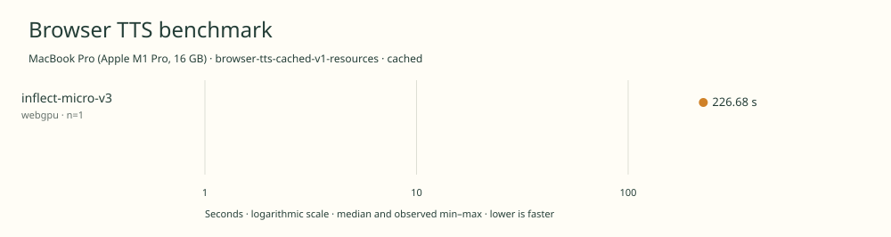

# 2026-11-19t13-58-17-329z-inflect-micro-v3-webgpu-cached-90200a0e

MacBook Pro (Apple M1 Pro, 16 GB) · Apple M1 Pro · Google Chrome 157.0.8103.40

Protocol: **browser-tts-cached-v1-resources**, scenario **cached**. Native harness run.

First source-chunk request through final CPU-readable PCM; excludes initialization, validation, hashing, WAV encoding and save. Optional articleCallPeakRssBytes spans the entire browser call including post-timer validation/export. Generation RSS uses timestamped samples inside browser generation start/end boundaries; it includes the owned Chrome process tree and browser baseline.

| Model | Requested backend | Status | Median | Min–max | Runs |
|---|---|---|---:|---:|---:|
| inflect-micro-v3 | webgpu | measured | 226.68 s | 226.68–226.68 s | 1 |

Additional metrics (median of available observations; scopes are distinct):

| Model | Backend | Metric | Median | Unit | n |
|---|---|---|---:|---|---:|
| inflect-micro-v3 | webgpu | First completed source chunk | 2861.145 | ms | 1 |
| inflect-micro-v3 | webgpu | First PCM block | 2548.280 | ms | 1 |
| inflect-micro-v3 | webgpu | Generated audio | 1289.030 | s | 1 |
| inflect-micro-v3 | webgpu | Generation / audio duration | 0.176 | ratio | 1 |
| inflect-micro-v3 | webgpu | Model initialization | 758.729 | ms | 1 |
| inflect-micro-v3 | webgpu | Complete controller trial including setup/export | 231835.837 | ms | 1 |
| inflect-micro-v3 | webgpu | Transferred HTTP body data | 38404 | bytes | 1 |
| inflect-micro-v3 | webgpu | Ideal body transfer at 1 Mbps | 0.307 | s | 1 |
| inflect-micro-v3 | webgpu | Whole-call Chrome process-tree peak RSS | 1809874944 | bytes | 1 |
| inflect-micro-v3 | webgpu | Per-trial mean generation Chrome process-tree RSS | 1108403284 | bytes | 1 |
| inflect-micro-v3 | webgpu | In-window Chrome RSS observations | 451.000 | samples | 1 |

Model support (catalog capability, not coverage of this run):

| Model | Supported voices | Bundled voices | Languages | Tested voice |
|---|---:|---:|---|---|
| inflect-micro-v3 | 6 | 1 | 1 (en) | Cassidy (fixed voice 2) |

Pinned Inflect Micro v3 English checkpoint c1a7db6ef44c931623fc2028cb0409659b83156c. Upstream checkpoint lists six English voices; only Cassidy \(voice 2\) is exported and benchmarked. 11,787,634-parameter core; browser export uses three FP32 ONNX graphs and a fixed Cassidy style bank. English G2P uses the separately pinned Klein 0.2.0 browser adaptation and does not claim native Misaki parity. Seeded JavaScript Gaussian noise differs from PyTorch RNG sequence. Sources: [1](https://huggingface.co/owensong/Inflect-Micro-v3/blob/c1a7db6ef44c931623fc2028cb0409659b83156c/README.md), [2](https://huggingface.co/owensong/Inflect-Micro-v3/blob/c1a7db6ef44c931623fc2028cb0409659b83156c/LICENSE_SCOPE.json), [3](https://huggingface.co/owensong/Inflect-Micro-v3/blob/c1a7db6ef44c931623fc2028cb0409659b83156c/THIRD_PARTY_NOTICES.md).

- **inflect-micro-v3 / webgpu**: Observed 1676 ONNX WebGPU dispatches during untimed model inference; source-filter DSP and final PCM assembly ran in JavaScript on CPU. Output tensors were read back to CPU; probe hooks were removed before timed work.

Capability checks run separately before timing. GPU dispatch does not imply GPU-exclusive execution.

Raw WAV is saved locally; opt-in audio publication is separate from timing and automatic result submission.

Campaign 2026-11-19T13-58-16-596Z-69cea3843390; cell 1/1; source 796a12747ad7c7ed79b3592dfa88c875629c0084; requested n=1; effective n=1; Sequential full-article Micro v3; Google Chrome 157.0.8103.40, Apple M1 Pro on AC power. Normal user background applications remain; thermal state is uninstrumented. Cassidy voice ID 2, speed 1, WebGPU with one-thread WASM fallback. One cached full article with generation-window RSS sampling; GPU dispatch is required.

RSS is sampled every 500 ms across the owned Chrome process tree, including the Chrome baseline and inference workers. Whole-call peak spans post-timer validation/export; generation mean uses only in-window samples from browser generation start through final CPU-readable PCM.

Different protocols, fixtures, settings or machines must not be pooled into a speedup ranking. This report does not rate speech quality.
