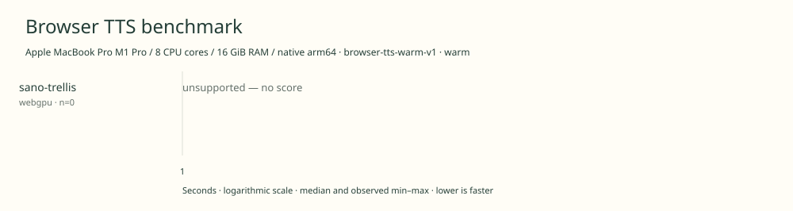

# 2026-11-19t16-13-20-544z-sano-trellis-webgpu-warm-0d8cc66d

Apple MacBook Pro M1 Pro / 8 CPU cores / 16 GiB RAM / native arm64 · Apple M1 Pro · Google Chrome 157.0.8103.40

Protocol: **browser-tts-warm-v1**, scenario **warm**. Native harness run.

First source-chunk request through final CPU-readable PCM; excludes initialization, validation, hashing, WAV encoding and save. Optional articleCallPeakRssBytes spans the entire browser call including post-timer validation/export.

| Model | Requested backend | Status | Median | Min–max | Runs |
|---|---|---|---:|---:|---:|
| sano-trellis | webgpu | unsupported | — | — | 0 |

Model support (catalog capability, not coverage of this run):

| Model | Supported voices | Bundled voices | Languages | Tested voice |
|---|---:|---:|---|---|
| sano-trellis | 1 | 1 | 1 (en) | SanoTTS Trellis (English, US) |

Pinned official trellis English checkpoint and CPU/WASM runtime. Official demo English preset; 120-character internal pieces preserve all canonical source characters. No WebGPU path in the selected runtime. Experimental Trellis-RIFT full pipeline with 995,058 FP32 parameters. Sources: [1](https://github.com/Ampixa/sanoTTS/blob/c0584a51213721faba98135821faab71bae888f0/web/index.html), [2](https://github.com/Ampixa/sanoTTS/blob/c0584a51213721faba98135821faab71bae888f0/README.md).

- **sano-trellis / webgpu**: The pinned official SanoTTS Robot/Trellis browser path is CPU WebAssembly; it does not implement WebGPU dispatch. The pinned official SanoTTS Robot/Trellis browser path is CPU WebAssembly; it does not implement WebGPU dispatch.

Capability checks run separately before timing. GPU dispatch does not imply GPU-exclusive execution.

Raw WAV is saved locally; opt-in audio publication is separate from timing and automatic result submission.

Campaign 2026-11-19T16-13-19-992Z-e02bf31a1252; cell 1/1; source 7f9b7982e5336be8642f91404584114371582fcd; requested n=5; effective n=5; Serial native M1 Pro campaign, disposable headed Google Chrome 157.0.8103.40 from the explicitly preserved executable. Shared OS slot excludes other benchmark/diagnostic/publication work. Cached resource article precedes warm timing. Full-fixture frontend audited separately on this exact clean source; official 304 internal text pieces preserve all non-whitespace source characters. No cold check; no inferred GPU score. Power and hardware observed in companion preflight.

Different protocols, fixtures, settings or machines must not be pooled into a speedup ranking. This report does not rate speech quality.
