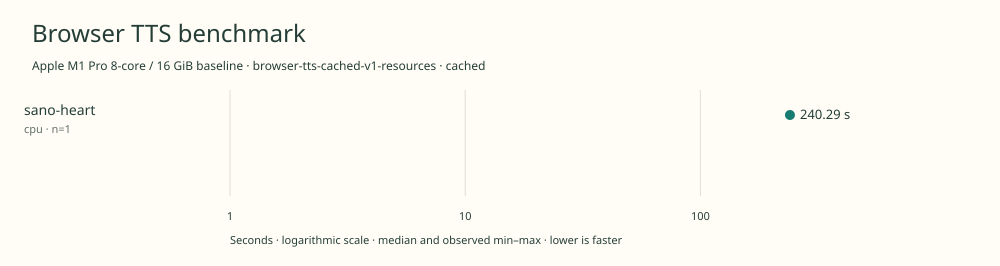

# 2026-11-19t16-19-15-814z-sano-heart-cpu-cached-865b4f98

Apple M1 Pro 8-core / 16 GiB baseline · Apple M1 Pro · Google Chrome 157.0.8103.40

Protocol: **browser-tts-cached-v1-resources**, scenario **cached**. Native harness run.

First source-chunk request through final CPU-readable PCM; excludes initialization, validation, hashing, WAV encoding and save. Optional articleCallPeakRssBytes spans the entire browser call including post-timer validation/export. Generation RSS uses timestamped samples inside browser generation start/end boundaries; it includes the owned Chrome process tree and browser baseline.

| Model | Requested backend | Status | Median | Min–max | Runs |
|---|---|---|---:|---:|---:|
| sano-heart | cpu | measured | 240.29 s | 240.29–240.29 s | 1 |

Additional metrics (median of available observations; scopes are distinct):

| Model | Backend | Metric | Median | Unit | n |
|---|---|---|---:|---|---:|
| sano-heart | cpu | First completed source chunk | 2747.895 | ms | 1 |
| sano-heart | cpu | First PCM block | 758.645 | ms | 1 |
| sano-heart | cpu | Generated audio | 1340.619 | s | 1 |
| sano-heart | cpu | Generation / audio duration | 0.179 | ratio | 1 |
| sano-heart | cpu | Model initialization | 78.673 | ms | 1 |
| sano-heart | cpu | Complete controller trial including setup/export | 244687.451 | ms | 1 |
| sano-heart | cpu | Transferred HTTP body data | 38404 | bytes | 1 |
| sano-heart | cpu | Ideal body transfer at 1 Mbps | 0.307 | s | 1 |
| sano-heart | cpu | Whole-call Chrome process-tree peak RSS | 1534607360 | bytes | 1 |
| sano-heart | cpu | Per-trial mean generation Chrome process-tree RSS | 735771301 | bytes | 1 |
| sano-heart | cpu | In-window Chrome RSS observations | 478.000 | samples | 1 |

Model support (catalog capability, not coverage of this run):

| Model | Supported voices | Bundled voices | Languages | Tested voice |
|---|---:|---:|---|---|
| sano-heart | 1 | 1 | 1 (en) | SanoTTS heart (English, US) |

One pinned Heart full-size FP32 English \(US\) mel-100 voice with the official snt\_nano browser runtime. The official Heart model uses its full-size FP32 \`snt\_nano\` module, distinct from heart-nano INT8 and piperlite voices. The same official English G2P/Trellis frontend splits each canonical span into sentence/clause pieces up to 120 characters; non-whitespace dropped symbols, token/output caps or empty synthesis fail closed. CPU/WASM only. Sources: [1](https://huggingface.co/ampixa/sanoTTS/blob/bc04c49fd137607b60294b3894441bbfbe5c6659/README.md), [2](https://huggingface.co/ampixa/sanoTTS/blob/bc04c49fd137607b60294b3894441bbfbe5c6659/web/voices/heart/meta.json), [3](https://github.com/Ampixa/sanoTTS/tree/c0584a51213721faba98135821faab71bae888f0/web).

- **sano-heart / cpu**: Pinned official Sano heart FP32 WASM completed an untimed neural synthesis piece in a headed Chrome worker; no GPU execution.

Capability checks run separately before timing. GPU dispatch does not imply GPU-exclusive execution.

Raw WAV is saved locally; opt-in audio publication is separate from timing and automatic result submission.

Campaign 2026-11-19T16-19-15-277Z-4da2af60c895; cell 1/1; source 8b929d8e68834b101dd1992981e9b04640222748; requested n=1; effective n=1; Official pinned Sano browser WASM profile. Supplemental full-article cached resource diagnostic, one observation; generation-window 500ms Chrome process-tree RSS, separate from existing warm n5. No cold/network timing. No source, voice, precision or frontend changes. Headed Chrome157.0.8103.40, actual Apple M1 Pro 8-core /16GiB, sequential exclusive M1 slot with disposable browser profile. Actual pre-cell power: Now drawing from 'AC Power'  -InternalBattery-0 (id=22216803)	78%; AC attached; not charging present: true; background load snapshot: 8:19  up 14 days, 22 hrs, 1 user, load averages: 2.34 2.43 2.43; UTC 2026-11-19T16:19:14.969519+00:00

RSS is sampled every 500 ms across the owned Chrome process tree, including the Chrome baseline and inference workers. Whole-call peak spans post-timer validation/export; generation mean uses only in-window samples from browser generation start through final CPU-readable PCM.

Different protocols, fixtures, settings or machines must not be pooled into a speedup ranking. This report does not rate speech quality.
