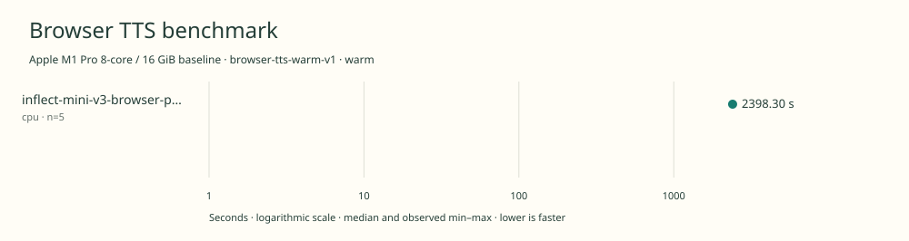

# 2026-11-19t16-23-50-621z-inflect-mini-v3-browser-port-cpu-warm-2bdd861d

Apple M1 Pro 8-core / 16 GiB baseline · Apple M1 Pro · Google Chrome 157.0.8103.40

Protocol: **browser-tts-warm-v1**, scenario **warm**. Native harness run.

First source-chunk request through final CPU-readable PCM; excludes initialization, validation, hashing, WAV encoding and save. Optional articleCallPeakRssBytes spans the entire browser call including post-timer validation/export.

| Model | Requested backend | Status | Median | Min–max | Runs |
|---|---|---|---:|---:|---:|
| inflect-mini-v3-browser-port | cpu | measured | 2398.30 s | 2397.79–2415.96 s | 5 |

Additional metrics (median of available observations; scopes are distinct):

| Model | Backend | Metric | Median | Unit | n |
|---|---|---|---:|---|---:|
| inflect-mini-v3-browser-port | cpu | First completed source chunk | 27215.295 | ms | 5 |
| inflect-mini-v3-browser-port | cpu | First PCM block | 24205.845 | ms | 5 |
| inflect-mini-v3-browser-port | cpu | Generated audio | 1318.105 | s | 5 |
| inflect-mini-v3-browser-port | cpu | Generation / audio duration | 1.820 | ratio | 5 |

Model support (catalog capability, not coverage of this run):

| Model | Supported voices | Bundled voices | Languages | Tested voice |
|---|---:|---:|---|---|
| inflect-mini-v3-browser-port | 6 | 1 | 1 (en) | Cassidy (synthetic preset; pinned Mini speaker 2, af_sarah donor bank; browser-port profile) |

Pinned Inflect Mini v3 checkpoint and the separately converted browser-port configuration. The upstream checkpoint supports six English presets; this configuration bundles Cassidy speaker 2 only. Reference enrollment, non-speech events and 48 kHz enhancement are outside this profile. Browser synthesis is a distinct frontend/source-DSP port and failed the recorded strict native waveform gate. Sources: [1](https://huggingface.co/owensong/Inflect-Mini-v3/blob/fdefa06ed090ba0f3e1c5e455c492d2a0b9512e6/README.md), [2](https://huggingface.co/owensong/Inflect-Mini-v3/blob/fdefa06ed090ba0f3e1c5e455c492d2a0b9512e6/core/baseline/models/mini/manifest.json).

- **inflect-mini-v3-browser-port / cpu**: Explicit one-thread ONNX Runtime Web WASM; an untimed Mini utterance completed.

Capability checks run separately before timing. GPU dispatch does not imply GPU-exclusive execution.

Raw WAV is saved locally; opt-in audio publication is separate from timing and automatic result submission.

Campaign 2026-11-19T16-23-49-899Z-41f840f2bfed; cell 1/1; source 3aa0b423b8ba6c36fea0b6ab2db2c046bfb57c49; requested n=5; effective n=5; Apple M1 Pro baseline, 8 CPU cores and 16 GiB RAM, macOS 26.6.2, headed preserved Google Chrome 157.0.8103.40. Inflect Mini v3 browser-port profile: 34,310,790 parameter FP32 ONNX conversion, Cassidy speaker 2, 24 kHz, one-thread ONNX Runtime Web WASM; Klein 0.2.0 G2P with pinned English lexicon and local browser eSpeak, shared Micro v3 normalization and source-preserving 220-character splitter; seeded Mulberry32 plus Box-Muller excitation; standalone Float32 CPU source/STFT and waveform neural graph. Full canonical 20,000-character English fixture, 93 source spans. First PCM follows full first internal utterance, with 120 ms inter-piece pause. Strict native waveform parity remains failed at both fixed lengths; this is an explicitly separate browser-port configuration. No cold run and no GPU score in these CPU plans. The cached resource cell is n=1 full article with resource sampling; the warm cell is one excluded full-article warm-up plus five scored full articles.

Different protocols, fixtures, settings or machines must not be pooled into a speedup ranking. This report does not rate speech quality.
