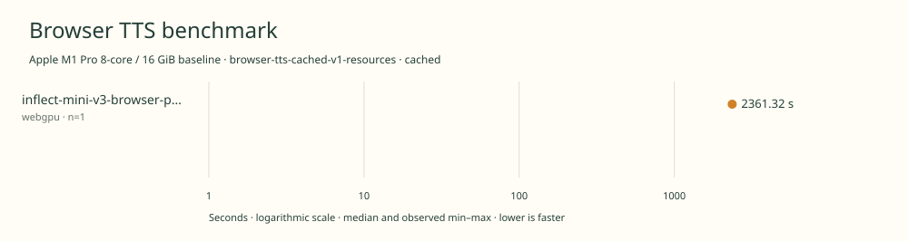

# 2026-11-19t20-24-45-805z-inflect-mini-v3-browser-port-webgpu-cached-1daec6ab

Apple M1 Pro 8-core / 16 GiB baseline · Apple M1 Pro · Google Chrome 157.0.8103.40

Protocol: **browser-tts-cached-v1-resources**, scenario **cached**. Native harness run.

First source-chunk request through final CPU-readable PCM; excludes initialization, validation, hashing, WAV encoding and save. Optional articleCallPeakRssBytes spans the entire browser call including post-timer validation/export. Generation RSS uses timestamped samples inside browser generation start/end boundaries; it includes the owned Chrome process tree and browser baseline.

| Model | Requested backend | Status | Median | Min–max | Runs |
|---|---|---|---:|---:|---:|
| inflect-mini-v3-browser-port | webgpu | measured | 2361.32 s | 2361.32–2361.32 s | 1 |

Additional metrics (median of available observations; scopes are distinct):

| Model | Backend | Metric | Median | Unit | n |
|---|---|---|---:|---|---:|
| inflect-mini-v3-browser-port | webgpu | First completed source chunk | 27504.000 | ms | 1 |
| inflect-mini-v3-browser-port | webgpu | First PCM block | 24445.450 | ms | 1 |
| inflect-mini-v3-browser-port | webgpu | Generated audio | 1318.105 | s | 1 |
| inflect-mini-v3-browser-port | webgpu | Generation / audio duration | 1.791 | ratio | 1 |
| inflect-mini-v3-browser-port | webgpu | Model initialization | 1218.658 | ms | 1 |
| inflect-mini-v3-browser-port | webgpu | Complete controller trial including setup/export | 2367034.936 | ms | 1 |
| inflect-mini-v3-browser-port | webgpu | Transferred HTTP body data | 38404 | bytes | 1 |
| inflect-mini-v3-browser-port | webgpu | Ideal body transfer at 1 Mbps | 0.307 | s | 1 |
| inflect-mini-v3-browser-port | webgpu | Whole-call Chrome process-tree peak RSS | 1931427840 | bytes | 1 |
| inflect-mini-v3-browser-port | webgpu | Per-trial mean generation Chrome process-tree RSS | 1109123974 | bytes | 1 |
| inflect-mini-v3-browser-port | webgpu | In-window Chrome RSS observations | 4704.000 | samples | 1 |

Model support (catalog capability, not coverage of this run):

| Model | Supported voices | Bundled voices | Languages | Tested voice |
|---|---:|---:|---|---|
| inflect-mini-v3-browser-port | 6 | 1 | 1 (en) | Cassidy (synthetic preset; pinned Mini speaker 2, af_sarah donor bank; browser-port profile) |

Pinned Inflect Mini v3 checkpoint and the separately converted browser-port configuration. The upstream checkpoint supports six English presets; this configuration bundles Cassidy speaker 2 only. Reference enrollment, non-speech events and 48 kHz enhancement are outside this profile. Browser synthesis is a distinct frontend/source-DSP port and failed the recorded strict native waveform gate. CPU uses ONNX Runtime Web WASM for all three graphs. The registered WebGPU option is scoped: only the duration graph uses WebGPU with WASM fallback; text-bridge and waveform graphs run on WASM, while deterministic source excitation/STFT run on CPU. Actual duration-graph dispatch is required. A separate all-graph WebGPU control clipped output and is not a registered profile. Sources: [1](https://huggingface.co/owensong/Inflect-Mini-v3/blob/fdefa06ed090ba0f3e1c5e455c492d2a0b9512e6/README.md), [2](https://huggingface.co/owensong/Inflect-Mini-v3/blob/fdefa06ed090ba0f3e1c5e455c492d2a0b9512e6/core/baseline/models/mini/manifest.json).

- **inflect-mini-v3-browser-port / webgpu**: Observed 722 WebGPU compute dispatches in the duration graph configured with WebGPU then WASM fallback during untimed Mini synthesis; the bridge and waveform graphs are explicitly WASM, and deterministic source excitation/STFT use standalone CPU DSP. Dispatch probe is removed before timed work.

Capability checks run separately before timing. GPU dispatch does not imply GPU-exclusive execution.

Raw WAV is saved locally; opt-in audio publication is separate from timing and automatic result submission.

Campaign 2026-11-19T20-24-45-163Z-c99c745a8039; cell 1/1; source c1ec07c3555ab43926a5fdc9213f46f3357065ed; requested n=1; effective n=1; Apple M1 Pro baseline, headed preserved Google Chrome 157.0.8103.40. Inflect Mini v3 separately named browser-port profile: pinned 34,310,790-parameter FP32 ONNX conversion, Cassidy speaker 2, 24 kHz. Registered WebGPU is a scoped hybrid: duration graph WebGPU with WASM fallback, text-bridge and waveform graphs explicit WASM, standalone source excitation/STFT CPU. Klein 0.2.0 browser G2P, pinned English lexicon and local browser eSpeak; seeded Mulberry32 plus Box-Muller; full canonical 20,000-character English fixture / 93 spans. Strict native waveform parity remains failed. The exact ONNX Runtime Web 1.23.2 WebGPU/asyncify assets are pinned and verified. No cold run. Cached resource cell is one full article with generation-window RSS sampling.

RSS is sampled every 500 ms across the owned Chrome process tree, including the Chrome baseline and inference workers. Whole-call peak spans post-timer validation/export; generation mean uses only in-window samples from browser generation start through final CPU-readable PCM.

Different protocols, fixtures, settings or machines must not be pooled into a speedup ranking. This report does not rate speech quality.
