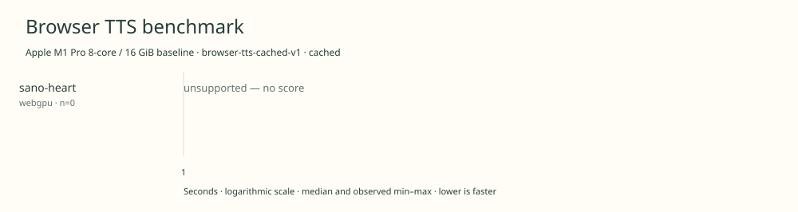

# 2026-11-19t21-43-26-563z-sano-heart-webgpu-cached-982189d9

Apple M1 Pro 8-core / 16 GiB baseline · Apple M1 Pro · Google Chrome 157.0.8103.40

Protocol: **browser-tts-cached-v1**, scenario **cached**. Native harness run.

First source-chunk request through final CPU-readable PCM; excludes initialization, validation, hashing, WAV encoding and save. Optional articleCallPeakRssBytes spans the entire browser call including post-timer validation/export.

| Model | Requested backend | Status | Median | Min–max | Runs |
|---|---|---|---:|---:|---:|
| sano-heart | webgpu | unsupported | — | — | 0 |

Model support (catalog capability, not coverage of this run):

| Model | Supported voices | Bundled voices | Languages | Tested voice |
|---|---:|---:|---|---|
| sano-heart | 1 | 1 | 1 (en) | SanoTTS heart (English, US) |

One pinned Heart full-size FP32 English \(US\) mel-100 voice with the official snt\_nano browser runtime. The official Heart model uses its full-size FP32 \`snt\_nano\` module, distinct from heart-nano INT8 and piperlite voices. The same official English G2P/Trellis frontend splits each canonical span into sentence/clause pieces up to 120 characters; non-whitespace dropped symbols, token/output caps or empty synthesis fail closed. CPU/WASM only. Sources: [1](https://huggingface.co/ampixa/sanoTTS/blob/bc04c49fd137607b60294b3894441bbfbe5c6659/README.md), [2](https://huggingface.co/ampixa/sanoTTS/blob/bc04c49fd137607b60294b3894441bbfbe5c6659/web/voices/heart/meta.json), [3](https://github.com/Ampixa/sanoTTS/tree/c0584a51213721faba98135821faab71bae888f0/web).

- **sano-heart / webgpu**: The pinned official SanoTTS heart browser path is CPU WebAssembly; it does not implement WebGPU dispatch. The pinned official SanoTTS heart browser path is CPU WebAssembly; it does not implement WebGPU dispatch.

Capability checks run separately before timing. GPU dispatch does not imply GPU-exclusive execution.

Raw WAV is saved locally; opt-in audio publication is separate from timing and automatic result submission.

Campaign 2026-11-19T21-43-26-051Z-40b0278490a6; cell 1/1; source 8b929d8e68834b101dd1992981e9b04640222748; requested n=1; effective n=1; Official pinned Sano browser WASM profile. Explicit no-score WebGPU capability attempt on the full canonical fixture; require unsupported with zero scored trials and no CPU fallback. Not a warm performance measurement. Headed Chrome157.0.8103.40, actual Apple M1 Pro 8-core /16GiB, sequential exclusive M1 slot with disposable browser profile. Actual pre-cell power: Now drawing from 'AC Power'  -InternalBattery-0 (id=22216803)	78%; AC attached; not charging present: true; background load snapshot: 13:43  up 15 days,  3:24, 1 user, load averages: 1.95 3.28 6.93; UTC 2026-11-19T21:43:25.727821+00:00

Different protocols, fixtures, settings or machines must not be pooled into a speedup ranking. This report does not rate speech quality.
