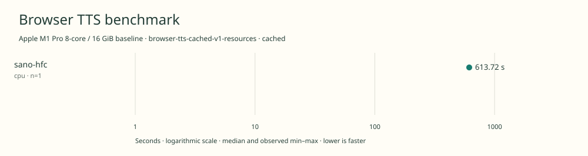

# 2026-11-19t23-09-09-954z-sano-hfc-cpu-cached-574942d8

Apple M1 Pro 8-core / 16 GiB baseline · Apple M1 Pro · Google Chrome 157.0.8103.40

Protocol: **browser-tts-cached-v1-resources**, scenario **cached**. Native harness run.

First source-chunk request through final CPU-readable PCM; excludes initialization, validation, hashing, WAV encoding and save. Optional articleCallPeakRssBytes spans the entire browser call including post-timer validation/export. Generation RSS uses timestamped samples inside browser generation start/end boundaries; it includes the owned Chrome process tree and browser baseline.

| Model | Requested backend | Status | Median | Min–max | Runs |
|---|---|---|---:|---:|---:|
| sano-hfc | cpu | measured | 613.72 s | 613.72–613.72 s | 1 |

Additional metrics (median of available observations; scopes are distinct):

| Model | Backend | Metric | Median | Unit | n |
|---|---|---|---:|---|---:|
| sano-hfc | cpu | First completed source chunk | 13747.160 | ms | 1 |
| sano-hfc | cpu | First PCM block | 13747.145 | ms | 1 |
| sano-hfc | cpu | Generated audio | 968.075 | s | 1 |
| sano-hfc | cpu | Generation / audio duration | 0.634 | ratio | 1 |
| sano-hfc | cpu | Model initialization | 45.649 | ms | 1 |
| sano-hfc | cpu | Complete controller trial including setup/export | 616812.821 | ms | 1 |
| sano-hfc | cpu | Transferred HTTP body data | 38404 | bytes | 1 |
| sano-hfc | cpu | Ideal body transfer at 1 Mbps | 0.307 | s | 1 |
| sano-hfc | cpu | Whole-call Chrome process-tree peak RSS | 1453015040 | bytes | 1 |
| sano-hfc | cpu | Per-trial mean generation Chrome process-tree RSS | 922885648 | bytes | 1 |
| sano-hfc | cpu | In-window Chrome RSS observations | 1222.000 | samples | 1 |

Model support (catalog capability, not coverage of this run):

| Model | Supported voices | Bundled voices | Languages | Tested voice |
|---|---:|---:|---|---|
| sano-hfc | 1 | 1 | 1 (en) | HFC (English, eSpeak en-us) |

One pinned English HFC 1.83M \(English\) voice checkpoint with the official piperlite WASM runtime. The official HFC piperlite voice uses its pinned FP32 front/decoder package, eSpeak en-us, G2P voice slot 2, length scale 1.08 and 22,050 Hz output. Synthesis runs in the official sanotts-web 0.3.0 WebAssembly runtime; no WebGPU provider is available. Sources: [1](https://huggingface.co/ampixa/sanoTTS/blob/bc04c49fd137607b60294b3894441bbfbe5c6659/README.md), [2](https://huggingface.co/ampixa/sanoTTS/blob/bc04c49fd137607b60294b3894441bbfbe5c6659/web/voices/hfc/meta.json).

- **sano-hfc / cpu**: Official Sano piperlite Emscripten WebAssembly in a headed Chrome classic worker; an untimed CPU utterance passed; no GPU execution.

Capability checks run separately before timing. GPU dispatch does not imply GPU-exclusive execution.

Raw WAV is saved locally; opt-in audio publication is separate from timing and automatic result submission.

Campaign 2026-11-19T23-09-09-442Z-d0afcb8c1cce; cell 1/1; source 8b929d8e68834b101dd1992981e9b04640222748; requested n=1; effective n=1; Official pinned Sano browser WASM profile. Supplemental full-article cached resource diagnostic, one observation; generation-window 500ms Chrome process-tree RSS, separate from existing warm n5. No cold/network timing. No source, voice, precision or frontend changes. Headed Chrome157.0.8103.40, actual Apple M1 Pro 8-core /16GiB, sequential exclusive M1 slot with disposable browser profile. Actual pre-cell power: Now drawing from 'AC Power'  -InternalBattery-0 (id=22216803)	78%; AC attached; not charging present: true; background load snapshot: 15:09  up 15 days,  4:50, 1 user, load averages: 2.10 1.90 1.99; UTC 2026-11-19T23:09:09.167881+00:00

RSS is sampled every 500 ms across the owned Chrome process tree, including the Chrome baseline and inference workers. Whole-call peak spans post-timer validation/export; generation mean uses only in-window samples from browser generation start through final CPU-readable PCM.

Different protocols, fixtures, settings or machines must not be pooled into a speedup ranking. This report does not rate speech quality.
