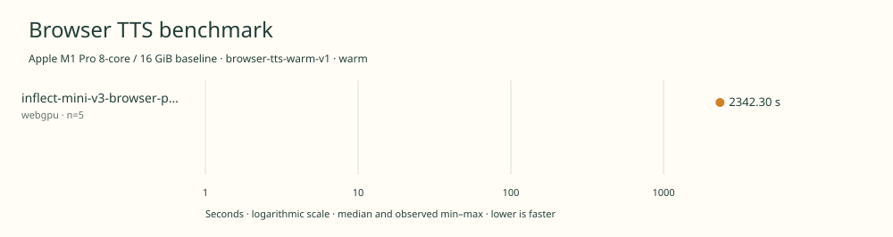

# 2026-11-20t01-14-02-658z-inflect-mini-v3-browser-port-webgpu-warm-aa3f07b4

Apple M1 Pro 8-core / 16 GiB baseline · Apple M1 Pro · Google Chrome 157.0.8103.40

Protocol: **browser-tts-warm-v1**, scenario **warm**. Native harness run.

First source-chunk request through final CPU-readable PCM; excludes initialization, validation, hashing, WAV encoding and save. Optional articleCallPeakRssBytes spans the entire browser call including post-timer validation/export.

| Model | Requested backend | Status | Median | Min–max | Runs |
|---|---|---|---:|---:|---:|
| inflect-mini-v3-browser-port | webgpu | measured | 2342.30 s | 2341.75–2342.90 s | 5 |

Additional metrics (median of available observations; scopes are distinct):

| Model | Backend | Metric | Median | Unit | n |
|---|---|---|---:|---|---:|
| inflect-mini-v3-browser-port | webgpu | First completed source chunk | 26659.855 | ms | 5 |
| inflect-mini-v3-browser-port | webgpu | First PCM block | 23665.470 | ms | 5 |
| inflect-mini-v3-browser-port | webgpu | Generated audio | 1318.105 | s | 5 |
| inflect-mini-v3-browser-port | webgpu | Generation / audio duration | 1.777 | ratio | 5 |

Model support (catalog capability, not coverage of this run):

| Model | Supported voices | Bundled voices | Languages | Tested voice |
|---|---:|---:|---|---|
| inflect-mini-v3-browser-port | 6 | 1 | 1 (en) | Cassidy (synthetic preset; pinned Mini speaker 2, af_sarah donor bank; browser-port profile) |

Pinned Inflect Mini v3 checkpoint and the separately converted browser-port configuration. The upstream checkpoint supports six English presets; this configuration bundles Cassidy speaker 2 only. Reference enrollment, non-speech events and 48 kHz enhancement are outside this profile. Browser synthesis is a distinct frontend/source-DSP port and failed the recorded strict native waveform gate. CPU uses ONNX Runtime Web WASM for all three graphs. The registered WebGPU option is scoped: only the duration graph uses WebGPU with WASM fallback; text-bridge and waveform graphs run on WASM, while deterministic source excitation/STFT run on CPU. Actual duration-graph dispatch is required. A separate all-graph WebGPU control clipped output and is not a registered profile. Sources: [1](https://huggingface.co/owensong/Inflect-Mini-v3/blob/fdefa06ed090ba0f3e1c5e455c492d2a0b9512e6/README.md), [2](https://huggingface.co/owensong/Inflect-Mini-v3/blob/fdefa06ed090ba0f3e1c5e455c492d2a0b9512e6/core/baseline/models/mini/manifest.json).

- **inflect-mini-v3-browser-port / webgpu**: Observed 722 WebGPU compute dispatches in the duration graph configured with WebGPU then WASM fallback during untimed Mini synthesis; the bridge and waveform graphs are explicitly WASM, and deterministic source excitation/STFT use standalone CPU DSP. Dispatch probe is removed before timed work.

Capability checks run separately before timing. GPU dispatch does not imply GPU-exclusive execution.

Raw WAV is saved locally; opt-in audio publication is separate from timing and automatic result submission.

Campaign 2026-11-20T01-14-02-005Z-d4eece380267; cell 1/1; source c1ec07c3555ab43926a5fdc9213f46f3357065ed; requested n=5; effective n=5; Apple M1 Pro baseline, headed preserved Google Chrome 157.0.8103.40. Inflect Mini v3 separately named browser-port profile: pinned 34,310,790-parameter FP32 ONNX conversion, Cassidy speaker 2, 24 kHz. Registered WebGPU is a scoped hybrid: duration graph WebGPU with WASM fallback, text-bridge and waveform graphs explicit WASM, standalone source excitation/STFT CPU. Klein 0.2.0 browser G2P, pinned English lexicon and local browser eSpeak; seeded Mulberry32 plus Box-Muller; full canonical 20,000-character English fixture / 93 spans. Strict native waveform parity remains failed. The exact ONNX Runtime Web 1.23.2 WebGPU/asyncify assets are pinned and verified. No cold run. Warm cell is one excluded full-article warm-up followed by five scored full articles.

Different protocols, fixtures, settings or machines must not be pooled into a speedup ranking. This report does not rate speech quality.
