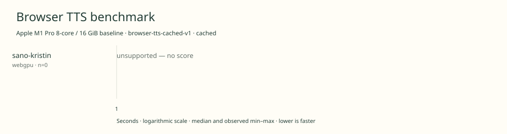

# 2026-11-20t10-56-29-899z-sano-kristin-webgpu-cached-f6a2c86f

Apple M1 Pro 8-core / 16 GiB baseline · Apple M1 Pro · Google Chrome 157.0.8103.40

Protocol: **browser-tts-cached-v1**, scenario **cached**. Native harness run.

First source-chunk request through final CPU-readable PCM; excludes initialization, validation, hashing, WAV encoding and save. Optional articleCallPeakRssBytes spans the entire browser call including post-timer validation/export.

| Model | Requested backend | Status | Median | Min–max | Runs |
|---|---|---|---:|---:|---:|
| sano-kristin | webgpu | unsupported | — | — | 0 |

Model support (catalog capability, not coverage of this run):

| Model | Supported voices | Bundled voices | Languages | Tested voice |
|---|---:|---:|---|---|
| sano-kristin | 1 | 1 | 1 (en) | Kristin (English, eSpeak en) |

One pinned English Kristin 1.40M \(English\) voice checkpoint with the official piperlite WASM runtime. The official Kristin piperlite voice uses its pinned FP32 front/decoder package, eSpeak voice en, G2P voice slot 0, length scale 1.08 and 22,050 Hz output. Synthesis runs in the official sanotts-web 0.3.0 WebAssembly runtime; no WebGPU provider is available. Sources: [1](https://huggingface.co/ampixa/sanoTTS/blob/bc04c49fd137607b60294b3894441bbfbe5c6659/README.md), [2](https://huggingface.co/ampixa/sanoTTS/blob/bc04c49fd137607b60294b3894441bbfbe5c6659/web/voices/kristin/meta.json).

- **sano-kristin / webgpu**: Official Sano piperlite inference is CPU WebAssembly; no WebGPU execution provider is available. Official Sano piperlite inference is CPU WebAssembly; no WebGPU execution provider is available.

Capability checks run separately before timing. GPU dispatch does not imply GPU-exclusive execution.

Raw WAV is saved locally; opt-in audio publication is separate from timing and automatic result submission.

Campaign 2026-11-20T10-56-29-385Z-da90fecdd504; cell 1/1; source 8b929d8e68834b101dd1992981e9b04640222748; requested n=1; effective n=1; Official pinned Sano browser WASM profile. Explicit no-score WebGPU capability attempt on the full canonical fixture; require unsupported with zero scored trials and no CPU fallback. Not a warm performance measurement. Headed Chrome157.0.8103.40, actual Apple M1 Pro 8-core /16GiB, sequential exclusive M1 slot with disposable browser profile. Actual pre-cell power: Now drawing from 'AC Power'  -InternalBattery-0 (id=22216803)	77%; AC attached; not charging present: true; background load snapshot: 2:56  up 15 days, 16:37, 1 user, load averages: 1.81 1.92 2.03; UTC 2026-11-20T10:56:29.111314+00:00

Different protocols, fixtures, settings or machines must not be pooled into a speedup ranking. This report does not rate speech quality.
