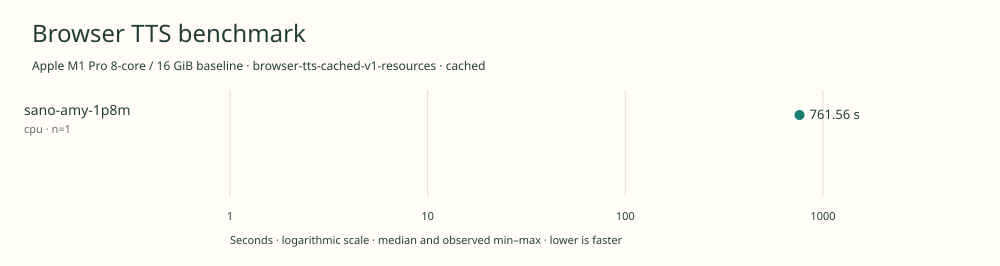

# 2026-11-20t11-15-20-837z-sano-amy-1p8m-cpu-cached-a1f0621c

Apple M1 Pro 8-core / 16 GiB baseline · Apple M1 Pro · Google Chrome 157.0.8103.40

Protocol: **browser-tts-cached-v1-resources**, scenario **cached**. Native harness run.

First source-chunk request through final CPU-readable PCM; excludes initialization, validation, hashing, WAV encoding and save. Optional articleCallPeakRssBytes spans the entire browser call including post-timer validation/export. Generation RSS uses timestamped samples inside browser generation start/end boundaries; it includes the owned Chrome process tree and browser baseline.

| Model | Requested backend | Status | Median | Min–max | Runs |
|---|---|---|---:|---:|---:|
| sano-amy-1p8m | cpu | measured | 761.56 s | 761.56–761.56 s | 1 |

Additional metrics (median of available observations; scopes are distinct):

| Model | Backend | Metric | Median | Unit | n |
|---|---|---|---:|---|---:|
| sano-amy-1p8m | cpu | First completed source chunk | 16956.705 | ms | 1 |
| sano-amy-1p8m | cpu | First PCM block | 16956.690 | ms | 1 |
| sano-amy-1p8m | cpu | Generated audio | 1203.165 | s | 1 |
| sano-amy-1p8m | cpu | Generation / audio duration | 0.633 | ratio | 1 |
| sano-amy-1p8m | cpu | Model initialization | 47.543 | ms | 1 |
| sano-amy-1p8m | cpu | Complete controller trial including setup/export | 765015.246 | ms | 1 |
| sano-amy-1p8m | cpu | Transferred HTTP body data | 38404 | bytes | 1 |
| sano-amy-1p8m | cpu | Ideal body transfer at 1 Mbps | 0.307 | s | 1 |
| sano-amy-1p8m | cpu | Whole-call Chrome process-tree peak RSS | 1387167744 | bytes | 1 |
| sano-amy-1p8m | cpu | Per-trial mean generation Chrome process-tree RSS | 977069366 | bytes | 1 |
| sano-amy-1p8m | cpu | In-window Chrome RSS observations | 1517.000 | samples | 1 |

Model support (catalog capability, not coverage of this run):

| Model | Supported voices | Bundled voices | Languages | Tested voice |
|---|---:|---:|---|---|
| sano-amy-1p8m | 1 | 1 | 1 (en) | Amy 1.8M (English, eSpeak en-us) |

One pinned English Amy 1.83M \(English\) voice checkpoint with the official piperlite WASM runtime. The source package is the pinned official Amy 1.8M FP16 piperlite package. A reproducible converter emits the matching FP32 browser front/decoder ABI; the pinned en-us phoneme config and voice slot 1 are retained. Output is 22,050 Hz. The bundled browser artifact is a reproducible benchmark conversion, not an upstream prebuilt browser voice package. Sources: [1](https://huggingface.co/ampixa/sanoTTS/blob/25410576d005d7f08d186990fd91f6a2651243de/README.md), [2](https://huggingface.co/ampixa/sanoTTS/blob/25410576d005d7f08d186990fd91f6a2651243de/amy-en-1p8m/manifest.json).

- **sano-amy-1p8m / cpu**: Official Sano piperlite Emscripten WebAssembly in a headed Chrome classic worker; an untimed CPU utterance passed; no GPU execution.

Capability checks run separately before timing. GPU dispatch does not imply GPU-exclusive execution.

Raw WAV is saved locally; opt-in audio publication is separate from timing and automatic result submission.

Campaign 2026-11-20T11-15-20-331Z-0a816848c337; cell 1/1; source 8b929d8e68834b101dd1992981e9b04640222748; requested n=1; effective n=1; Official pinned Sano browser WASM profile. Supplemental full-article cached resource diagnostic, one observation; generation-window 500ms Chrome process-tree RSS, separate from existing warm n5. No cold/network timing. No source, voice, precision or frontend changes. Headed Chrome157.0.8103.40, actual Apple M1 Pro 8-core /16GiB, sequential exclusive M1 slot with disposable browser profile. Actual pre-cell power: Now drawing from 'AC Power'  -InternalBattery-0 (id=22216803)	77%; AC attached; not charging present: true; background load snapshot: 3:15  up 15 days, 16:56, 1 user, load averages: 3.86 3.27 3.23; UTC 2026-11-20T11:15:20.029692+00:00

RSS is sampled every 500 ms across the owned Chrome process tree, including the Chrome baseline and inference workers. Whole-call peak spans post-timer validation/export; generation mean uses only in-window samples from browser generation start through final CPU-readable PCM.

Different protocols, fixtures, settings or machines must not be pooled into a speedup ranking. This report does not rate speech quality.
