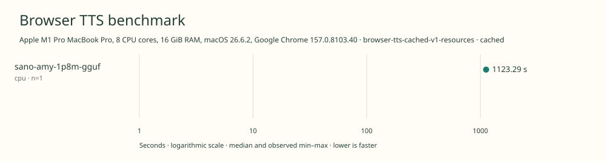

# 2026-11-20t12-24-52-820z-sano-amy-1p8m-gguf-cpu-cached-6661f50b

Apple M1 Pro MacBook Pro, 8 CPU cores, 16 GiB RAM, macOS 26.6.2, Google Chrome 157.0.8103.40 · Apple M1 Pro · Google Chrome 157.0.8103.40

Protocol: **browser-tts-cached-v1-resources**, scenario **cached**. Native harness run.

First source-chunk request through final CPU-readable PCM; excludes initialization, validation, hashing, WAV encoding and save. Optional articleCallPeakRssBytes spans the entire browser call including post-timer validation/export. Generation RSS uses timestamped samples inside browser generation start/end boundaries; it includes the owned Chrome process tree and browser baseline.

| Model | Requested backend | Status | Median | Min–max | Runs |
|---|---|---|---:|---:|---:|
| sano-amy-1p8m-gguf | cpu | measured | 1123.29 s | 1123.29–1123.29 s | 1 |

Additional metrics (median of available observations; scopes are distinct):

| Model | Backend | Metric | Median | Unit | n |
|---|---|---|---:|---|---:|
| sano-amy-1p8m-gguf | cpu | First completed source chunk | 13402.535 | ms | 1 |
| sano-amy-1p8m-gguf | cpu | First PCM block | 13402.520 | ms | 1 |
| sano-amy-1p8m-gguf | cpu | Generated audio | 1312.891 | s | 1 |
| sano-amy-1p8m-gguf | cpu | Generation / audio duration | 0.856 | ratio | 1 |
| sano-amy-1p8m-gguf | cpu | Model initialization | 64.377 | ms | 1 |
| sano-amy-1p8m-gguf | cpu | Complete controller trial including setup/export | 1127274.333 | ms | 1 |
| sano-amy-1p8m-gguf | cpu | Transferred HTTP body data | 38404 | bytes | 1 |
| sano-amy-1p8m-gguf | cpu | Ideal body transfer at 1 Mbps | 0.307 | s | 1 |
| sano-amy-1p8m-gguf | cpu | Whole-call Chrome process-tree peak RSS | 1652342784 | bytes | 1 |
| sano-amy-1p8m-gguf | cpu | Per-trial mean generation Chrome process-tree RSS | 1406883245 | bytes | 1 |
| sano-amy-1p8m-gguf | cpu | In-window Chrome RSS observations | 2238.000 | samples | 1 |

Model support (catalog capability, not coverage of this run):

| Model | Supported voices | Bundled voices | Languages | Tested voice |
|---|---:|---:|---|---|
| sano-amy-1p8m-gguf | 1 | 1 | 1 (en) | amy-1p8m (US English; Piper NFD phonemes with interleaved PAD) |

Individual pinned amy-en-1p8m voice converted with Kokopop. One selected voice; 22050 Hz. Mixed F16/F32 GGUF from pinned Piperlite FP16 source; precision preserved across CPU and WebGPU. CPU is cpu/wasm; GPU is webgpu+wasm with mandatory actual dispatch proof. Kokopop LONG\_FORM normalization and internal chunking are retained. No other voices are bundled. Sources: [1](https://huggingface.co/ampixa/sanoTTS/blob/25410576d005d7f08d186990fd91f6a2651243de/amy-en-1p8m/manifest.json), [2](https://huggingface.co/ampixa/sanoTTS/blob/25410576d005d7f08d186990fd91f6a2651243de/README.md), [3](https://github.com/tterrasson/kokopop/tree/73ed5710cb37ca0384bc4bfdd7138d13605c9a88).

- **sano-amy-1p8m-gguf / cpu**: Explicit CPU/WASM mode of the same Kokopop runtime and selected locked Sano GGUF.

Capability checks run separately before timing. GPU dispatch does not imply GPU-exclusive execution.

Raw WAV is saved locally; opt-in audio publication is separate from timing and automatic result submission.

Campaign 2026-11-20T12-24-52-319Z-ecf6c18c013e; cell 1/1; source 01d9c9f51ed94c41b6dbf480a3a0b1304fc6d661; requested n=1; effective n=1; Separate native cached-resource diagnostic after the primary12 converted warm cells. One full English20k/93-span article, n=1 with --resources. Chrome RSS sampling belongs only to this cached run and does not alter previous warm timings. Same clean source, pinned weights/runtime/voice and actual baseline Apple M1 Pro/8cores/16GiB/headed Chrome157.0.8103.40. No cold measurement or warmup; preserve full native receipt, in-window Chrome process-tree RSS observations, effective backend and actual waveform. Require working backend and absence of any existing qualified cached measurement before admission. Native Kokopop frontend substitutions remain unchanged; see source-bound frontend-admission.json.

RSS is sampled every 500 ms across the owned Chrome process tree, including the Chrome baseline and inference workers. Whole-call peak spans post-timer validation/export; generation mean uses only in-window samples from browser generation start through final CPU-readable PCM.

Different protocols, fixtures, settings or machines must not be pooled into a speedup ranking. This report does not rate speech quality.
