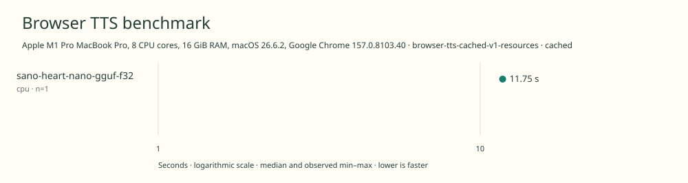

# 2026-11-20t14-28-12-714z-sano-heart-nano-gguf-f32-cpu-cached-d4f0b122

Apple M1 Pro MacBook Pro, 8 CPU cores, 16 GiB RAM, macOS 26.6.2, Google Chrome 157.0.8103.40 · Apple M1 Pro · Google Chrome 157.0.8103.40

Protocol: **browser-tts-cached-v1-resources**, scenario **cached**. Native harness run.

First source-chunk request through final CPU-readable PCM; excludes initialization, validation, hashing, WAV encoding and save. Optional articleCallPeakRssBytes spans the entire browser call including post-timer validation/export. Generation RSS uses timestamped samples inside browser generation start/end boundaries; it includes the owned Chrome process tree and browser baseline.

| Model | Requested backend | Status | Median | Min–max | Runs |
|---|---|---|---:|---:|---:|
| sano-heart-nano-gguf-f32 | cpu | measured | 11.75 s | 11.75–11.75 s | 1 |

Additional metrics (median of available observations; scopes are distinct):

| Model | Backend | Metric | Median | Unit | n |
|---|---|---|---:|---|---:|
| sano-heart-nano-gguf-f32 | cpu | First completed source chunk | 220.040 | ms | 1 |
| sano-heart-nano-gguf-f32 | cpu | First PCM block | 220.025 | ms | 1 |
| sano-heart-nano-gguf-f32 | cpu | Generated audio | 1303.390 | s | 1 |
| sano-heart-nano-gguf-f32 | cpu | Generation / audio duration | 0.009 | ratio | 1 |
| sano-heart-nano-gguf-f32 | cpu | Model initialization | 60.632 | ms | 1 |
| sano-heart-nano-gguf-f32 | cpu | Complete controller trial including setup/export | 15633.559 | ms | 1 |
| sano-heart-nano-gguf-f32 | cpu | Transferred HTTP body data | 38404 | bytes | 1 |
| sano-heart-nano-gguf-f32 | cpu | Ideal body transfer at 1 Mbps | 0.307 | s | 1 |
| sano-heart-nano-gguf-f32 | cpu | Whole-call Chrome process-tree peak RSS | 1731395584 | bytes | 1 |
| sano-heart-nano-gguf-f32 | cpu | Per-trial mean generation Chrome process-tree RSS | 1037355809 | bytes | 1 |
| sano-heart-nano-gguf-f32 | cpu | In-window Chrome RSS observations | 23.000 | samples | 1 |

Model support (catalog capability, not coverage of this run):

| Model | Supported voices | Bundled voices | Languages | Tested voice |
|---|---:|---:|---|---|
| sano-heart-nano-gguf-f32 | 1 | 1 | 1 (en) | heartnano (US English; upstream Misaki-normalized eSpeak IPA frontend) |

Pinned Ampixa heartnano package converted to the separately named Kokopop F32 GGUF profile. One fixed heartnano US English voice is benchmarked at 24 kHz. The GGUF is F32 expanded from the exact pinned Q8 front/decoder blobs; this is distinct from the official Q8 browser configuration. Generation uses speed 1 and seed 42 + canonical chunk id. Kokopop applies the pinned Misaki-normalized eSpeak IPA frontend. The CPU profile is cpu/wasm; WebGPU is webgpu+wasm and requires actual hardware dispatch. Only English \(US\) eSpeak data is bundled. Sources: [1](https://huggingface.co/ampixa/sanoTTS/blob/4a8194aa1dd958033ee449b3ad30c37e536b216e/README.md), [2](https://huggingface.co/ampixa/sanoTTS/blob/4a8194aa1dd958033ee449b3ad30c37e536b216e/heartnano/meta.json), [3](https://github.com/tterrasson/kokopop/tree/73ed5710cb37ca0384bc4bfdd7138d13605c9a88), [4](https://github.com/Ampixa/sanoTTS/tree/939d982b9faa54cbcf5d24cc878f5cd514b2646e).

- **sano-heart-nano-gguf-f32 / cpu**: Explicit CPU/WASM mode of the same Kokopop runtime and selected locked Sano GGUF.

Capability checks run separately before timing. GPU dispatch does not imply GPU-exclusive execution.

Raw WAV is saved locally; opt-in audio publication is separate from timing and automatic result submission.

Campaign 2026-11-20T14-28-12-222Z-7317bb329d3c; cell 1/1; source 01d9c9f51ed94c41b6dbf480a3a0b1304fc6d661; requested n=1; effective n=1; Separate native cached-resource diagnostic after the primary12 converted warm cells. One full English20k/93-span article, n=1 with --resources. Chrome RSS sampling belongs only to this cached run and does not alter previous warm timings. Same clean source, pinned weights/runtime/voice and actual baseline Apple M1 Pro/8cores/16GiB/headed Chrome157.0.8103.40. No cold measurement or warmup; preserve full native receipt, in-window Chrome process-tree RSS observations, effective backend and actual waveform. Require working backend and absence of any existing qualified cached measurement before admission. Native Kokopop frontend substitutions remain unchanged; see source-bound frontend-admission.json.

RSS is sampled every 500 ms across the owned Chrome process tree, including the Chrome baseline and inference workers. Whole-call peak spans post-timer validation/export; generation mean uses only in-window samples from browser generation start through final CPU-readable PCM.

Different protocols, fixtures, settings or machines must not be pooled into a speedup ranking. This report does not rate speech quality.
