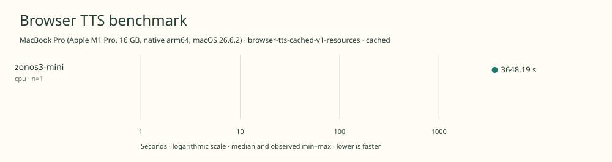

# 2026-11-20t14-37-16-739z-zonos3-mini-cpu-cached-4bf21700

MacBook Pro (Apple M1 Pro, 16 GB, native arm64; macOS 26.6.2) · Apple M1 Pro · Google Chrome 157.0.8103.40

Protocol: **browser-tts-cached-v1-resources**, scenario **cached**. Native harness run.

First source-chunk request through final CPU-readable PCM; excludes initialization, validation, hashing, WAV encoding and save. Optional articleCallPeakRssBytes spans the entire browser call including post-timer validation/export. Generation RSS uses timestamped samples inside browser generation start/end boundaries; it includes the owned Chrome process tree and browser baseline.

| Model | Requested backend | Status | Median | Min–max | Runs |
|---|---|---|---:|---:|---:|
| zonos3-mini | cpu | measured | 3648.19 s | 3648.19–3648.19 s | 1 |

Additional metrics (median of available observations; scopes are distinct):

| Model | Backend | Metric | Median | Unit | n |
|---|---|---|---:|---|---:|
| zonos3-mini | cpu | First completed source chunk | 44167.250 | ms | 1 |
| zonos3-mini | cpu | First PCM block | 44157.710 | ms | 1 |
| zonos3-mini | cpu | Generated audio | 1287.133 | s | 1 |
| zonos3-mini | cpu | Generation / audio duration | 2.834 | ratio | 1 |
| zonos3-mini | cpu | Model initialization | 3071.929 | ms | 1 |
| zonos3-mini | cpu | Complete controller trial including setup/export | 3658892.502 | ms | 1 |
| zonos3-mini | cpu | Transferred HTTP body data | 38404 | bytes | 1 |
| zonos3-mini | cpu | Ideal body transfer at 1 Mbps | 0.307 | s | 1 |
| zonos3-mini | cpu | Whole-call Chrome process-tree peak RSS | 3479535616 | bytes | 1 |
| zonos3-mini | cpu | Per-trial mean generation Chrome process-tree RSS | 1879085018 | bytes | 1 |
| zonos3-mini | cpu | In-window Chrome RSS observations | 7268.000 | samples | 1 |

Model support (catalog capability, not coverage of this run):

| Model | Supported voices | Bundled voices | Languages | Tested voice |
|---|---:|---:|---|---|
| zonos3-mini | 27 | 1 | 43 | Imogen (English, British female) |

Pinned ZONOS3-Mini checkpoint and official 27-preset voice catalog; one English preset is staged and benchmarked.. The checkpoint advertises 43 languages across 44 server locale codes and the pinned voice manifest lists 27 presets, including 10 English voices. Only Imogen \(English, British female\) is staged and measured. The WebGPU profile loads its reference codes and speaker embedding; the CPU/WASM profile loads the speaker embedding only. The benchmark skips unused preview audio. No other preset or language is exercised. Sources: [1](https://huggingface.co/Zyphra/ZONOS3-Mini/blob/2921b8821772b0bd10a04456863d21abf9d2f283/README.md), [2](https://huggingface.co/Zyphra/ZONOS3-Mini/blob/2921b8821772b0bd10a04456863d21abf9d2f283/web/voices/voices.json), [3](https://github.com/Zyphra/ZONOS3-Mini/blob/a50e14117d99181ba7f28047b451ba03ba1a09a9/servers/web/README.md), [4](https://github.com/Zyphra/ZONOS3-Mini/blob/a50e14117d99181ba7f28047b451ba03ba1a09a9/model/src/zonos3/registries/languages.json).

- **zonos3-mini / cpu**: CPU/WASM probe returned finite 44.1 kHz mono PCM; the runtime contains no GPU backend.

Capability checks run separately before timing. GPU dispatch does not imply GPU-exclusive execution.

Raw WAV is saved locally; opt-in audio publication is separate from timing and automatic result submission.

AC power; Chrome 157.0.8103.40; one-thread v3 CPU/WASM; serialized shared M1 queue.

RSS is sampled every 500 ms across the owned Chrome process tree, including the Chrome baseline and inference workers. Whole-call peak spans post-timer validation/export; generation mean uses only in-window samples from browser generation start through final CPU-readable PCM.

Different protocols, fixtures, settings or machines must not be pooled into a speedup ranking. This report does not rate speech quality.
