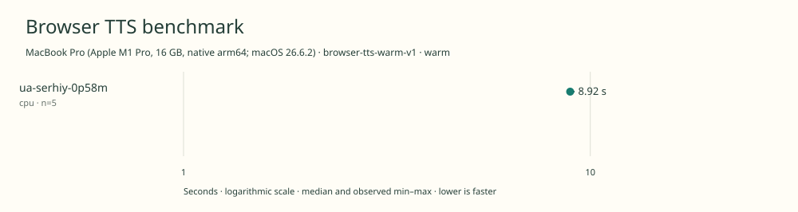

# 2026-11-20t23-21-10-743z-ua-serhiy-0p58m-cpu-warm-c5806285

MacBook Pro (Apple M1 Pro, 16 GB, native arm64; macOS 26.6.2) · Apple M1 Pro · Google Chrome 157.0.8103.40

Protocol: **browser-tts-warm-v1**, scenario **warm**. Native harness run.

First source-chunk request through final CPU-readable PCM; excludes initialization, validation, hashing, WAV encoding and save. Optional articleCallPeakRssBytes spans the entire browser call including post-timer validation/export.

| Model | Requested backend | Status | Median | Min–max | Runs |
|---|---|---|---:|---:|---:|
| ua-serhiy-0p58m | cpu | measured | 8.92 s | 8.91–9.14 s | 5 |

Additional metrics (median of available observations; scopes are distinct):

| Model | Backend | Metric | Median | Unit | n |
|---|---|---|---:|---|---:|
| ua-serhiy-0p58m | cpu | First completed source chunk | 80.280 | ms | 5 |
| ua-serhiy-0p58m | cpu | First PCM block | 29.830 | ms | 5 |
| ua-serhiy-0p58m | cpu | Generated audio | 1185.576 | s | 5 |
| ua-serhiy-0p58m | cpu | Generation / audio duration | 0.008 | ratio | 5 |

Model support (catalog capability, not coverage of this run):

| Model | Supported voices | Bundled voices | Languages | Tested voice |
|---|---:|---:|---|---|
| ua-serhiy-0p58m | 1 | 1 | 1 (uk) | Serhiy (Ukrainian; one pinned synthetic voice) |

Pinned dmytro-m/ua-serhiy-0p58m distilled Ukrainian checkpoint; one Serhiy voice with a local browser conversion to four dynamic FP32 ONNX graphs.. One Ukrainian Serhiy synthetic voice is selected. The full inference stack has 575,888 stored scalar values; this is not a trainable-only parameter claim. The checkpoint carries GPL-3.0; teacher and corpus licenses do not grant separate rights to the student checkpoint or generated voice. The upstream notice says speaker-consent and dataset-rights review is not independently completed. Only Ukrainian is exposed; no other voice or language is tested. Sources: [1](https://huggingface.co/dmytro-m/ua-serhiy-0p58m/blob/1abd585d725a787b405c28a59ce1cbdfd34780bb/README.md), [2](https://huggingface.co/dmytro-m/ua-serhiy-0p58m/blob/1abd585d725a787b405c28a59ce1cbdfd34780bb/NOTICE.md), [3](https://huggingface.co/dmytro-m/ua-serhiy-0p58m/blob/1abd585d725a787b405c28a59ce1cbdfd34780bb/manifest.json), [4](https://huggingface.co/dmytro-m/ua-serhiy-0p58m/blob/1abd585d725a787b405c28a59ce1cbdfd34780bb/inference.py), [5](https://huggingface.co/dmytro-m/ua-serhiy-0p58m/blob/1abd585d725a787b405c28a59ce1cbdfd34780bb/stress.py), [6](https://github.com/rhasspy/piper-samples/tree/da672d1157136d07365790f51da3357a17cf9650), [7](https://github.com/microsoft/onnxruntime/tree/v1.23.2).

- **ua-serhiy-0p58m / cpu**: Explicit ONNX Runtime Web WASM graph inference with one thread; Ukrainian eSpeak and stress restoration run in the local Chrome worker.

Capability checks run separately before timing. GPU dispatch does not imply GPU-exclusive execution.

Raw WAV is saved locally; opt-in audio publication is separate from timing and automatic result submission.

Campaign 2026-11-20T23-20-51-850Z-c772c169049e; cell 2/4; source 9870c198651481dfed69ece7dc7bb88d870edabd; fixture uk-article-v1 (uk, 19980 JavaScript characters, 92 spans); requested n=5; effective n=5; Observed MacBook Pro Apple M1 Pro 8-core/16GB, native arm64; headed Chrome 157.0.8103.40; AC power; one serialized model/backend cell at a time.

Different protocols, fixtures, settings or machines must not be pooled into a speedup ranking. This report does not rate speech quality.
