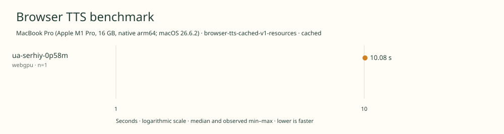

# 2026-11-20t23-22-14-572z-ua-serhiy-0p58m-webgpu-cached-ac55e923

MacBook Pro (Apple M1 Pro, 16 GB, native arm64; macOS 26.6.2) · Apple M1 Pro · Google Chrome 157.0.8103.40

Protocol: **browser-tts-cached-v1-resources**, scenario **cached**. Native harness run.

First source-chunk request through final CPU-readable PCM; excludes initialization, validation, hashing, WAV encoding and save. Optional articleCallPeakRssBytes spans the entire browser call including post-timer validation/export. Generation RSS uses timestamped samples inside browser generation start/end boundaries; it includes the owned Chrome process tree and browser baseline.

| Model | Requested backend | Status | Median | Min–max | Runs |
|---|---|---|---:|---:|---:|
| ua-serhiy-0p58m | webgpu | measured | 10.08 s | 10.08–10.08 s | 1 |

Additional metrics (median of available observations; scopes are distinct):

| Model | Backend | Metric | Median | Unit | n |
|---|---|---|---:|---|---:|
| ua-serhiy-0p58m | webgpu | First completed source chunk | 159.340 | ms | 1 |
| ua-serhiy-0p58m | webgpu | First PCM block | 92.050 | ms | 1 |
| ua-serhiy-0p58m | webgpu | Generated audio | 1185.576 | s | 1 |
| ua-serhiy-0p58m | webgpu | Generation / audio duration | 0.008 | ratio | 1 |
| ua-serhiy-0p58m | webgpu | Model initialization | 409.472 | ms | 1 |
| ua-serhiy-0p58m | webgpu | Complete controller trial including setup/export | 13993.099 | ms | 1 |
| ua-serhiy-0p58m | webgpu | Transferred HTTP body data | 56640 | bytes | 1 |
| ua-serhiy-0p58m | webgpu | Ideal body transfer at 1 Mbps | 0.453 | s | 1 |
| ua-serhiy-0p58m | webgpu | Whole-call Chrome process-tree peak RSS | 2679078912 | bytes | 1 |
| ua-serhiy-0p58m | webgpu | Per-trial mean generation Chrome process-tree RSS | 1964758630 | bytes | 1 |
| ua-serhiy-0p58m | webgpu | In-window Chrome RSS observations | 20.000 | samples | 1 |

Model support (catalog capability, not coverage of this run):

| Model | Supported voices | Bundled voices | Languages | Tested voice |
|---|---:|---:|---|---|
| ua-serhiy-0p58m | 1 | 1 | 1 (uk) | Serhiy (Ukrainian; one pinned synthetic voice) |

Pinned dmytro-m/ua-serhiy-0p58m distilled Ukrainian checkpoint; one Serhiy voice with a local browser conversion to four dynamic FP32 ONNX graphs.. One Ukrainian Serhiy synthetic voice is selected. The full inference stack has 575,888 stored scalar values; this is not a trainable-only parameter claim. The checkpoint carries GPL-3.0; teacher and corpus licenses do not grant separate rights to the student checkpoint or generated voice. The upstream notice says speaker-consent and dataset-rights review is not independently completed. Only Ukrainian is exposed; no other voice or language is tested. Sources: [1](https://huggingface.co/dmytro-m/ua-serhiy-0p58m/blob/1abd585d725a787b405c28a59ce1cbdfd34780bb/README.md), [2](https://huggingface.co/dmytro-m/ua-serhiy-0p58m/blob/1abd585d725a787b405c28a59ce1cbdfd34780bb/NOTICE.md), [3](https://huggingface.co/dmytro-m/ua-serhiy-0p58m/blob/1abd585d725a787b405c28a59ce1cbdfd34780bb/manifest.json), [4](https://huggingface.co/dmytro-m/ua-serhiy-0p58m/blob/1abd585d725a787b405c28a59ce1cbdfd34780bb/inference.py), [5](https://huggingface.co/dmytro-m/ua-serhiy-0p58m/blob/1abd585d725a787b405c28a59ce1cbdfd34780bb/stress.py), [6](https://github.com/rhasspy/piper-samples/tree/da672d1157136d07365790f51da3357a17cf9650), [7](https://github.com/microsoft/onnxruntime/tree/v1.23.2).

- **ua-serhiy-0p58m / webgpu**: Observed 822 WebGPU compute dispatches during a separate untimed speech synthesis. The Ukrainian eSpeak frontend and spectral iSTFT run in JavaScript; WebGPU handles ONNX graph operators with explicit WASM fallback. Dispatch hooks were removed before timed generation.

Capability checks run separately before timing. GPU dispatch does not imply GPU-exclusive execution.

Raw WAV is saved locally; opt-in audio publication is separate from timing and automatic result submission.

Campaign 2026-11-20T23-20-51-850Z-c772c169049e; cell 3/4; source 9870c198651481dfed69ece7dc7bb88d870edabd; fixture uk-article-v1 (uk, 19980 JavaScript characters, 92 spans); requested n=1; effective n=1; Observed MacBook Pro Apple M1 Pro 8-core/16GB, native arm64; headed Chrome 157.0.8103.40; AC power; one serialized model/backend cell at a time.

RSS is sampled every 500 ms across the owned Chrome process tree, including the Chrome baseline and inference workers. Whole-call peak spans post-timer validation/export; generation mean uses only in-window samples from browser generation start through final CPU-readable PCM.

Different protocols, fixtures, settings or machines must not be pooled into a speedup ranking. This report does not rate speech quality.
