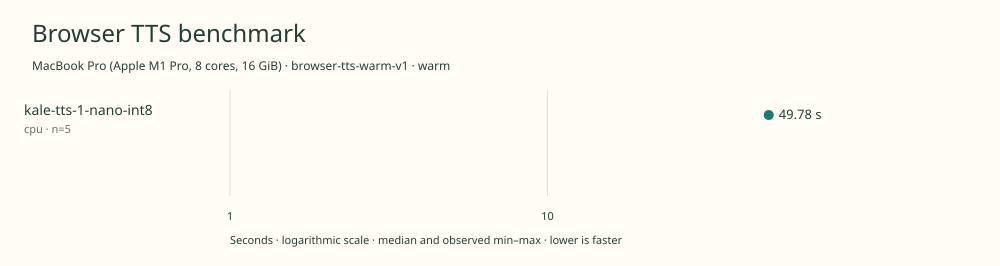

# 2026-11-21t00-53-06-603z-kale-tts-1-nano-int8-cpu-warm-1537bbc8

MacBook Pro (Apple M1 Pro, 8 cores, 16 GiB) · Apple M1 Pro · Google Chrome 157.0.8103.79

Protocol: **browser-tts-warm-v1**, scenario **warm**. Native harness run.

First source-chunk request through final CPU-readable PCM; excludes initialization, validation, hashing, WAV encoding and save. Optional articleCallPeakRssBytes spans the entire browser call including post-timer validation/export.

| Model | Requested backend | Status | Median | Min–max | Runs |
|---|---|---|---:|---:|---:|
| kale-tts-1-nano-int8 | cpu | measured | 49.78 s | 49.75–49.87 s | 5 |

Additional metrics (median of available observations; scopes are distinct):

| Model | Backend | Metric | Median | Unit | n |
|---|---|---|---:|---|---:|
| kale-tts-1-nano-int8 | cpu | First completed source chunk | 583.945 | ms | 5 |
| kale-tts-1-nano-int8 | cpu | First PCM block | 163.965 | ms | 5 |
| kale-tts-1-nano-int8 | cpu | Generated audio | 1210.475 | s | 5 |
| kale-tts-1-nano-int8 | cpu | Generation / audio duration | 0.041 | ratio | 5 |

Model support (catalog capability, not coverage of this run):

| Model | Supported voices | Bundled voices | Languages | Tested voice |
|---|---:|---:|---|---|
| kale-tts-1-nano-int8 | 10 | 1 | 1 (en) | Kenzie (s057b) |

Pinned Kale Nano checkpoint and official voice catalog. Ten English synthetic presets across US and British accents. Only the American English Kenzie \(s057b\) voice pack and frontend are staged. Sources: [1](https://huggingface.co/KaleComputer/kale-tts-1-nano/blob/b6ce1887268c3667994fc3b0b2c82887c069915c/README.md), [2](https://huggingface.co/KaleComputer/kale-tts-1-nano/blob/b6ce1887268c3667994fc3b0b2c82887c069915c/voices.json).

- **kale-tts-1-nano-int8 / cpu**: Explicit single-thread WASM provider.

Capability checks run separately before timing. GPU dispatch does not imply GPU-exclusive execution.

Raw WAV is saved locally; opt-in audio publication is separate from timing and automatic result submission.

AC power; macOS 26.6.2 (25G83); single WASM thread; first warm timing cell, before FP32 WebGPU; ambient and thermal conditions unmeasured.

Different protocols, fixtures, settings or machines must not be pooled into a speedup ranking. This report does not rate speech quality.
