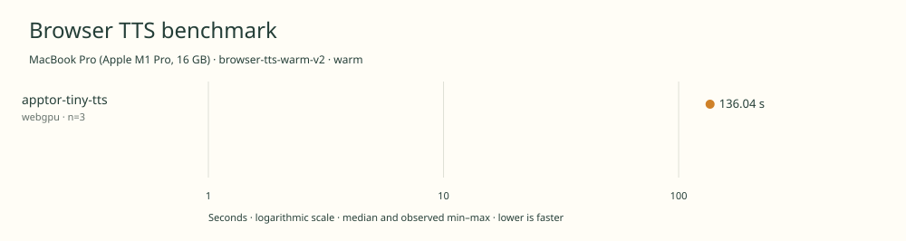

# 2026-11-22t01-30-59-189z-apptor-tiny-tts-webgpu-warm-050c577c

MacBook Pro (Apple M1 Pro, 16 GB) · Apple M1 Pro · Google Chrome 157.0.8103.79

Protocol: **browser-tts-warm-v2**, scenario **warm**. Native harness run.

First source-chunk request through final CPU-readable PCM; excludes initialization, validation, hashing, WAV encoding and save. Optional articleCallPeakRssBytes spans the entire browser call including post-timer validation/export.

| Model | Requested backend | Status | Median | Min–max | Runs |
|---|---|---|---:|---:|---:|
| apptor-tiny-tts | webgpu | measured | 136.04 s | 135.77–136.05 s | 3 |

Additional metrics (median of available observations; scopes are distinct):

| Model | Backend | Metric | Median | Unit | n |
|---|---|---|---:|---|---:|
| apptor-tiny-tts | webgpu | First completed source chunk | 1269.595 | ms | 3 |
| apptor-tiny-tts | webgpu | First PCM block | 439.440 | ms | 3 |
| apptor-tiny-tts | webgpu | Generated audio | 1295.331 | s | 3 |
| apptor-tiny-tts | webgpu | Generation / audio duration | 0.105 | ratio | 3 |

Model support (catalog capability, not coverage of this run):

| Model | Supported voices | Bundled voices | Languages | Tested voice |
|---|---:|---:|---|---|
| apptor-tiny-tts | 2 | 2 | 1 (de) | M2 |

Pinned Standard German checkpoint with author-provided German G2P and Vocos second stage.. The benchmark selects Standard German M2, speed 1.0, pitch shift 0 and range 1.0, with Vocos enabled. Austrian weights, accent input, and Austrian pronunciation data are not included. Sources: [1](https://huggingface.co/apptor/apptor-tiny-tts/tree/0b6962273a1d6618f250cdbd621b56ba04b62cef), [2](https://huggingface.co/apptor/apptor-tiny-tts/blob/0b6962273a1d6618f250cdbd621b56ba04b62cef/README.md), [3](https://huggingface.co/apptor/apptor-tiny-tts-at/tree/e28eb444250b4d06162e6ba8e5090c4284345913/web), [4](https://github.com/gemelo-ai/vocos/tree/eb39abfc42c1dee4854d9b10d44dd7d4fd3b0e53).

- **apptor-tiny-tts / webgpu**: Observed 3072 compute dispatches in the untimed probe. CPU-side German normalization and final PCM assembly; ONNX operators may fall back to WASM.

Capability checks run separately before timing. GPU dispatch does not imply GPU-exclusive execution.

Raw WAV is saved locally; opt-in audio publication is separate from timing and automatic result submission.

Campaign 2026-11-22T01-18-02-082Z-097c7ce22cd1; cell 2/4; source 4786ead9110d21ee878e1fc4bee70d594cfe4a4d; fixture de-article-v1 (de, 23885 JavaScript characters, 109 spans); requested n=3; effective n=3; Standard German M2 at speed 1.0, 24 kHz, Vocos enabled. Full warm v2 scores precede separate cached RSS diagnostics. CPU and WebGPU are sequential.

Different protocols, fixtures, settings or machines must not be pooled into a speedup ranking. This report does not rate speech quality.
