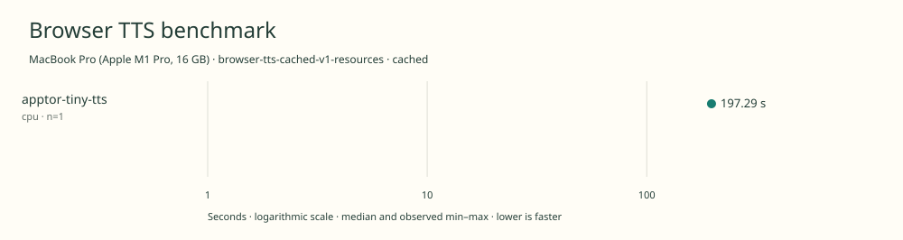

# 2026-11-22t01-40-25-874z-apptor-tiny-tts-cpu-cached-f7c1946a

MacBook Pro (Apple M1 Pro, 16 GB) · Apple M1 Pro · Google Chrome 157.0.8103.79

Protocol: **browser-tts-cached-v1-resources**, scenario **cached**. Native harness run.

First source-chunk request through final CPU-readable PCM; excludes initialization, validation, hashing, WAV encoding and save. Optional articleCallPeakRssBytes spans the entire browser call including post-timer validation/export. Generation RSS uses timestamped samples inside browser generation start/end boundaries; it includes the owned Chrome process tree and browser baseline.

| Model | Requested backend | Status | Median | Min–max | Runs |
|---|---|---|---:|---:|---:|
| apptor-tiny-tts | cpu | measured | 197.29 s | 197.29–197.29 s | 1 |

Additional metrics (median of available observations; scopes are distinct):

| Model | Backend | Metric | Median | Unit | n |
|---|---|---|---:|---|---:|
| apptor-tiny-tts | cpu | First completed source chunk | 1910.745 | ms | 1 |
| apptor-tiny-tts | cpu | First PCM block | 719.615 | ms | 1 |
| apptor-tiny-tts | cpu | Generated audio | 1295.298 | s | 1 |
| apptor-tiny-tts | cpu | Generation / audio duration | 0.152 | ratio | 1 |
| apptor-tiny-tts | cpu | Model initialization | 415.130 | ms | 1 |
| apptor-tiny-tts | cpu | Complete controller trial including setup/export | 201683.167 | ms | 1 |
| apptor-tiny-tts | cpu | Transferred HTTP body data | 49143 | bytes | 1 |
| apptor-tiny-tts | cpu | Ideal body transfer at 1 Mbps | 0.393 | s | 1 |
| apptor-tiny-tts | cpu | Whole-call Chrome process-tree peak RSS | 1530314752 | bytes | 1 |
| apptor-tiny-tts | cpu | Per-trial mean generation Chrome process-tree RSS | 1192757541 | bytes | 1 |
| apptor-tiny-tts | cpu | In-window Chrome RSS observations | 392.000 | samples | 1 |

Model support (catalog capability, not coverage of this run):

| Model | Supported voices | Bundled voices | Languages | Tested voice |
|---|---:|---:|---|---|
| apptor-tiny-tts | 2 | 2 | 1 (de) | M2 |

Pinned Standard German checkpoint with author-provided German G2P and Vocos second stage.. The benchmark selects Standard German M2, speed 1.0, pitch shift 0 and range 1.0, with Vocos enabled. Austrian weights, accent input, and Austrian pronunciation data are not included. Sources: [1](https://huggingface.co/apptor/apptor-tiny-tts/tree/0b6962273a1d6618f250cdbd621b56ba04b62cef), [2](https://huggingface.co/apptor/apptor-tiny-tts/blob/0b6962273a1d6618f250cdbd621b56ba04b62cef/README.md), [3](https://huggingface.co/apptor/apptor-tiny-tts-at/tree/e28eb444250b4d06162e6ba8e5090c4284345913/web), [4](https://github.com/gemelo-ai/vocos/tree/eb39abfc42c1dee4854d9b10d44dd7d4fd3b0e53).

- **apptor-tiny-tts / cpu**: Explicit single-thread WASM inference for German G2P, TTS and Vocos.

Capability checks run separately before timing. GPU dispatch does not imply GPU-exclusive execution.

Raw WAV is saved locally; opt-in audio publication is separate from timing and automatic result submission.

Campaign 2026-11-22T01-18-02-082Z-097c7ce22cd1; cell 3/4; source 4786ead9110d21ee878e1fc4bee70d594cfe4a4d; fixture de-article-v1 (de, 23885 JavaScript characters, 109 spans); requested n=1; effective n=1; Standard German M2 at speed 1.0, 24 kHz, Vocos enabled. Full warm v2 scores precede separate cached RSS diagnostics. CPU and WebGPU are sequential.

RSS is sampled every 500 ms across the owned Chrome process tree, including the Chrome baseline and inference workers. Whole-call peak spans post-timer validation/export; generation mean uses only in-window samples from browser generation start through final CPU-readable PCM.

Different protocols, fixtures, settings or machines must not be pooled into a speedup ranking. This report does not rate speech quality.
